# x86-64 汇编语言编程（Ubuntu版）

* 作者 Ed Jorgensen, Ph.D. 

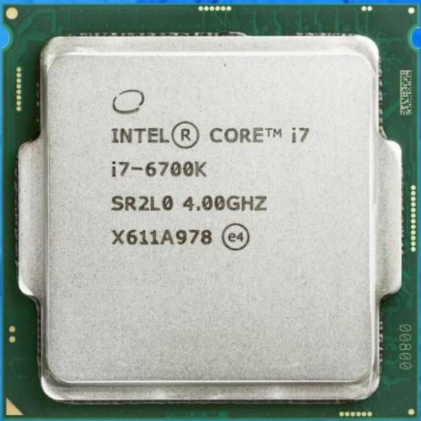

## 第1章

给人一个程序，你会让他郁闷一天；教他编程，你会让他郁闷一辈子。

## 1.0 引言

本教程旨在为大学级别的汇编语言和系统编程课程提供参考。具体而言，本教程针对流行的x86-64处理器家族，结合Ubuntu 64位操作系统，讲解x86-64指令集。虽然所提供的代码和各类示例理论上应能在任何基于Linux的64位操作系统上运行，但它们仅在Ubuntu 14.04 LTS (64位) 上进行了测试。

x86-64是一种复杂指令集计算架构。这指的是内部处理器的设计理念。CISC处理器通常包含种类繁多的指令（有时存在重叠）、不同长度的指令以及多种寻址模式。该术语是为了与精简指令集计算机形成对比而追溯创造的。

### 1.1 预备知识

必须指出，本教程并非面向学习如何编程的初学者。假定读者已经熟练掌握一门高级编程语言。具体而言，本教程主要面向已编译的、基于C的高级语言，如C、C++或Java。许多解释和示例都假定读者已熟悉编程概念，如声明、算术运算、控制结构、循环、函数调用、函数、间接寻址（即指针）以及变量作用域问题。

此外，读者应能熟练使用基于Linux的操作系统，包括使用命令行。如果读者是Linux新手，参考资料章节提供了一些有用文档的链接。

### 1.2 什么是汇编语言

学生常问的问题是“为什么要学汇编？”。在回答这个问题之前，我们先明确汇编语言的确切含义。

汇编语言是机器相关的。例如，为x86-64处理器编写的代码无法在RISC处理器（在平板电脑和智能手机中很流行）上运行。

汇编语言是一种“低级”语言，它提供了与计算机处理器交互的基本指令接口。汇编语言是程序员能够接触到的、最接近处理器的语言。用高级语言编写的程序会被翻译成汇编语言，以便处理器执行。高级语言是介于语言和实际处理器指令之间的抽象层。因此，“汇编语言已死”的说法是无稽之谈。

汇编语言让你能够直接控制系统资源。这包括设置处理器寄存器、访问内存位置以及与其他硬件元件交互。这需要更深入地理解处理器和内存的工作方式。

### 1.3 为何学习汇编语言

本教程的目标是全面介绍汇编语言编程。学习汇编语言的原因更多在于理解计算机的工作原理，而非开发大型程序。由于汇编语言是机器相关的，缺乏可移植性，这对编程项目来说限制很大。

学习汇编语言的过程本身，就需要编写非平凡的程序来执行特定的底层操作，包括算术运算、函数调用、使用栈动态局部变量，以及与操作系统交互进行输入输出等活动。仅仅浏览小型汇编程序是不够的。

长远来看，学习底层原理（包括汇编语言），是区分一名只会应付不断变化语言的“编码技工”和一名能够适应日新月异技术的“计算机科学家”的关键。

以下各节详细阐述了学习汇编语言的若干具体原因。

#### 1.3.1 深入理解体系结构问题

学习和花时间在汇编语言层面工作，能让你对底层计算机体系结构有更丰富的理解。这包括基本指令集、处理器寄存器、内存寻址、硬件交互和输入输出。由于所有程序最终都在这一层面执行，了解汇编语言的能力有助于洞察哪些操作可行、哪些容易、哪些可能更困难或更慢。

#### 1.3.2 理解工具链

“工具链”是指将人类编写的代码转换为计算机可直接执行的程序的过程。这包括编译器（在本教程中是汇编器）、链接器、加载器和调试器。在编译方面，初学者常被教导“照做即可”，而对其中涉及的复杂性鲜有解释。在底层工作有助于理解和欣赏工具链的细节。

#### 1.3.3 提升算法开发技能

使用汇编语言并编写底层程序，迫使程序员在需要更多思考和关注细节的语言中进行练习，从而提升算法开发技能。在程序第一次运行就成功的极小概率事件中，调试汇编语言也提供了实践机会，并且由于难以像高级语言那样简单地添加一堆输出语句，通常需要更细致的调试方法。这通常涉及更全面地使用调试器，这是对所有程序员都有用的技能。

#### 1.3.4 加深对函数/过程的理解

使用汇编语言能极大地提升对函数/过程调用工作原理的理解。这包括函数调用帧（也称为激活记录）的内容和结构的理解。根据具体实例，激活记录可能包含栈上传入的参数、被保存的寄存器和/或栈动态局部变量。关于栈动态局部变量存在一些重要的实现和安全隐患，最好在底层工作中理解。此外，栈及其相关调用帧是递归的基础，有助于理解递归函数的直接实现。

#### 1.3.5 理解I/O缓冲机制

在高级语言中，输入输出指令及其相关的缓冲操作可能显得像魔法一样。在汇编语言层面工作并执行一些底层输入输出操作，能让你更详细地理解输入输出和缓冲的实际工作方式。这包括交互式输入输出、文件输入输出以及相关操作系统服务的区别。

#### 1.3.6 理解编译器作用域

在学习了高级语言之后再进行汇编语言编程，有助于确保程序员理解编译器的作用范围和能力。具体来说，这意味着学习编译器在计算机体系结构方面做了什么，以及没做什么。

#### 1.3.7 初步了解多处理概念

本教程还将简要介绍多处理概念。主要介绍分布式和多核编程的一般概念，重点放在共享内存、线程化处理上。作者认为，真正理解与线程相关的微妙问题（如共享内存和竞态条件）的最佳途径就是在底层学习。

#### 1.3.8 初步了解中断处理概念

现代多用户计算机运行的基本底层机制是基于中断的。在底层工作是介绍中断处理、中断服务例程和向量中断相关基本概念的最佳场所。

### 1.4 补充参考资料

以下各节列出了一些关键参考资料，以获取更多信息。这些参考资料提供了更广泛、更详细的信息。如果这些链接失效，通过网页搜索可以找到新的位置。

#### 1.4.1 Ubuntu参考资料
关于Ubuntu操作系统有大量文档。主要的用户指南如下：
Ubuntu社区Wiki
《Ubuntu 16.04入门指南》
此外，还有许多其他网站致力于提供Ubuntu（或其他基于Linux的操作系统）的使用帮助。
#### 1.4.2 BASH命令行参考资料
BASH是Ubuntu的默认shell。读者应熟悉基本的命令行操作。一些补充参考资料如下：
《Linux命令行》（在线教程和文本）
《Linux命令Shell初学者指南》（PDF）
此外，还有许多其他网站提供关于BASH命令Shell的信息。
#### 1.4.3 体系结构参考资料
Intel发布的一些关键参考资料详细描述了支持IA-32和Intel 64架构的处理器的体系结构和编程环境。
《Intel® 64和IA-32架构软件开发人员手册：基本架构》
《Intel 64和IA-32架构软件开发人员手册：指令集参考》
《Intel 64和IA-32架构软件开发人员手册：系统编程指南》
如果嵌入式链接失效，可以通过互联网搜索找到新位置。
#### 1.4.4 工具链参考资料
工具链包括汇编器、链接器、加载器和调试器。第5章“工具链”将概述本教程中使用的工具链。以下参考资料提供了更详细的信息和文档。

##### 1.4.4.1 YASM参考资料
YASM汇编器是一种开源汇编器，常见于基于Linux的系统。YASM参考资料如下：
Yasm官方网站
Yasm文档
关于YASM的更多信息可以在许多汇编语言网站上找到，也可以通过互联网搜索获得。
##### 1.4.4.2 DDD调试器参考资料
DDD调试器是一种支持汇编语言的开源调试器。
DDD官方网站
DDD文档
关于DDD的更多信息可以在许多汇编语言网站上找到，也可以通过互联网搜索获得。

## 第2章

警告：未检测到键盘。请按回车键继续。

### 2.0 体系结构概述

本章对x86-64体系结构进行基本、通用的概述。如需更详细的解释，请参阅第1章引言中提到的补充参考资料。

### 2.1 体系结构概览

计算机的基本组件包括中央处理器、主存储器（或称随机存取存储器）、辅助存储设备、输入输出设备（如屏幕、键盘、鼠标）以及一个称为总线的互连部件。

计算机体系结构的一个非常基础的示意图如下：

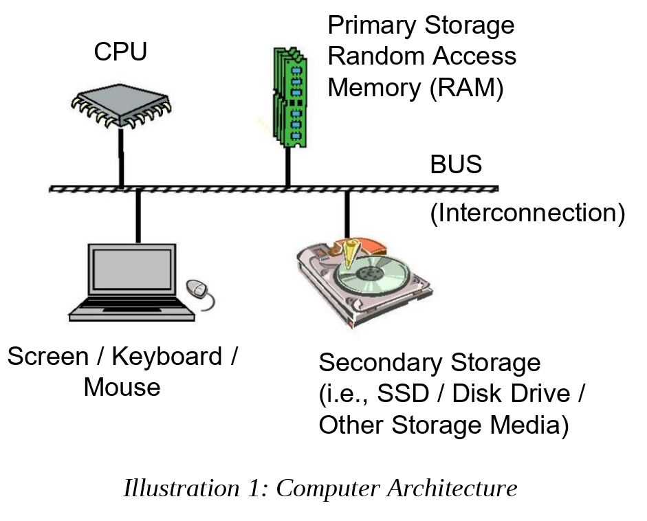

这种体系结构通常被称为冯·诺依曼体系结构，或普林斯顿体系结构，由数学家兼物理学家约翰·冯·诺依曼于1945年描述。

程序和通常存储在辅助存储设备上（如磁盘驱动器或固态硬盘）。当程序被执行时，它必须从辅助存储设备复制到主存储器或内存中。CPU从主存储器或RAM中执行程序。

主存储器或内存也被称为易失性存储器，因为当电源移除时，其中的信息不会被保留，因而丢失。辅助存储设备被称为非易失性存储器，因为当断电时，其中的信息仍被保留。例如，考虑将一篇学期论文存储在辅助存储设备（如磁盘）上。当用户开始撰写或编辑学期论文时，它被从辅助存储介质复制到主存储器（即RAM或内存）。完成后，更新后的版本通常会被存回辅助存储设备（如磁盘）。如果你曾经在编辑文档时断电（假设没有电池或不间断电源），丢失未保存的工作的经历无疑会让你清楚地区分易失性和非易失性存储器。

### 2.2 数据存储大小

x86-64体系结构支持一组特定的数据存储大小元素，全部基于2的幂。支持的存储大小如下：

| 存储单元               | 大小（位） | 大小（字节） |
| ---------------------- | ---------- | ------------ |
| Byte 字节              | 8位        | 1字节        |
| Word 字                | 16位       | 2字节        |
| Double-word 双字       | 32位       | 4字节        |
| Quadword 四字          | 64位       | 8字节        |
| Double quadword 双四字 | 128位      | 16字节       |

列表或数组（内存集合）可以用上述任何类型预留空间。

这些存储大小与高级语言（如C、C++、Java等）中的变量声明有直接对应关系。

例如，C/C++声明映射如下：

| C/C++声明    | 存储单元 | 大小（位） | 大小（字节） |
| ------------ | -------- | ---------- | ------------ |
| char         | 字节     | 8位        | 1字节        |
| short        | 字       | 16位       | 2字节        |
| int          | 双字     | 32位       | 4字节        |
| unsigned int | 双字     | 32位       | 4字节        |
| long ¹       | 四字     | 64位       | 8字节        |
| long long    | 四字     | 64位       | 8字节        |
| char*        | 四字     | 64位       | 8字节        |
| int*         | 四字     | 64位       | 8字节        |
| float        | 双字     | 32位       | 4字节        |
| double       | 四字     | 64位       | 8字节        |

星号表示地址变量。例如，int * 表示整数的地址。其他高级语言通常有类似的映射关系。

¹注：long类型的声明取决于编译器。所示类型为gcc和g++编译器的情况。

### 2.3 中央处理器

中央处理器是计算机的“大脑”，因为实际的计算都在这里进行。CPU封装在单个芯片中，有时被称为处理器、芯片或晶片。封面图片展示了一款此类CPU。

CPU芯片包含许多功能单元，包括算术逻辑单元，它是芯片中实际执行算术和逻辑计算的部分。为了支持ALU，处理器寄存器和高速缓存也集成在“晶片上”（芯片内部的术语）。CPU寄存器和高速缓存在后续章节中描述。

应当指出，现代处理器的内部设计相当复杂。本节仅对CPU内的一些关键功能单元进行了非常简化、高层次的概述。详情请参阅脚注或补充参考资料。

#### 2.3.1 CPU寄存器
CPU寄存器，或简称寄存器，是内置在CPU本身内部的临时存储或工作位置（与内存分离）。计算通常由CPU使用寄存器执行。

##### 2.3.1.1 通用寄存器
共有十六个64位通用寄存器。下表描述了GPR。GPR可以访问全部64位，也可以访问其部分或子集

| 64位寄存器 | 低32位 | 低16位 | 低8位 (后缀b) | 低8位 (后缀l/h) |
| :--------: | :----: | :----: | :-----------: | :-------------: |
|      rax      |   eax     |    ax    |      al         |        ah         |
|rbx        | ebx    | bx     | bl            | bh|
|rcx        | ecx    | cx     | cl            | ch|
|rdx        | edx    | dx     | dl            | dh|
|rsi        | esi    | si     | sil           ||
|rdi        | edi    | di     | dil           | |
|rbp        | ebp    | bp     | bpl           ||
|rsp        | esp    | sp     | spl           ||
|r8         | r8d    | r8w    | r8b           ||
|r9         | r9d    | r9w    | r9b           ||
|r10        | r10d   | r10w   | r10b          ||
|r11        | r11d   | r11w   | r11b          ||
|r12        | r12d   | r12w   | r12b          ||
|r13        | r13d   | r13w   | r13b          ||
|r14        | r14d   | r14w   | r14b          ||
|r15        | r15d   | r15w   | r15b          ||

此外，一些GPR被用于特定用途，如后续章节所述。

当使用小于64位的数据元素大小（即32位、16位或8位）时，可以通过使用不同的寄存器名来访问寄存器的较低部分，如上表所示。

例如，当访问64位rax寄存器的较低部分时，布局如下：

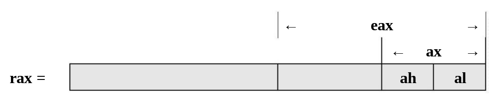

如图所示，前四个寄存器rax、rbx、rcx和rdx还允许通过ah、bh、ch和dh寄存器名访问第8-15位。除ah外，这些主要是为了向后兼容，本教程不会使用。

能够访问寄存器的部分意味着，如果将四字rax寄存器设置为50,000,000,000（五百亿），则rax寄存器将包含以下十六进制值：

rax = 0000 000B A43B 7400

如果后续操作将字ax寄存器设置为50,000（五万，即C350），则rax寄存器将包含以下十六进制值：

rax = 0000 000B A43B C350

在这种情况下，当设置64位rax寄存器的低16位ax部分时，高48位不受影响。注意ax的变化（从7400变为C350）。

如果后续操作将字节大小的al寄存器设置为50（五十，即32），则rax寄存器将包含以下十六进制值：

rax = 0000 000B A43B C332

当设置64位rax寄存器的低8位al部分时，高56位不受影响。注意al的变化（从50变为32）。

对于32位寄存器操作，高32位会被清零（设置为0）。通常这不是问题，因为在32位寄存器上的操作不使用寄存器的高32位。对于无符号值，这可以方便地将32位值转换为64位值。然而，对于有符号值，这不适用于从32位到64位的转换。具体来说，对于负值，这可能会提供不正确的结果。有关有符号值表示的更多信息，请参阅第3章“数据表示”。

##### 2.3.1.2 栈指针寄存器

其中一个CPU寄存器rsp，用于指向当前栈顶。rsp寄存器不应用于数据或其他用途。关于栈和栈操作的更多信息在第9章“进程栈”中提供。

##### 2.3.1.3 基址指针寄存器
其中一个CPU寄存器rbp，在函数调用期间用作基址指针。rbp寄存器不应用于数据或其他用途。关于函数和函数调用的更多信息在第12章“函数”中提供。

##### 2.3.1.4 指令指针寄存器
除了GPR之外，还有一个特殊的寄存器rip，被CPU用来指向下一条要执行的指令。具体来说，由于rip指向下一条指令，这意味着在调试器中显示的、由rip指向的指令尚未被执行。这是一个重要的区别，在调试器中查看代码时可能会造成混淆。

##### 2.3.1.5 标志寄存器
标志寄存器rFlags，用于存储状态信息和CPU控制信息。rFlag寄存器在每条指令执行后由CPU更新，程序无法直接访问。该寄存器存储刚刚执行的指令的状态信息。在rFlag寄存器的64位中，许多位是为将来使用而保留的。

下表显示了标志寄存器中的一些状态位：

| 名称 | 符号 | 位   | 用途 |
| ---- | ---- | ---- | ---- |
|进位标志	|CF	|0|	用于指示先前的操作是否产生了进位。|
|奇偶标志	|PF	|2	|用于指示最后一个字节是否有偶数个1（即偶校验）。|
|辅助进位标志	|AF	|4	|用于支持二进制编码的十进制运算。|
|零标志	|ZF	|6	|用于指示先前的操作是否产生了零结果。|
|符号标志	|SF	|7	|用于指示先前操作的结果是否在最高有效位为1（在有符号数据的上下文中表示负数）。|
|方向标志	|DF	|10	|用于指定某些字符串操作的方向（递增或递减）。|
|溢出标志	|OF	|11	|用于指示先前的操作是否导致了溢出。|

本教程未指定其他一些位。更多信息可从第1章引言中提到的参考资料中获取。

##### 2.3.1.6 XMM寄存器
有一组专用寄存器用于支持64位和32位浮点运算以及单指令多数据指令。SIMD指令允许一条指令同时应用于多个数据项。如果使用得当，这可以带来显著的性能提升。典型的应用包括一些图形处理和数字信号处理。

XMM寄存器如下：


注：一些较新的X86-64处理器支持256位的XMM寄存器。这对本教程中的程序不会造成影响。

此外，XMM寄存器用于支持流式SIMD扩展。SSE指令超出了本教程的范围。更多信息可从Intel参考资料（如第1章引言所述）中获取。

#### 2.3.2 高速缓存
高速缓存是位于CPU芯片内的主存储器或RAM的一小部分子集。如果访问了一个内存位置，其值的一份副本会被放入缓存中。随后对该内存位置的连续快速访问将从缓存位置（CPU芯片内部）检索。内存读取涉及通过总线向内存控制器发送地址，内存控制器将获取请求内存位置的值，并通过总线将其发回。相比之下，如果值在缓存中，访问该值的速度要快得多。

当请求的数据可以在缓存中找到时，称为缓存命中；当无法找到时，称为缓存缺失。缓存命中通过从缓存读取数据来服务，这比从主内存读取更快。能够从缓存服务的请求越多，系统的整体性能通常就越好。每一代新的CPU芯片都增加了高速缓存容量并改进了缓存映射策略，以提高整体性能。

典型的CPU芯片配置框图如下：


当前的芯片设计通常在每个核心包含一个L1缓存和一个共享的L2缓存。许多较新的CPU芯片还会有一个额外的L3缓存。

从图中可以看出，所有的内存访问都要经过每一级缓存。因此，值可能存在多个重复副本（CPU寄存器、L1缓存、L2缓存和主内存）。这种复杂性由CPU管理，程序员无法更改。理解缓存及其相关的性能提升有助于理解计算机的工作原理。

### 2.4 主存储器

内存可以看作是一系列连续的字节。也就是说，内存是按字节寻址的。这意味着每个内存地址保存一个字节的信息。要存储一个双字，需要四个字节，占用四个内存地址。

此外，本体系结构采用小端序。这意味着最低有效字节存储在最低的内存地址中。最高有效字节存储在最高的内存位置。

对于一个双字（32位），MSB和LSB的分配如下所示：


例如，假设值5,000,000 (004C4B40)要放入一个名为var1的双字变量中。

对于小端序体系结构，内存布局如下：


基于小端序体系结构，LSB存储在最低的内存地址中，MSB存储在最高的内存位置中。

### 2.5 内存布局

程序的通用内存布局如下图所示：


保留区对用户程序不可用。代码段（或称文本段）是存放机器语言（即代表代码的0和1序列）的地方。数据段是存放已初始化数据的地方。这包括在汇编时已提供初始值的已声明变量。未初始化数据段，通常称为BSS段，存放尚未提供初始值的已声明变量。如果在设置之前访问，其值将无意义。堆是存放动态分配数据的地方（如果请求）。栈从高地址开始并向低地址增长。

后续章节将为代码段和数据段提供更多细节。

### 2.6 内存层次结构

为了充分理解各种不同内存层级及其相关用法，回顾内存层次结构是很有用的。一般来说，更快的内存更昂贵，而更慢的内存块更便宜。CPU寄存器很小、很快且昂贵。辅助存储设备如磁盘驱动器和固态硬盘更大、更慢且更便宜。总体目标是在性能和成本之间取得平衡。

内存层次结构概览如下：


三角形的顶部代表最快、最小和最昂贵的内存。随着我们向下移动层级，内存变得更慢、更大且更便宜。目标是在小而快、昂贵的存储和大而慢、便宜的存储之间取得有效的平衡。

一些典型的性能和大小特征如下：

| 存储单元 | 示例大小 | 典型速度 |
| -------- | -------- | -------- |
|寄存器	|16个64位寄存器|	~1纳秒|
|高速缓存|	4-8+ MB (L1+L2)|	~5-60纳秒|
|主存储器|	2-32+ GB|	~100-150纳秒|
|辅助存储|	500GB-4+ TB|	~3-15毫秒|

基于此表，一次主存储器访问耗时100纳秒，比一次辅助存储访问耗时3毫秒快30,000倍。

典型的速度会随着时间的推移而提高（这些数据已经过时）。关键点在于各存储单元之间的相对差异是显著的。即使在使用更新、更快的SSD时，这种差异仍然存在。

## 第 3 章 数据表示

数据表示指的是信息在计算机内部的存储方式。存储整数有特定的方法，这与存储浮点数值不同，也与存储字符不同。本章简要概述整数、浮点数和 ASCII 表示方案。

假定读者已经基本熟悉二进制、十进制和十六进制数制。

需要注意的是，如果没有特别指定，数字默认为十进制。此外，以 0x 开头的数字是十六进制值。例如


### 3.1 整数表示

整数表示指的是计算机在内存中存储或表示一个数字的方式。计算机以二进制（1 和 0）表示数字。但是，计算机为每个数字或变量所能使用的空间是有限的。这直接影响了可表示数字的大小或范围。

例如，一个字节（8 位）可以用来表示 2^8（即 256）个不同的数字。这 256 个不同的数字可以是有符号的（全为正数），此时我们可以表示 0 到 255（含）之间的任意数字。如果我们选择有符号（正值和负值），那么我们可以表示 -128 到 +127（含）之间的任意数字。

如果该范围不足以处理预期的值，则必须使用更大的尺寸。例如，一个字（16 位）可以用来表示 2^16（即 65,536）个不同的值，双字（32 位）可以用来表示 2^32（即 4,294,967,296）个不同的数字。因此，如果要存储 100,000 这样的值，就需要双字。

正如你可能从 C、C++ 或 Java 中回忆起来的那样，整数声明（例如 int）是单个双字，可用于表示 −2^32（-2,147,483,648）到 +2^31−1（+2,147,483,647）之间的值。

下表显示了典型尺寸对应的范围：

| 尺寸 | 大小 | 无符号范围 | 有符号范围 |
| ---- | ---- | ---------- | ---------- |
|字节（8 位）|	2^8	|0 到 255|	-128 到 +127|
|字（16 位）	|2^16|	0 到 65,535	|-32,768 到 +32,767|
|双字（32 位）|	2^32|	0 到 4,294,967,295|	-2,147,483,648 到 +2,147,483,647|
|四字|	2^64|	0 到 2^64−1|	−(2^63) 到 2^63−1|
|双四字	|2^128|	0 到 2^128−1|	−(2^127) 到 2^127−1|

为了确定一个值是否能被表示，你需要知道所用存储单元（字节、字、双字、四字等）的大小，以及这些值是无符号还是有符号的。

* 对于给定存储大小范围内表示无符号值，使用标准二进制。

* 对于范围内表示有符号值，使用补码（two's complement）。具体而言，补码编码过程适用于负值范围内的数值。对于正值范围内的值，使用标准二进制。

  例如，无符号字节范围可以用数轴表示如下

  0                                                                               255
  ├───────────────────────────────┤

  例如，有符号字节范围也可以用数轴表示如下：

  -128                                0                                 +127
  ├──────────────┼──────────────┤

同样的概念适用于具有更大范围的半字和字。

由于无符号值具有不同于有符号值的、仅限正数的范围，因此这些值之间存在重叠。这在检查内存中的变量（使用调试器时）会非常令人困惑。

例如，当无符号和有符号值在重叠的正值范围（0 到 +127）内时：
12 的有符号字节表示是 0x0C 

12 的无符号字节表示也是 0x0C 

当无符号和有符号值在重叠范围之外时：
−15 的有符号字节表示是 0xF1 
241 的无符号字节表示也是 0xF1 
除非数据类型被清晰且正确地定义，否则这种重叠会引起混淆。

#### 3.1.1 补码（Two's Complement）

下面描述如何为负值（而非正值）查找补码表示。要对一个数字取补码：
取反码（one's complement，即逐位取反）
加 1（二进制加法）
同一过程用于将十进制值编码为补码，以及从补码转回十进制。

以下各节提供了一些示例。

#### 3.1.2 字节示例

例如，查找 -9 和 -12 的字节大小（8 位）补码表示。

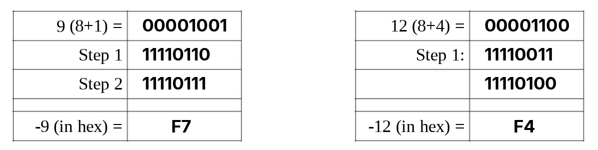

注意，必须指定给定大小的所有位，本例中为字节。

#### 3.1.3 字示例

例如，求-9和-12的8位（1字节）补码表示。

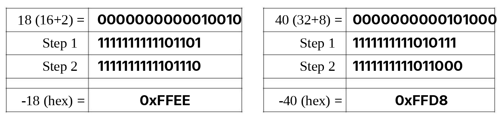

注意：本例中须完整给出指定位宽下的所有比特位（即字长）。

### 3.2 无符号与有符号加法

如前所述，无符号和有符号表示可以为最终表示的值提供不同的

解释。但是，加法和减法运算是相同的。例如：

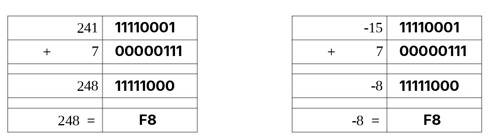

0xF8 的最终结果可以解释为：在无符号表示法中对应 248，而在有符号表示法中则对应 -8。此外，在 ASCII 表中，0xF8 对应的是符号 º（度数符号）。

因此，在执行运算时，必须明确定义数据的大小（字节、半字、字等）及类型（有符号、无符号），这一点至关重要。

### 3.3 浮点表示

浮点数的表示问题要复杂得多。针对不同的数值取值范围，存在多种对应的浮点数表示规范。为简化讲解，我们将重点介绍IEEE 754标准的32位浮点数格式。

####  3.3.1 IEEE 32 位表示

IEEE 754 32 位浮点标准定义如下：

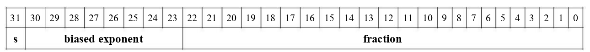

其中 s 为符号位（0 表示正数，1 表示负数）。更正式地，该表达式可写作：


在表示浮点数值时，第一步是转换浮点数值转换为二进制。下表简要回顾了二进制如何处理小数部分：

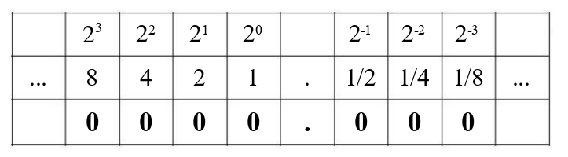

例如，二进制数 100.101 对应的十进制值为 4.625。对于循环小数，计算其二进制表示可能相当耗时。不过由于计算机存储空间有限（本例中为 32 位），这种计算终有上限。

下一步是将该值表示为**二进制规格化科学记数法**。这意味着小数点左侧必须仅有且仅有一位非零数字。例如，8.125 的二进制表示为 1000.001（即 1000.001 × 2⁰），其规格化形式为 **1.000001 × 2³**（因为小数点向左移动了三位）。同理，若数值为 0.125，其二进制为 0.001（即 0.001 × 2⁰），规格化形式则为 **1.0 × 2⁻³**（小数点向右移动了三位）。最高位 1 之后的各位（不含该前导 1）将以**左对齐**的方式存储在双字（double-word）的分数段中。

接下来计算**偏置指数**，即规格化科学记数法中的指数值加上偏置量。IEEE 754 32 位浮点数标准的偏置量为 **127**。计算结果需转换为 8 位字节形式，存入字（word）的偏置指数段中。

**注意**：将 IEEE 754 32 位浮点数表示还原为十进制值时，操作顺序相反——但必须**补回前导 1**（因为它并未实际存储在字中），同时偏置量执行**减法**运算（而非加法）。

##### 3.3.1.1 IEEE 32 位表示示例

下面通过几个例子来说明如何将十进制数转换为 IEEE 754 32 位浮点格式，以及如何反向转换。

###### 3.3.1.1.1 示例 → -7.75₁₀
将十进制数 -7.75 转换为 IEEE 754 32 位十六进制表示。

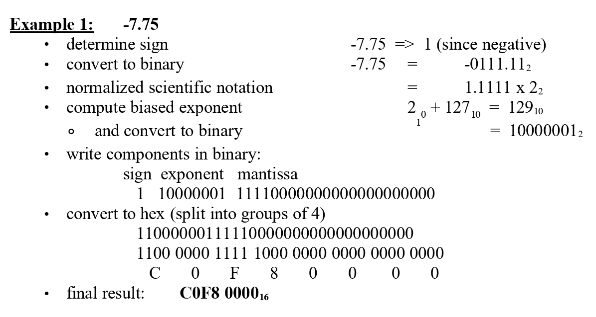

###### 3.3.1.1.2 示例 → -0.125₁₀
将十进制数 -0.125 转换为 IEEE 754 32 位十六进制表示。

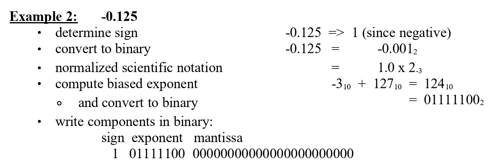


###### 3.3.1.1.3 示例 → 41440000₁₆
给定一个 IEEE 754 32 位十六进制值 41440000₁₆，求其对应的十进制数值。

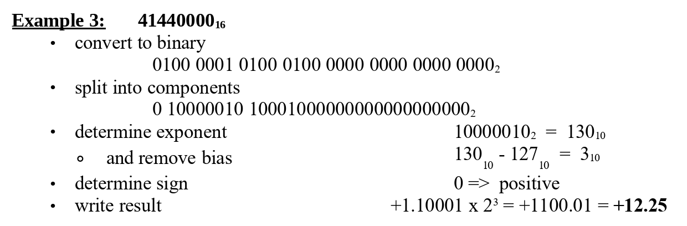

#### 3.3.2 IEEE 64 位表示

IEEE 754 64 位浮点标准定义如下

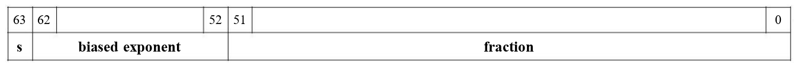

表示过程是相同的，但该格式允许使用 11 位偏置指数（支持更大和更小的值）。11 位偏置指数使用 ±1023 的偏置。

#### 3.3.3 非数（NaN）

当一个值被解释为浮点值，但它不符合定义的标准（无论是 32 位还是 64 位）时，它就不能用作浮点数。如果整数表示被当作浮点表示来处理，或者浮点算术运算（加、减、乘或除）产生的值太大或太小而无法表示，就可能发生这种情况。不正确的格式或无法表示的数字被称为 NaN，是 "not a number"（非数）的缩写。

### 3.4 字符与字符串

除了数值数据外，通常还需要符号数据。符号或非数值数据可能包括重要的消息，例如 "Hello World"——这是首个程序的常见问候语。说英语的人很容易理解这些符号。计算机内存旨在存储和检索数字。因此，通过为每个符号或字符分配数值来表示这些符号。

理解字符（例如 "2"）和整数（例如 2₁₀）之间的区别非常重要。字符可以显示到控制台，但不能用于计算。整数可以用于计算，但不能显示到控制台（如果不改变其表示的话）。字符通常存储在字节（8 位）空间中。由于内存是按字节寻址的，这工作得很好。

#### 3.4.1 字符表示

在计算机中，**字符**是一种信息单元，对应于字母表中的某个字母等符号。字符的例子包括字母、数字、常用标点符号（如"."或"!"）以及空白符。广义上的字符概念还包含**控制字符**——这类字符并不对应某种特定语言的符号，而是用于文本处理的其他控制信息，例如回车符和制表符。

##### 3.4.1.1 美国信息交换标准代码（ASCII）

字符采用**美国信息交换标准代码（ASCII）**进行表示。根据 ASCII 码表，每个字符及控制字符均被分配了一个数值。在 ASCII 编码体系中，屏幕上显示的字符由其对应的数值决定。这一机制得以成立的前提是所有参与者对编码值达成一致，而这正是 ASCII 码表存在的意义。例如，字母"A"被定义为十进制 65（十六进制 0x41）。

数值 0x41 存储在计算机内存中，当输出到控制台时，显示出来的便是字母"A"。完整 ASCII 码表参见附录 A。

此外，数字符号同样可以用 ASCII 表示。例如，"9"在内存中存储为十进制 57（十六进制 0x39），输出到控制台时显示为字符"9"。但如果向控制台发送整数值 9（0x09），则会被解释为 ASCII 码值，在本例中对应制表符（Tab）。

**务必厘清字符（如"2"）与整数（如 2）之间的区别。** 字符可直接输出到控制台显示，但不能直接参与算术运算；整数可用于计算，但若不经转换直接输出到控制台，则无法正确显示为数字字符。

字符通常占用 **1 字节（8 位）**存储空间。由于计算机内存采用**按字节寻址**的架构，这一设计恰好与之契合。

##### 3.4.1.2 Unicode

需注意，Unicode是现行字符编码标准，支持多种语言的字符表示。Unicode标准为每一个字符分配唯一的码点，不受平台、设备、应用程序或编程语言的限制，为此它定义了一系列编码方案（UTF-8、UTF-16、UTF-32等）。其中应用最广泛的是UTF-8编码方案：ASCII范围内的英文字符在UTF-8中的编码与ASCII标准完全一致，其他语言的字符则按需使用更多字节存储。本书不展开讨论Unicode的具体编码细节。

#### 3.4.2 字符串表示

字符串是由一系列ASCII字符组成的序列，通常以**空字符（NULL）**作为终止标志。空字符属于不可打印的ASCII控制字符，正因如此，它可被用来标记字符串的结束位置。

例如，字符串"Hello"的内存表示如下所示：

| 字符 | "H"  | "e"  | "l"  | "l"  | "o"  | NULL |
| ---- | ---- | ---- | ---- | ---- | ---- | ---- |
|ASCII 值（十进制）|	72|	101	|108|	108	|111	|0|
|ASCII 值（十六进制）|	0x48|	0x65|	0x6C|	0x6C|	0x6F|	0x0|

字符串可以部分或全部由数字符号组成。例如，字符串 "19653" 表示如下：

| 字符 | "1"  | "9"  | "6"  | "5"  | "3"  | NULL |
| ---- | ---- | ---- | ---- | ---- | ---- | ---- |
|ASCII 值（十进制）|	49|	57|	54|	53|	51|	0|
|ASCII 值（十六进制）|	0x31|	0x39|	0x36|	0x35|	0x33|	0x0|

## 第 4 章 程序格式

本章总结了汇编语言程序的格式规范要求，相关规则专门针对 **yasm 汇编器** 制定，其他汇编器的要求可能略有差异。为演示正确的程序格式，本节将给出一份完整的汇编语言程序示例。

格式规范的汇编源文件主要由以下几部分构成：

​		**数据段（data section）**：用于声明和定义**已初始化的数据**。

​		**BSS 段（bss section）**：用于声明**未初始化的数据**。

​		**代码段（text section）**：用于存放程序指令。

以下各节将总结基本的格式规范要求。本节仅介绍基础格式与汇编器语法，如需进一步了解，请参阅《yasm 参考手册》（详见第 1 章"简介"部分的说明）。

### 4.1 注释

分号（`;`）用于标记程序注释。以分号开头的注释可放置于代码任意位置，也可紧跟在指令之后。分号后的所有内容都会被汇编器忽略，既可用于说明代码的实现步骤，也可用于临时注释掉部分代码段。

### 4.2 数值表示

数值可采用十进制、十六进制或八进制进行指定。

- **十六进制（基数为16）**：数值前需加前缀 `0x`。例如，十进制 127 的十六进制表示为 `0x7f`。
- **八进制（基数为8）**：数值后需加后缀 `q`。例如，十进制 511 的八进制表示为 `777q`。
- **十进制（基数为10）**：为默认基数，无需特殊标记。

### 4.3 常量定义

常量通过 `equ` 伪指令定义，一般格式如下：

```
<名称>    equ     <值>
```

常量的值在程序运行过程中不可修改。它会在汇编阶段被直接替换为定义时的数值，因此不会为其分配独立的内存空间。这也使得常量的使用更为灵活：它不需要预先绑定特定的类型或位宽（字节、字、双字等），实际值域仅受限于其使用场景。

例如，下述常量定义：

```
SIZE equ 10000
```

该常量可作为字（16位，最大值65535）或双字（32位）使用，但无法作为字节（8位，最大值255）使用。

### **4.4 数据段**

已初始化的数据必须在 `section .data` 段中声明，且 `section` 关键字后必须保留一个空格。所有已初始化的变量和常量都存放在该段中。

变量名必须以字母开头，后续可接字母、数字或特定特殊字符（如下划线"_"）。变量定义必须包含三项要素：变量名、数据类型，以及对应的初始值。

通用定义格式如下：

```
<变量名>     <数据类型>     <初始值>
```

各类数据类型的使用示例将在后续小节中逐一给出。

支持的数据类型如下：

| 声明 |                               |
| ---- | ----------------------------- |
| db   | 8-bit variable(s)             |
| dw   | 16-bit variable(s)            |
| dd   | 32-bit variable(s)            |
| dq   | 64-bit variable(s)            |
| ddq  | 128-bit variable(s) → integer |
| dt   | 128-bit variable(s) → float   |

上述即为用于已初始化数据声明的**主要汇编器伪指令**。其余伪指令将在后续不同章节中另行介绍。

已初始化数组通过**逗号分隔的多个值**进行定义。

简单示例如下：

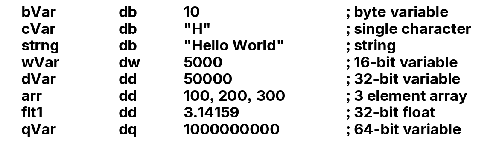

所指定的数值必须能够容纳于声明的数据类型范围之内。例如，若将某字节型变量的初值定义为 500，则会触发汇编错误。

**4.5 BSS 段**

未初始化的数据需在 `section .bss` 段中声明，且 `section` 关键字后必须保留一个空格。所有未初始化的变量均在此段中声明。变量名必须以字母开头，后续可接字母、数字或特定特殊字符（如下划线"_"）。变量定义必须包含三项要素：变量名、**预留类型**，以及**数量**。

通用定义格式如下：

```
<变量名>    <预留类型>    <数量>
```

各类数据类型的使用示例将在后续小节中逐一给出。

支持的数据类型如下：

| **声明** |      |
| -------- | ---- |
| resb  | 8位变量|
| resw | 16位变量|
| resd |  32位变量|
| resq | 64位变量|
| resdq |128位变量|

一些简单的例子包括

| bArr | resb | 10   | ; 10个元素的字节数组    |
| ---- | ---- | ---- | ----------------------- |
| wArr | resw | 50   | ；50个元素的单词数组    |
| dArr | resd | 100  | ；100个元素的双精度数组 |
| qArr | resq | 200  | ；200个元素的四精度数组 |

分配的数组未初始化为任何特定值。

### 4.6 文本段

程序指令存放在 section .text 段中，section 关键字后必须保留空格。每条指令独占一行，且必须为带合法操作数的有效指令。
代码段中包含若干前置声明或标号，用于指定程序的初始入口点。以使用标准系统链接器的基础程序为例，必须包含如下声明：

​				**global _start**

​				**_start:**

程序终止本身不需要特殊的标号或伪指令。然而，应当通过**系统服务调用**来通知操作系统程序已结束运行，以便回收并复用内存等资源。具体用法可参考下一节中的示例程序。

### **4.7 示例程序**

一个非常简单的汇编语言程序被用来演示合适的程序格式。

```assembly
; Simple example demonstrating basic program format and layout.
; Ed Jorgensen
; July 18, 2014

;************************************************************
;  Some basic data declarations
 
section   .data
;-----
;  Define constants
EXIT_SUCCESS    equ     0       ; successful operation
SYS_exit        equ     60      ; call code for terminate

; -----
;  Byte (8-bit) variable declarations

bVar1           db      17
bVar2           db      9
bResult         db      0
; -----
;  Word (16-bit) variable declarations
wVar1           dw      17000
wVar2           dw      9000
wResult         dw      0
; -----
;  Double-word (32-bit) variable declarations
dVar1           dd      17000000
dVar2           dd      9000000
dResult         dd      0
; -----
;  quadword (64-bit) variable declarations
qVar1           dq      170000000
qVar2           dq      90000000
qResult         dq      0
; ************************************************************
;  Code Section
section     .text
global _start
_start:
;  Performs a series of very basic addition operations
;  to demonstrate basic program format.
;	----------
;  Byte example
;   bResult = bVar1 + bVar2
    mov     al, byte [bVar1]
    add     al, byte [bVar2]
    mov     byte [bResult], al
; ----------
;  Word example
;   wResult = wVar1 + wVar2
    mov     ax, word [wVar1]
    add     ax, word [wVar2]
    mov     word [wResult], ax
; ----------
;  Double-word example
;   dResult = dVar1 + dVar2
    mov     eax, dword [dVar1]
    add     eax, dword [dVar2]
    mov     dword [dResult], eax
;----------
;  Quadword example
;   qResult = qVar1 + qVar2
    mov     rax, qword [qVar1]
    add     rax, qword [qVar2]
    mov     qword [qResult], rax
; ************************************************************
;  Done, terminate program.
last:
    mov     rax, SYS_exit       ; Call code for exit
    mov     rdi, EXIT_SUCCESS   ; Exit program with success
    syscall
```

本示例程序将在后续章节中多次引用并作进一步阐释。

## **第5章  工具链**

通常来说，用于构建程序的一整套编程工具统称为**工具链**。本书所采用的工具链包含以下组件：

- 汇编器
- 链接器
- 加载器
- 调试器

尽管工具链的选型方案十分多样，但本书选用了一套兼容性良好、全面支持 x86 64 位架构的开源标准工具组合。上述各类工具的具体功能与使用方式将在后续章节中逐一介绍。

### **5.1 汇编 / 链接 / 加载流程概述**

广义而言，汇编、链接和加载是将程序员编写的源文件转化为可执行程序的完整过程。

汇编器将人类可读的源文件转换为**目标文件**（object file）。链接器将目标文件（最基础的形式）转换为**可执行文件**。加载器再将可执行文件载入内存。

上述流程的整体概览如下图所示。

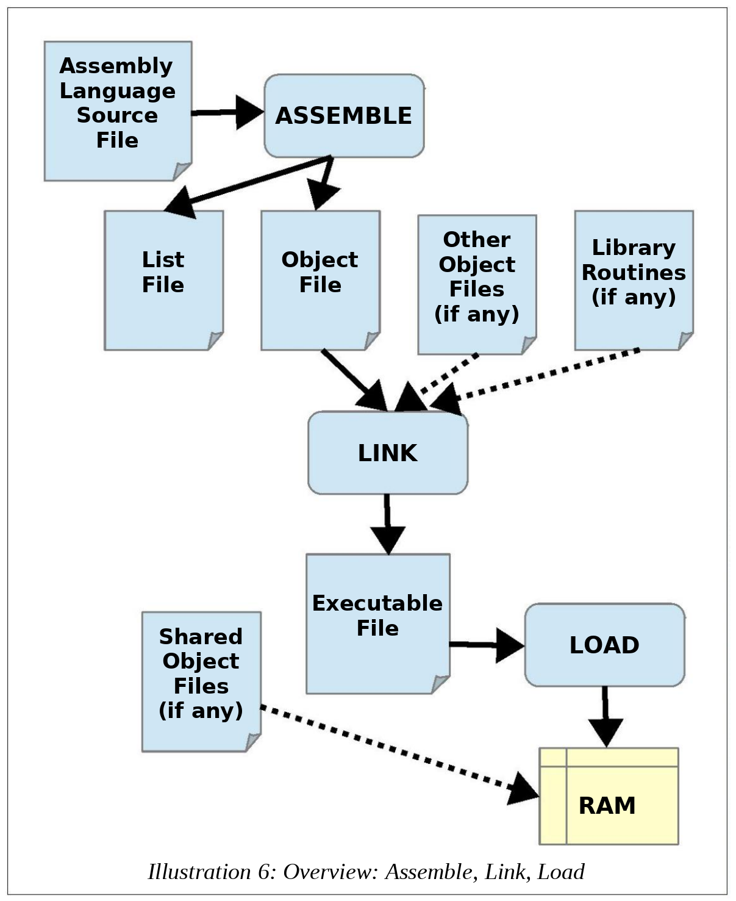

### **5.2 汇编器**

汇编器是一种读取汇编语言输入文件、将代码转换为机器语言二进制文件的程序。输入文件即汇编语言源文件，其中包含人类可读形式的汇编指令。输出的机器语言文件被称为**目标文件**。在此过程中，汇编器会移除所有注释，并将变量名和标号转换为对应的地址，以满足CPU执行时的寻址需求。

本书使用的汇编器为yasm。yasm官方网站及相关文档的链接可参见第1章「简介」部分。

####  **5.2.1 汇编命令**

针对前一章给出的示例类汇编源文件，yasm 汇编器的对应调用命令如下：

**yasm -g dwarf2 -f elf64 example.asm -l example.lst**

注意：参数 `-l` 中的 `l` 是**短横线加小写字母 L**，极易与数字 `1` 混淆。

`-g dwarf2` 选项用于告知汇编器在生成的目标文件中嵌入调试信息。这会增加目标文件的体积，但对于后续有效调试是必需的。`-f elf64` 指定汇编器生成 ELF64 格式的目标文件，该格式适配 64 位 Linux 系统。`example.asm` 为输入的汇编语言源文件名。参数 `-l example.lst`（同样为短横线加小写字母 L）指定汇编器生成一个名为 `example.lst` 的列表文件。

如果汇编过程中触发错误，必须先修复所有错误，才能进入后续的链接步骤。

#### **5.2.2 列表文件**

此外，汇编器还支持按需生成列表文件（即通过前文所述的 `-l` 参数开启）。列表文件会逐行列出行号、段内相对地址、指令对应的机器码（含变量与标号引用），以及原始汇编源代码。调试过程中，列表文件具有很高的实用价值。

例如，上一章示例程序的数据段在列表文件中的片段如下所示：

  **36 00000009 40660301      dVar1   dd  17000000** 

  **37 0000000D 40548900      dVar2   dd  9000000** 

  **38 00000011 00000000      dResult  dd  0**

列表文件首行的 36 为源代码行号。紧随其后的 0x00000009 是该变量在数据段内的相对地址。由于 dVar1 为双字类型，占用 4 字节，因此下一个变量的起始地址为 0x0000000D——dVar1 依次占用地址 0x00000009、0x0000000A、0x0000000B 和 0x0000000C。行末内容为原始汇编源文件中手写的变量定义语句。
0x40660301 是存入内存的十六进制值，而十进制 17000000 对应的十六进制为 0x01036640。回顾此前内容，x86 架构采用小端字节序，即最低有效字节存于最低内存地址。因此最低位字节 0x40 被存放在相对地址 0x00000009 处，次低位字节 0x66 存放在 0x0000000A，依此类推。初次查看时容易觉得数值排列顺序颠倒或混乱（具体观感取决于查看方式）。
为便于直观理解，对应的内存布局示意如下：

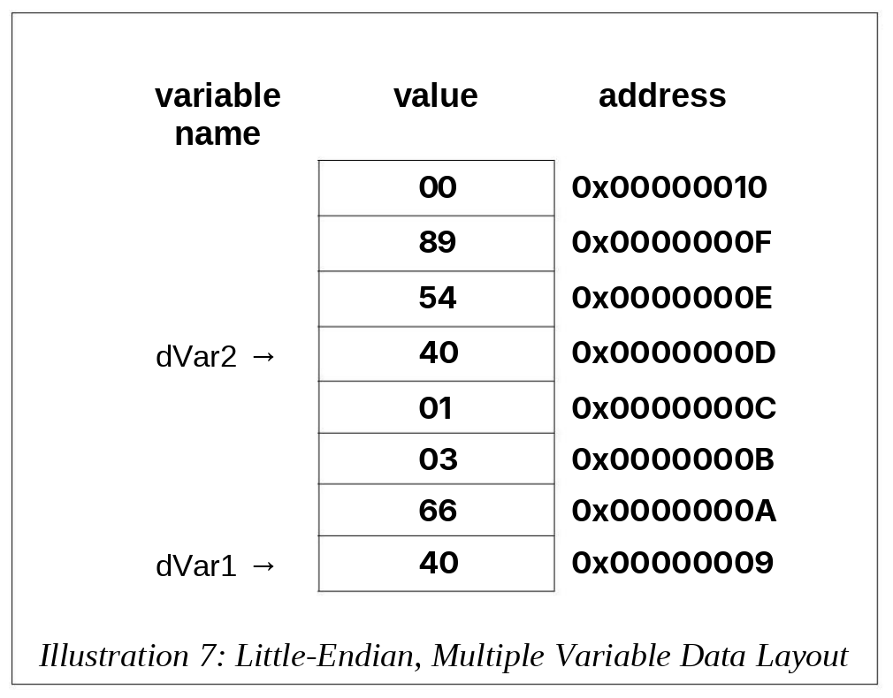

例如，从上一章示例程序中截取的一段代码段（.text 段）列表文件内容如下所示：


同样地，左侧的数字为源代码行号。紧随其后的0x0000005A是该行代码在.text段内的相对地址。
再往后的一组十六进制数0x48C7C03C000000是该指令对应的CPU可识别的机器码，行末内容则是原始的汇编源指令。
标号last:本身不对应任何机器码，因为标号仅用于标识特定内存地址，不属于可执行指令。

#### 5.2.3 两遍扫描汇编器
汇编器会读取源文件，将程序员手写的每一条汇编指令转换为CPU可识别的二进制机器码（即由0和1构成的比特序列）。这些0和1的组合即为机器语言。汇编指令与二进制机器码之间存在严格的一一对应关系，这意味着可执行文件中的机器码可以被反向转换为人类可读的汇编语言（即反汇编）。当然，反汇编得到的代码会丢失原有的注释、变量名和标号名，因此可读性极差。
汇编器逐行读取汇编源文件时，会同步为该行指令生成机器码。对于不涉及跳转的指令，这一过程毫无障碍。但对于会改变控制流的指令（例如条件分支、无条件跳转等），汇编器在第一遍扫描时无法直接完成转换。举个例子，假设有如下代码片段：


这种情况被称为前向引用。如果汇编器逐行读取源文件，此时尚未扫描到 skipRest 标号的定义行，甚至根本无法确认该标号是否真实存在。
这一问题的解决方案是将源文件完整读取两遍，整个过程被称为两遍扫描汇编。每一遍扫描的具体操作步骤将在后续小节中逐一说明。

##### 5.2.3.1 第一遍扫描

第一遍扫描的具体步骤会因汇编器的设计实现不同而有所差异，但通常会包含以下基础操作：
 * 创建符号表
 * 展开宏
 * 计算常量表达式

宏是一种程序构件，在汇编阶段会被展开为一组程序员预定义的指令。更多细节请参见第11章「宏」。
常量表达式是完全由常量构成的算式。由于表达式中不含变量，可在汇编阶段直接完成求值。例如，假设已定义常量BUFF，则下述指令中就包含常量表达式：

​				 **mov** **rax, BUFF+5**

这类常量表达式在大型或复杂程序中尤为常用。第一遍扫描会为程序中的每一条汇编语句分配地址。符号表是一个列表（或表格），完整记录了程序中所有符号、变量名和程序标号及其对应的地址。
此外，视具体情况而定，部分汇编器伪指令也会在第一遍扫描期间完成处理。

##### **5.2.3.2 第二遍扫描**

第二遍扫描的具体步骤会因汇编器的设计实现不同而有所差异，但核心基础操作通常包括以下三项：

- 最终代码生成
- 列表文件生成（若启用）
- 目标文件创建

**代码生成**指将程序员编写的汇编指令转换为CPU可直接执行的机器语言指令。由于汇编指令与机器码存在严格的一一对应关系，不涉及符号引用的指令可在第一遍或第二遍扫描中完成转换。

需要说明的是，不同汇编器的实现策略不同：部分代码生成工作可能在第一遍扫描中完成，也可能全部集中在第二遍扫描处理。但无论采用哪种策略，**最终的代码生成收尾工作一定在第二遍扫描中完成**——这一阶段需要依赖第一遍扫描构建的符号表，校验所有程序符号的有效性，并从表中查询对应地址填入指令中（例如前向跳转的偏移量、变量引用的内存地址等）。

列表文件为可选输出产物，但对调试极具价值。若用户通过`-l`参数启用了列表文件生成，该文件会在第二遍扫描中输出。

若第二遍扫描未检测到错误，最终的目标文件即在此阶段创建完成。

​		**ld -g -o example example.o**

-g 选项用于告知链接器在最终生成的可执行文件中保留调试信息。这会增大可执行文件的体积，但对于实现有效调试而言必不可少。-o example 指定生成名为 example（无扩展名）的可执行文件。若省略 -o <文件名> 选项，链接器默认输出名为 a.out 的文件。example.o 是链接器读取的输入目标文件名。需要注意的是，可执行文件可任意命名，无需与任一输入目标文件同名。

#### **5.3.1 多文件链接**

程序设计领域通常遵循"分而治之"的思路，将大型问题拆解为若干小型子问题，各子问题可独立实现，甚至可由不同程序员分别负责开发。

若存在额外的输入目标文件，需按顺序依次列出，文件之间以空格分隔。例如，若有两个目标文件`main.o`与`funcs.o`，要生成包含调试信息的可执行文件`example`，对应的链接命令如下：

​		**ld -g -o example main.o funcs.o**

这种方式通常适用于规模更大或逻辑更复杂的程序。
当调用位于其他外部源文件中的函数时，当前源文件内未定义的所有函数都必须通过 extern 伪指令进行声明。其他源文件中定义的全局变量等数据，同样可以使用 extern 语句进行访问，但实际开发中数据通常通过函数参数传递，而非直接跨文件访问全局变量。

#### 5.3.2 链接过程

链接是将各独立模块（即前文拆解的小型子问题解决方案）合并为单一可执行单元的核心过程。若程序使用了用户自定义库或系统库例程，链接器会自动纳入所需的对应例程。所有目标文件与库例程会被合并为一个完整的可执行模块，各目标文件中的机器码也会被统一复制到该模块中。
在合并目标文件的过程中，链接器必须按需调整可重定位地址。假设现有两个源文件：主文件和一个包含若干函数的附属文件，二者均已汇编为目标文件main.o与funcs.o。每个文件汇编时，对当前文件外例程的调用均通过extern伪指令声明。由于外部引用对应的代码尚未可用，这类引用会在目标文件中被标记为外部符号，列表文件中会以字母R标注此类可重定位地址。链接器必须解析所有外部引用，并将外部引用的最终地址填入对应代码位置。
例如，若main.o调用funcs.o中定义的函数，链接器必须将调用指令中的地址更新为该函数的实际地址，具体过程如下图所示。


此处，`fnc1`函数是`main.o`目标文件的外部符号，被标记为`R`（需重定位）。`fnc1`的实际定义位于`funcs.o`目标文件中。由于汇编阶段`funcs.o`无法获知主模块代码的存在，其`.text`段内的相对地址从`0x0`开始独立计数。

当两个目标文件合并时，`fnc1`原有的段内相对地址（图中标注为`0x0100:`）会被调整为其在最终可执行文件中的虚拟内存地址（图中标注为`0x0400:`）。链接器必须将此最终地址填入`main.o`中对应调用指令的位置（图中标注为`call 0x0400:`），才能完成链接过程，确保函数调用正确执行。

代码段和数据段中的所有可重定位地址都会经历同样的调整过程。

------

#### **5.3.3 动态链接**

Linux操作系统支持动态链接，可将部分符号的解析工作推迟到程序运行时完成。动态链接的库代码不会被复制到可执行文件中，而是在需要时于运行时解析并加载到内存。

尽管实现逻辑更复杂，但动态链接具备两项优势：

- 常用库（如标准系统库）仅需存储一份，无需在每个可执行二进制文件中重复拷贝。
- 若库函数中的缺陷得到修复，所有动态依赖该库的程序在下次运行时即可直接受益；反之，静态链接了该函数的程序必须重新链接才能应用修复。

动态链接也存在劣势：

- 不兼容的库更新会导致依赖旧版本行为的可执行文件失效。
- 某个程序及其依赖的库可能作为一个整体通过认证（例如正确性、文档合规性、性能等方面的认证），但如果其中的组件可以被替换，就无法维持这种整体认证状态。

Linux/Unix系统中，动态链接的目标文件通常以`.so`（共享对象，Shared Object）为扩展名；Windows系统中则对应`.dll`（动态链接库，Dynamic Link Library）扩展名。动态链接的更多细节超出本书的讨论范围。

------

### **5.4 汇编/链接脚本**

编程过程中，往往需要针对不同的程序反复输入汇编和链接命令。与其每次都手动键入 `yasm` 汇编命令和 `ld` 链接命令，不如将这些命令统一写入一个脚本文件。之后只需执行该脚本，即可自动运行文件中预设的所有命令。虽然使用脚本并非强制要求，但能有效节省时间、简化操作流程，尤其在频繁迭代程序时优势明显。

一个简单的 Bash 汇编/链接脚本示例如下：

```bash
#!/bin/bash
# Simple assemble/link script.
if [ -z $1 ]; then 
    echo "Usage:  ./asm64 <asmMainFile> (no extension)" 
    exit 
fi 
#  Verify no extensions were entered 
if [ ! -e "$1.asm" ]; then 
    echo "Error, $1.asm not found." 
    echo "Note, do not enter file extensions." 
    exit 
fi 
#  Compile, assemble, and link. 
```

**yasm -Worphan-labels -g dwarf2 -f elf64 $1.asm -l $1.lst** 

**ld -g -o $1 $1.o**

上述脚本需保存为一个独立文件。本例中，该文件命名为 `asm64`，并放置在**当前工作目录**（即存放汇编源文件的目录）下。

文件创建完成后，需为其添加可执行权限，命令如下：

```bash
chmod +x asm64
```

该操作每个脚本文件仅需执行一次。

脚本会从命令行读取源文件名作为参数。例如，若要使用该脚本汇编前一章的示例文件 `example.asm`，只需输入：

```bash
./asm64 example
```

注意：`example.asm` 的 `.asm` 扩展名**无需手动输入**（脚本内部已自动拼接该后缀）。执行后，脚本会自动完成汇编与链接全流程，生成列表文件（`.lst`）、目标文件（`.o`）及可执行文件。

是否使用本脚本（或自定义脚本）完全由用户自行决定，脚本名称也可按需修改。

### **5.5 加载器**

加载器是操作系统的组成部分，负责将程序从**二级存储**（如硬盘）载入**主存**（即物理内存）。广义而言，加载器的工作流程为：首先尝试定位格式合法的可执行文件，若定位成功则将其读入内存，创建新进程，将程序代码载入内存空间，并将程序标记为就绪态，等待调度执行。进程的调度顺序与执行时机由操作系统的**调度器**决定。

加载器由用户在命令行输入程序名时**隐式调用**。以之前生成的名为`example`的可执行文件为例，Linux下的执行命令为：

```bash
./example
```

该命令会运行经过前述汇编、链接步骤生成的`example`文件。由于该示例程序未执行任何输出操作，控制台不会显示任何内容，因此需要借助调试器来验证运行结果。

------

### **5.6 调试器**

调试器³⁴用于控制程序的执行流程，支撑各类测试与调试工作的开展。

前文的示例程序完成了一系列运算，但未输出任何结果，此时即可通过调试器查看运算结果。用于调试的可执行文件必须通过前述汇编、链接命令生成，且必须包含`-g`选项以保留调试信息。

本书使用的调试器为 **GNU DDD**（Data Display Debugger，数据展示调试器），它为 GNU 命令行调试器 `gdb` 提供了可视化前端。DDD 的官方网站与相关文档链接可参见第 1 章「简介」的参考文献部分。

鉴于调试器功能复杂且地位重要，本书将单独开设章节详细介绍调试相关内容。

## **第6章 DDD 调试器**

调试器允许用户控制程序执行流程、检查变量及其他内存区域（如栈空间），并显示程序输出（若有）。开源 **GNU 数据展示调试器（DDD）** 是 GNU 调试器（GDB）的可视化前端，应用范围广泛。如有需要，也可按需改用其他调试器。

本章仅涵盖调试器的基础操作命令。DDD 拥有大量本章未提及的功能与选项，随着使用经验积累，建议查阅第 1 章引用的 DDD 文档，深入了解进阶功能以提升整体调试效率。

DDD 的功能可通过各类插件扩展，但插件并非必需，本章也不会涉及相关内容。本章仅将 GNU DDD 调试器作为工具进行介绍，**不涉及程序调试的逻辑流程与通用方法论**。

------

### **6.1 启动 DDD**

DDD 调试器需配合可执行文件启动，且该可执行文件必须按照上一章所述的正确选项完成汇编与链接。以前文的示例程序 `example` 为例，启动命令为：

```bash
ddd example
```

启动 DDD/GDB 后，屏幕应显示类似下图的界面，并自动加载对应的源代码。

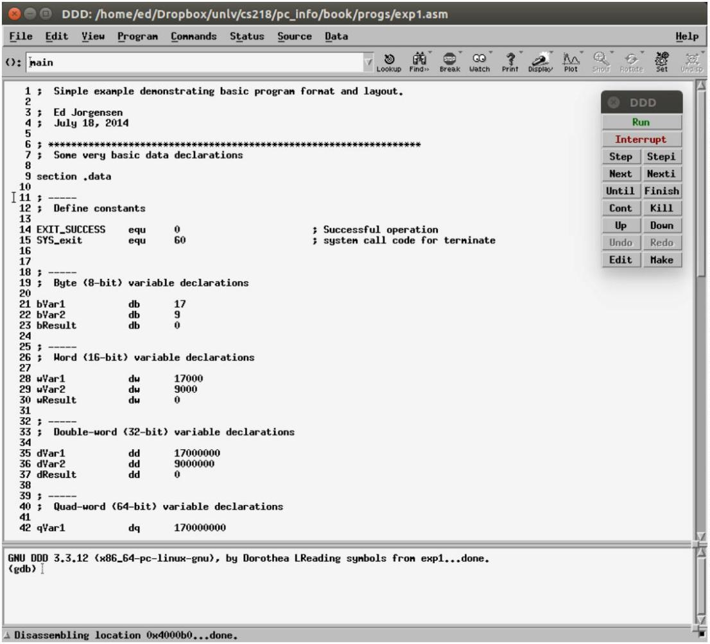

若代码未按上述方式显示，请核查汇编与链接步骤是否正确。需特别注意，**汇编和链接两个阶段都必须添加 `-g` 选项**。

点击右上角的「帮助」菜单项即可查看内置帮助文档。DDD 和 GDB 的完整手册可通过课程网页的虚拟图书馆链接获取。要退出 DDD/GDB，可从顶部菜单栏选择「文件 → 退出」。

#### **6.1.1 DDD 配置建议**

以下为几项推荐的 DDD/GDB 配置调整，可提升调试体验：

- 「编辑 → 首选项 → 常规 → 抑制 X 窗口警告」

- 「编辑 → 首选项 → 源代码 → 显示源代码行号」

上述设置并非强制要求，但能显著降低使用门槛。设置完成后会被保存到本机，后续启动 DDD 时将自动生效。

------

### **6.2 使用 DDD 执行程序**

点击命令工具栏中的「运行」（Run）按钮即可启动程序。也可直接在底部 GDB 控制台的 `(gdb)` 提示符后输入 `run` 命令启动。但需注意：**若不加断点直接全速运行，程序执行完毕后所有结果会被重置（丢失）**。

------

#### **6.2.1 设置断点**

要控制程序执行节奏，必须在用户指定的位置设置**断点**（即程序暂停点）。设置方法为选中源码中需要暂停的位置，以第 95 行为例，可通过以下三种方式之一设置断点：

- 右键点击目标行号，选择「设置断点」
- 在 GDB 控制台 `(gdb)` 提示符后输入：`break last`
- 在 GDB 控制台 `(gdb)` 提示符后输入：`break 95`

以下述场景为例：第 94 行为标号（无实际指令）。若将断点设在标号上，程序实际会暂停在该标号后的第一条可执行指令处（本例中为第 95 行）。

断点设置成功后，行号左侧会显示「停止」图标（如下图所示）。

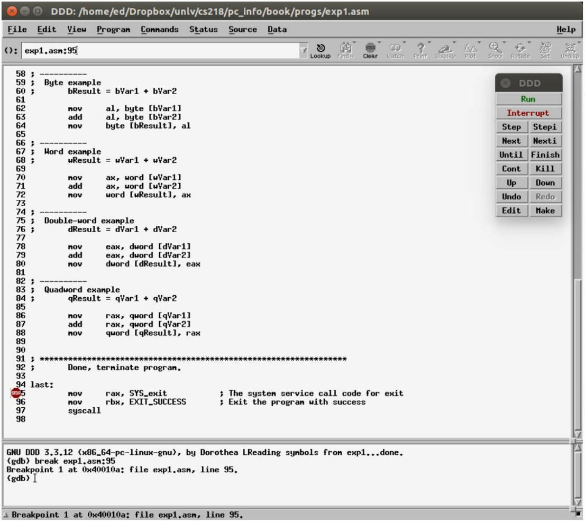

DDD/GDB 命令可随时在底部窗口的 `(gdb)` 提示符后输入。若需要，也可设置多个断点。

**6.2.2 程序执行**

调试器启动后，若要有效开展调试工作，必须先设置一个初始断点。

断点设置完成后，可通过点击工具栏的「运行」按钮，或在 `(gdb)` 提示符后输入 `run` 命令启动程序。程序将执行到断点所在行**之前暂停**，此时绿色箭头指向的是下一条待执行的语句（即断点所在行的代码尚未执行）。

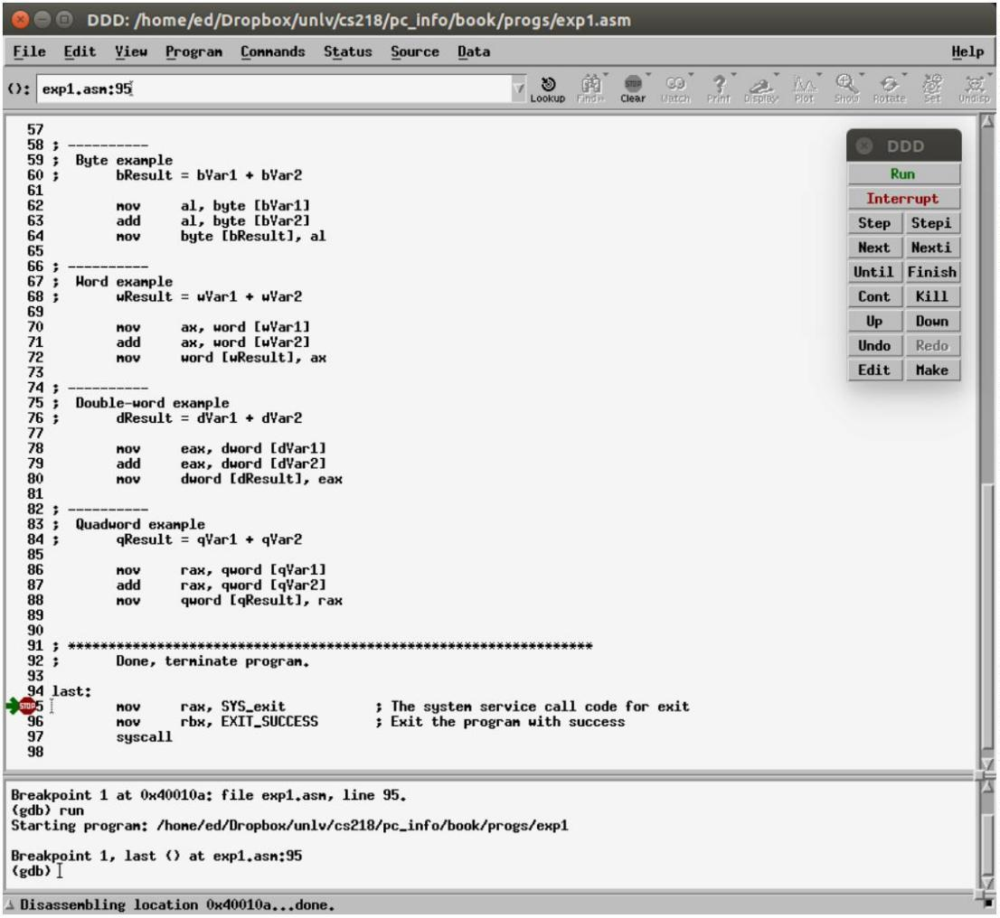


------

##### **6.2.2.1 Run / Continue**

可按需设置额外断点。左侧的**停止图标**标记已设置的断点位置，**绿色箭头**标记当前执行位置（见上图示例）。具体来说，绿色箭头指向**下一条即将执行的指令**——即箭头所指的语句尚未被执行。

需注意：点击「运行」（Run）命令会让程序**从头重新开始执行**，并在初始断点处暂停。

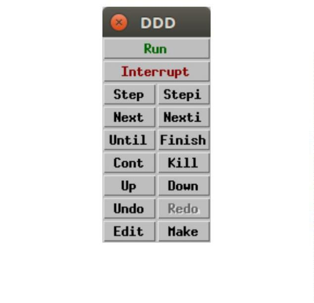

##### **6.2.2.1 运行 / 继续**

首次使用 `Run` 命令启动程序后，若要继续执行到下个断点，需使用**继续（Continue）**命令：可点击工具栏的「Cont」按钮，或在 `(gdb)` 提示符后输入 `cont`（`continue` 的缩写）即可。也可通过单步执行命令逐行运行程序：点击工具栏的「Step」或「Next」按钮，或在 `(gdb)` 提示符后输入 `step` 或 `next` 即可。

##### **6.2.2.2 Next / Step（单步跳过 / 单步步入）**

`next` 命令会执行到**下一条指令**；若当前指令是函数调用，会直接执行完整个函数并停在调用后的下一行。

`step` 命令则执行**一个执行步骤**；若当前指令是函数调用，会进入函数内部并停在第一条可执行指令处。

对于不涉及函数调用的普通单条指令，`next` 和 `step` 的执行效果完全相同。

#### **6.2.3 查看寄存器内容**

查看寄存器内容最简单的方式是使用**寄存器窗口**。该窗口默认不显示，可通过顶部菜单栏选择「状态 → 寄存器」（Status → Registers）打开。打开后，窗口左侧为寄存器名称，中间列为十六进制值，右侧列为无符号十进制值。

需注意：右侧列显示的是整个寄存器的无符号值，若寄存器中存储的是有符号数据，该显示会造成混淆（会按无符号格式解析）。此外，部分寄存器（如 `rbp`、`rsp`）的两列均默认以十六进制显示，因为这类寄存器通常用于存储内存地址。后续章节将介绍的**内存检查（examine memory）**命令可更灵活地控制数值显示格式（如有符号、无符号、十六进制等）。

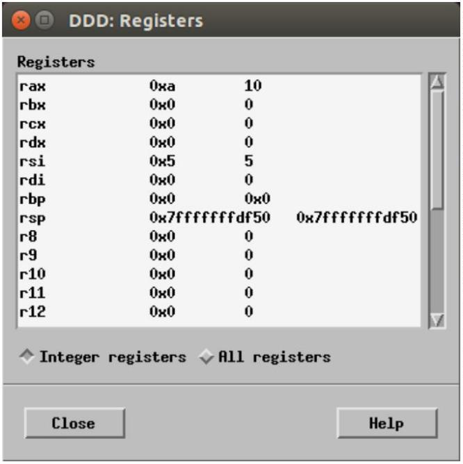

------

**6.2.3 查看寄存器内容（续）**

根据机器配置和屏幕分辨率不同，可能需要手动调整寄存器窗口尺寸才能查看完整内容。

寄存器窗口的第三列通常显示**四字（64位）十进制值**，但`rbp`、`rsp`等特殊用途寄存器除外。该列的有符号四字十进制表示并非在所有场景下都有意义：例如当寄存器中存储无符号数据（如内存地址）时，有符号显示会得到错误结果；若存储的是字符数据，该列的数值同样不具备可读性。

默认情况下寄存器窗口仅显示整数寄存器，勾选窗口内的「All registers」（全部寄存器）复选框即可追加显示浮点寄存器，此时需要向下滚动窗口才能查看完整内容。

------

#### **6.2.4 DDD/GDB 常用命令汇总**

下表仅列出了最常用的 DDD 命令中的一小部分。大多数命令输入时均可使用缩写，例如 `quit` 可缩写为 `q`。表中同时给出了完整命令及其对应缩写。

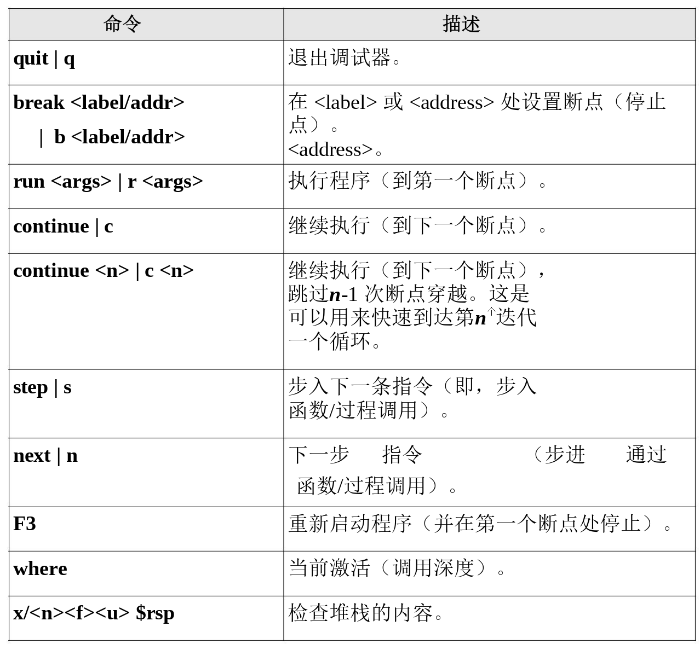

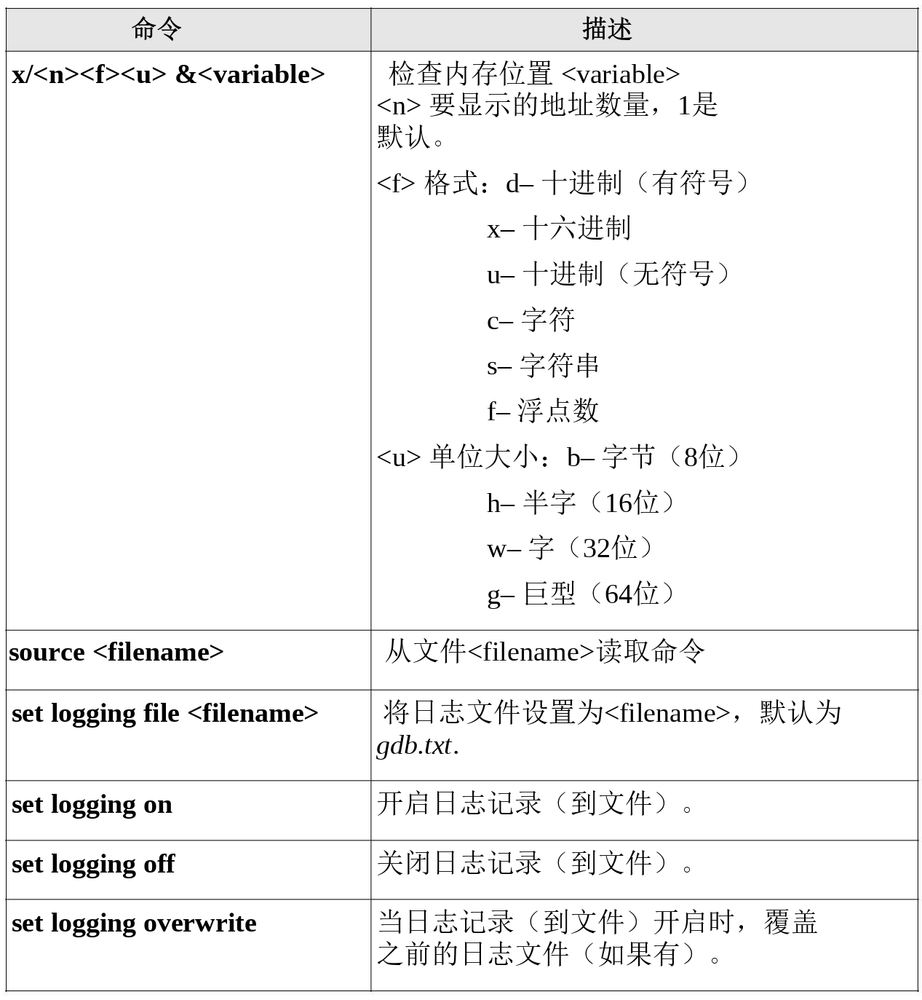

**译注：**

1. **列显示差异说明**：本节与 6.2.3 节关于寄存器窗口列的描述略有出入，实际 DDD 默认寄存器窗口为三列结构：左列为寄存器名，中列为十六进制值，右列为十进制值。右列十进制默认按**有符号 64 位整数**解析，因此当寄存器中存储无符号数据（如 `rsp` 栈指针值 `0xFFFFFFFFFFFFFFF0`）时，右列会显示为 `-16`，造成误解。建议查看地址类数据时直接参考中列的十六进制值即可。

2. **四字（Quadword）术语**：x86-64 架构中 64 位数据宽度被称为"四字"，对应汇编伪指令中的 `dq`（Define Quadword），与字节（8位）、字（16位）、双字（32位）共同构成 x86 数据宽度序列。

3. **浮点寄存器扩展**：勾选「All registers」后，除 x87 浮点栈寄存器（`st0`~`st7`）外，还会显示 SSE/AVX 寄存器（`xmm0`~`xmm15` 等），本书聚焦整数运算，因此默认不显示以减少干扰，调试浮点程序时再按需开启。

4. **命令缩写规则**：GDB 遵循「唯一前缀」缩写原则，只要缩写是某条命令的唯一前缀即可识别，无需死记硬背。常用缩写对照：

   | 完整命令         | 缩写  | 功能                 |
   | ---------------- | ----- | -------------------- |
   | `break`          | `b`   | 设置断点             |
   | `continue`       | `c`   | 继续执行到下一个断点 |
   | `step`           | `s`   | 单步步入             |
   | `next`           | `n`   | 单步跳过             |
   | `print`          | `p`   | 打印表达式值         |
   | `info registers` | `i r` | 查看寄存器内容       |
   | `quit`           | `q`   | 退出调试器           |

5. **窗口调整技巧**：若寄存器窗口内容被截断，除手动拖拽边框外，也可在 `(gdb)` 提示符后输入 `set width 0` 取消行宽限制，让内容自动换行显示。

##### **6.2.4.1 DDD/GDB命令示例**

更多命令详情可通过内置帮助系统获取，也可查阅第1章引用的DDD官方网站文档。

例如，给定以下数据定义：

```
bnum1  db  5              ; 字节型（8位）变量
wnum2  dw  -2000           ; 字型（16位）变量
dnum3  dd  100000          ; 双字型（32位）变量
qnum   dq  1234567890      ; 四字型（64位）变量
class  db  "Assembly", 0   ; 以NULL结尾的字符串（字节序列）
twopi  dd  6.28            ; 双字型浮点数
```

假设上述数据为**有符号类型**，对应的内存检查命令如下：

```
x/db &bnum1    ; 按字节、有符号十进制查看bnum1
x/dh &wnum2    ; 按半字（16位）、有符号十进制查看wnum2
x/dw &dnum3    ; 按字（32位）、有符号十进制查看dnum3
x/dg &qnum     ; 按四字（64位）、有符号十进制查看qnum
x/s &class     ; 按字符串格式查看class
x/f &twopi     ; 按浮点数格式查看twopi
```

如果使用了不匹配的内存查看命令（即数据尺寸错误），调试器**不会报错**，而是如实显示请求的内容（即便结果毫无意义）。查看变量时必须根据数据定义的类型选用对应的内存查看命令。更多显示选项可通过顶部菜单栏访问。

要在DDD中查看数组，需使用基础内存检查命令，格式如下：

```
x/<元素个数><显示格式><单位尺寸> &<变量名>
```

例如，假设有如下数组定义：

```
list1  dd  100001, -100002, 100003, 100004, 100005
```

对应的内存检查命令为：

```
x/5dw &list1
```

其中`5`为数组元素个数；`d`表示按**有符号十进制**显示（若需无符号则改用`u`）；`w`表示单位为32位字（对应源文件中`dd`（define double-word，定义双字）伪指令的宽度）；`&list1`为变量`list1`的地址。

注意：`&list1`指向数组的**首元素**（且仅指向首元素）。因此你可以指定显示少于或多于数组实际声明个数的元素。

基础内存检查命令也可直接搭配**内存地址**（而非变量名）使用。例如：

```
x/dw 0x600d44
```

由于地址通常以十六进制显示，因此直接输入十六进制地址时必须添加`0x`前缀，如上例所示。

#### **6.2.5 查看栈内容**

某些场景下查看栈内容非常有用。栈通常由**64位无符号元素**构成，查看时同样使用内存检查命令，但地址需取自`rsp`寄存器（而非变量名）。查看当前栈顶内容的命令如下：

```
x/ug $rsp
```

若要查看栈顶的6个元素，命令为：

```
x/6ug $rsp
```

受栈的实现方式限制，命令输出结果的第一个元素始终是当前栈顶值。

#### **6.2.6 交互式调试命令脚本**

由于内存显示命令必须严格正确输入，手动逐条输入颇为繁琐。此外如前文所述，命令参数错误时通常不会触发报错，极易造成困惑。为减少输入错误，可将正确的执行与显示命令预先存储在文本文件中，调试时直接让调试器从文件读取命令（无需手动输入）。虽然结果默认输出到屏幕，但也可重定向到输出文件中，便于后续复盘审查。

例如，典型的调试命令脚本可能包含设置断点、运行程序、显示变量值、将输出重定向到日志文件等操作，示例如下：（*原文此处示例未完整给出*）

```bash
#------------------------------------
#  Debugger Input Script
#------------------------------------
echo \n\n
break last
run
set pagination off
set logging file out.txt
set logging overwrite
set logging on
set prompt
echo ------------------------------------ \n
echo display variables \n
echo \n
x/100dw &list
x/dw &length
echo \n
x/dw &listMin
x/dw &listMid
x/dw &listMax
x/dw &listSum
x/dw &listAve
echo \n \n
set logging off
quit
```

Note 1：本示例假设源程序中已定义标号"last"（前文示例程序中已如此定义）。

Note 2：本示例会在执行完毕后退出调试器。若不需自动退出，可删除"quit"命令。通过命令文件退出时，调试器可能会请求用户确认是否退出（yes 或 no）。

上述命令应保存到一个文件中（如 gdbIn.txt），以便在调试器中从该文件读取并执行。

##### **6.2.6.1 非交互式调试器命令文件**

GDB 中读取命令文件的指令为 `source <文件名>`。例如，若命令文件名为 `gdbIn.txt`，则在 `(gdb)` 提示符后输入：

```
(gdb) source gdbIn.txt
```

按上述命令配置，调试输出将被写入 `out.txt` 文件，输出文件名可按需修改。

每个程序都需要根据自身定义的变量及其数据宽度定制对应的命令集。调试器命令文件仅在程序**基本可正常运行**（接近正常工作状态）时才有实用价值；若程序发生崩溃或其他严重错误，仍需通过交互式调试才能定位具体问题。

##### **6.2.6.2 非交互式调试器命令文件**

可以不启动交互式 DDD 会话而直接获取输出文件。在命令行中输入以下命令，即可对指定程序执行输入文件中的调试命令、生成输出文件并自动退出调试器：

```
gdb prog < gdbIn.txt
```

该命令会创建输出文件（输出文件名由 `gdbIn.txt` 内部指定），并在完成后退出调试器。一旦输入文件准备妥当，这是获取可正常运行程序的输出文件最快的方式。再次强调，该方式仅在程序能够正常运行或接近正常工作状态时才具备实用价值。

## **第7章 指令集概述**

本章简要介绍x86-64指令集的一个精简子集，重点关注整数运算相关指令。本部分仅涵盖本书涉及的主题与程序所需的指令子集，不包含部分高级指令及受限模式专用指令。如需处理器全部指令的完整清单，请参阅第1章所列的参考文献。

本书将按以下类别讲解指令：

- 数据传送类指令
- 转换类指令
- 算术类指令
- 逻辑类指令
- 控制类指令

函数调用相关指令将在第12章「函数」中专门讲解。本书涉及的所有指令的完整汇总表参见附录B，可供查阅。

### **7.1 符号约定**

本节总结了本文中使用的符号，这些符号在技术文献中相当常见。一般来说，一条指令将由指令或操作本身（即，add、sub、mul 等）和**操作数**组成。操作数指的是数据(要操作的）来自哪里和/或结果要放在哪里。

#### **7.1.1 操作数表示法**

下表汇总了本文档后续章节中使用的**操作数表示规范**，该规范与主流 x86‑64 指令集技术文献保持一致。

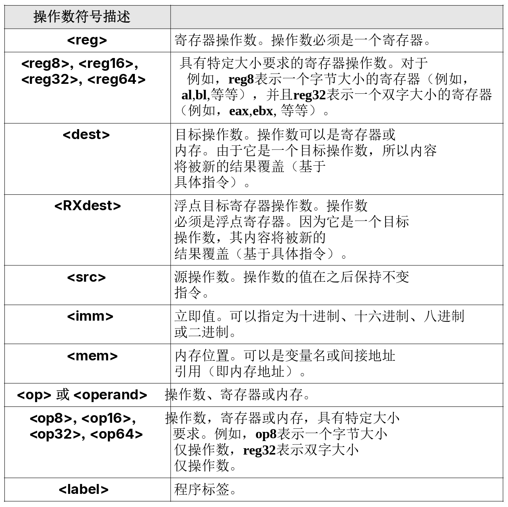

默认情况下，立即数值是十进制或以 10 为基数。十六进制或以 16 为基数可以使用立即数值，但必须在前面加上**0x** 以表明该值是十六进制。例如，15 可以用十六进制输入为**0x0F**。

有关内存单元与间接寻址的更多信息，请参阅第8章「寻址方式」。

### **7.2 数据传送**

通常，数据必须先从主存（RAM）载入CPU寄存器，方可参与运算。运算完成后，结果可从寄存器复制回变量中存储。前文示例程序中已出现多处执行此类操作的基础代码，这类基本数据传送操作即通过`mov`指令实现。

`mov`指令的一般形式如下：

```
mov <目的操作数>, <源操作数>
```

该指令将源操作数的值复制至目的操作数中，源操作数本身的值保持不变。目的操作数与源操作数的位宽必须一致（同为字节、字、双字等）。目的操作数不能为立即数，且两个操作数不能同时为内存操作数。若需执行内存到内存的数据传送，必须分两条指令完成。


当目的寄存器操作数位宽为**双字（32位）**、源操作数位宽也为双字时，对应四字（64位）寄存器的高位双字会被自动置零。该规则仅适用于目的操作数为32位整数寄存器的场景。

具体而言，若执行以下操作序列：

```asm
mov eax, 100      ; eax = 0x00000064
mov rcx, -1       ; rcx = 0xffffffffffffffff
mov ecx, eax      ; ecx = 0x00000064
```

初始时`rcx`被赋值为-1（即64位全为1）。当`eax`中的正数（100）被写入`rcx`时，该四字寄存器的高32位会被强制清零，覆盖上一条指令写入的全1值。

`mov`指令的核心规则总结如下：

| 指令                   | 解释                                                         |
| ---------------------- | ------------------------------------------------------------ |
| **mov  <dest>, <src>** | 功能：将源操作数复制至目的操作数。<br />说明：<br/>源操作数与目的操作数不可同时为内存操作数。<br/>目的操作数不可为立即数。<br/>若目的操作数与源操作数均为双字（32位），则对应四字寄存器的高32位将被自动清零。 |
| 例子                   | **说明：**mov   ax, 42<br/>mov   cl, byte [bvar]<br/>mov   dword [dVar], eax<br/>mov   qword [qVar], rdx |

本书涉及指令的完整汇总参见附录B。

例如，假设有如下数据定义：

```asm
dValue  dd  0          ; 双字变量，初始值0
bNum    db  42         ; 字节变量，初始值42
wNum    dw  5000       ; 字变量，初始值5000
dNum    dd  73000      ; 双字变量，初始值73000
qNum    dq  73000000   ; 四字变量，初始值73000000
bAns    db  0          ; 字节变量，用于存放结果
wAns    dw  0          ; 字变量，用于存放结果
dAns    dd  0          ; 双字变量，用于存放结果
qAns    dq  0          ; 四字变量，用于存放结果
```

若要实现以下基本赋值操作：

```c
dValue = 27;
bAns = bNum;
wAns = wNum;
dAns = dNum;
qAns = qNum;
```

可使用如下指令序列：

```asm
mov dword [dValue], 27     ; dValue = 27
mov al, byte [bNum]        ; 将bNum的值读入8位寄存器al
mov byte [bAns], al        ; 将al的值写入bAns
mov ax, word [wNum]        ; 将wNum的值读入16位寄存器ax
mov word [wAns], ax        ; 将ax的值写入wAns
mov eax, dword [dNum]      ; 将dNum的值读入32位寄存器eax
mov dword [dAns], eax      ; 将eax的值写入dAns
mov rax, qword [qNum]      ; 将qNum的值读入64位寄存器rax
mov qword [qAns], rax      ; 将rax的值写入qAns
```

对于上述部分指令，当另一操作数的位宽已能明确界定数据尺寸时，可省略显式类型说明符（如`byte`、`word`、`dword`、`qword`）。但本书为保持代码一致性及遵循良好编程规范，仍会在示例中显式标注。

###  **7.3 地址与值**

访问内存的唯一方式是使用方括号（`[]`）。若省略方括号，则不会访问内存内容，而是获取对应符号的地址。例如：

```asm
mov  rax, qword [var1]    ; rax中存放var1的内存值（取内容）
mov  rax, var1            ; rax中存放var1的内存地址（取地址）
```

由于省略方括号并非语法错误，汇编器不会生成任何报错或警告，极易引发隐蔽的逻辑错误。

此外，可通过**加载有效地址（lea, Load Effective Address）**指令获取变量的地址。lea指令的核心功能总结如下：

| **指令**             | **说明**                                                 |
| :------------------- | :------------------------------------------------------- |
| `lea <reg64>, <mem>` | 将`<mem>`对应的内存有效地址存入64位通用寄存器`<reg64>`。 |

示例：

```asm
lea   rcx, byte [bvar]    ; 将字节变量bvar的内存地址存入rcx寄存器
lea   rsi, dword [dVar]   ; 将双字变量dVar的内存地址存入rsi寄存器
```

------

###  **7.4 转换类指令**

实际开发中时常需要将数据从一种位宽转换为另一种位宽，例如公式运算中可能需要将字节型数据转换为双字型以参与计算。转换方式取决于操作数的位宽与数据类型（有符号/无符号），具体规则将在后续小节中说明。

本书涉及指令的完整汇总参见附录B。关于寻址方式的更多细节与大量示例，请参考第8章「寻址方式」。

#### **7.4.1 窄化转换**

窄化转换指将大数据类型转换为小数据类型（如16位字型转8位字节型、32位双字型转16位字型）。

窄化转换无需专用指令，可直接访问内存单元或寄存器的低序位部分。例如，若将数值50（0x32）存入rax寄存器，可直接访问其低8位子寄存器al来获取该值：

```asm
mov rax, 50
mov byte [bVal], al    ; 将al的值存入字节变量bVal
```

本例中数值50可容纳于8位字节空间，因此转换合理。但若将数值500（0x1f4）存入rax寄存器后，仍可访问al子寄存器：

```asm
mov rax, 500
mov byte [bVal], al    ; bVal最终值为0xf4
```

此时bVal变量的值为0xf4（十进制244），会导致运算结果错误。窄化转换的正确性完全由程序员自行保证，与高级语言编译器不同，汇编器不会对此类潜在溢出生成警告或报错信息。

#### **7.4.2 宽化转换**

宽化转换指从小数据类型转换为大数据类型（如8位字节型转16位字型、16位字型转32位双字型）。由于位宽扩大，新增的高序位必须根据原始值的符号属性进行填充。因此必须明确数据的有符号/无符号类型，并选用对应的处理逻辑或指令。

##### **7.4.2.1 无符号数宽化转换**

无符号数执行宽化转换时，内存单元或寄存器的高序位必须全部清零。由于无符号数恒为非负值，其高序位只能为0。例如，要将`al`寄存器中的字节值50转换为`rbx`中的四字值，可执行如下操作：

```asm
mov al, 50        ; al = 0x32（50的8位表示）
mov rbx, 0        ; rbx清零
mov bl, al        ; 将al的值写入rbx的低8位bl
```

由于`rbx`已预先清零，仅低8位被赋值为`al`中的50，因此整个64位`rbx`寄存器的值即为50。

该通用流程同样适用于内存单元或其他寄存器场景，但程序员需自行确保数值与目标位宽的适配性。

无符号数从小位宽向大位宽的转换也可通过专用传送指令实现，格式如下：

```
movzx <目的操作数>, <源操作数>
```

该指令会自动将高序位补零。`movzx`不支持**64位目的操作数搭配32位源操作数**的组合——正如前文所述，当`mov`指令的目的操作数为32位寄存器、源操作数也为32位时，所属64位寄存器的高32位会自动清零，无需额外指令。

无符号宽化转换指令的汇总说明如下：

| 指令                  | 说明                                                         |
| --------------------- | ------------------------------------------------------------ |
| `movzx <dest>, <src>` | 无符号宽化转换。 注1：两个操作数不能同为内存操作数。 注2：目的操作数不能是立即数。 注3：不允许使用立即数作为源操作数。 |
| `movzx reg16, op8`    | 8位源操作数零扩展为16位存入目的寄存器                        |
| `movzx reg32, op8`    | 8位源操作数零扩展为32位存入目的寄存器                        |
| `movzx reg32, op16`   | 16位源操作数零扩展为32位存入目的寄存器                       |
| `movzx reg64, op8`    | 8位源操作数零扩展为64位存入目的寄存器                        |
| `movzx reg64, op16`   | 16位源操作数零扩展为64位存入目的寄存器                       |

示例：

```asm
movzx cx, byte [bVar]    ; 字节变量bVar零扩展为16位存入cx
movzx dx, al             ; al零扩展为16位存入dx
movzx ebx, word [wVar]   ; 字变量wVar零扩展为32位存入ebx
movzx ebx, cx            ; cx零扩展为32位存入ebx
movzx rbx, cl            ; cl零扩展为64位存入rbx
movzx rbx, cx            ; cx零扩展为64位存入rbx
```

本书涉及指令的完整汇总参见附录B。

------

##### **7.4.2.2 有符号数宽化转换**

有符号数执行宽化转换时，高序位必须根据原始值的符号填充为0或1，即执行**符号扩展操作**：原始值的最高有效位（符号位）若为0表示正值，高序位全部补0；若为1表示负值，高序位全部补1。

例如，若`ax`寄存器被赋值为-7（十六进制`0xfff9`），其位扩展结果如下：

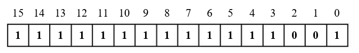

由于原始值为负数，其最高有效位（第15位）为1。要将`ax`寄存器中的16位字型值转换为`eax`寄存器中的32位双字值，需将最高位（本例中为1）**扩展**并复制至高序字的所有位（第31~16位），最终结果如下：

```
ax  = 0xfff9                     ; 16位，-7
eax = 0xffff fff9                ; 32位，-7（高16位全部补1）
```

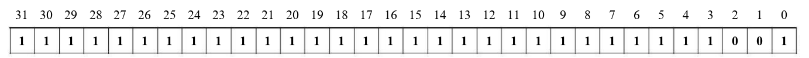

------

x86架构提供了一系列专用指令，用于将**累加器（A寄存器，即`ax`/`eax`/`rax`）**中的有符号值从小位宽扩展为大位宽。这类指令仅作用于累加器，部分指令会使用**数据寄存器（D寄存器，即`dx`/`edx`/`rdx`）**存储结果。例如，`cwd`指令会将`ax`中的16位有符号值扩展为32位值：高16位存入`dx`，低16位保留在`ax`中，按惯例将该32位拼接结果记为`dx:ax`。`cwde`指令则直接将`ax`中的16位有符号值符号扩展为32位值并存入`eax`。

除专用指令外，也可通过以下通用符号扩展传送指令实现小位宽到有符号大位宽的转换：

```
movsx  <dest>, <src>
movsxd <dest>, <src>
```

上述指令会对源操作数执行符号扩展后写入目的操作数。其中`movsx`为通用形式；`movsxd`是64位模式新增的专用变体，用于支持**32位源操作数扩展为64位目的操作数**的场景——因64位模式下向32位寄存器写入时会自动触发零扩展，有符号扩展需单独指令实现。

有符号宽化转换指令的汇总说明如下：

有符号宽化转换指令汇总

| 指令   | 说明                                                         |
| ------ | ------------------------------------------------------------ |
| `cbw`  | 将`al`中的8位字节值符号扩展为`ax`中的16位字值。 注：仅支持`al`到`ax`寄存器的转换。 示例：`cbw` |
| `cwd`  | 将`ax`中的16位字值符号扩展为`dx:ax`拼接形式的32位双字值（`dx`存高16位，`ax`存低16位）。 注：仅支持`ax`到`dx:ax`的转换。 示例：`cwd` |
| `cwde` | 将`ax`中的16位字值符号扩展为`eax`中的32位双字值。 注：仅支持`ax`到`eax`寄存器的转换。 示例：`cwde` |
| `cdq`  | 将`eax`中的32位双字值符号扩展为`edx:eax`拼接形式的64位四字值（`edx`存高32位，`eax`存低32位）。 注：仅支持`eax`到`edx:eax`的转换。 示例：`cdq` |
| `cdqe` | 将`eax`中的32位双字值符号扩展为`rax`中的64位四字值。 注：仅支持`eax`到`rax`寄存器的转换。 示例：`cdqe` |
| `cqo`  | 将`rax`中的64位四字值符号扩展为`rdx:rax`拼接形式的128位双四字值（`rdx`存高64位，`rax`存低64位）。 注：仅支持`rax`到`rdx:rax`的转换。 示例：`cqo` |


| 指令                     | 说明                                                         |
| ------------------------ | ------------------------------------------------------------ |
| `movsx <dest>, <src>`    | 带符号扩展的宽化传送（通用形式）。 注1：两个操作数不能同时为内存操作数。 注2：目的操作数不能为立即数。 注3：源操作数不能为立即数。 注4：32位源操作数扩展到64位目的操作数时需使用专用指令`movsxd`。 |
| `movsx <reg16>, <op8>`   | 8位源操作数符号扩展为16位存入目的寄存器                      |
| `movsx <reg32>, <op8>`   | 8位源操作数符号扩展为32位存入目的寄存器                      |
| `movsx <reg32>, <op16>`  | 16位源操作数符号扩展为32位存入目的寄存器                     |
| `movsx <reg64>, <op8>`   | 8位源操作数符号扩展为64位存入目的寄存器                      |
| `movsx <reg64>, <op16>`  | 16位源操作数符号扩展为64位存入目的寄存器                     |
| `movsxd <reg64>, <op32>` | 32位源操作数符号扩展为64位存入目的寄存器                     |

示例：

```asm
movsx cx, byte [bVar]      ; 字节变量bVar符号扩展为16位存入cx
movsx dx, al               ; al符号扩展为16位存入dx
movsx ebx, word [wVar]     ; 字变量wVar符号扩展为32位存入ebx
movsx ebx, cx              ; cx符号扩展为32位存入ebx
movsxd rbx, dword [dVar]   ; 双字变量dVar符号扩展为64位存入rbx
```

本书涉及指令的完整汇总参见附录B。

### 7.5 整数算术指令

整数算术指令用于对整数值执行加、减、乘、除等运算。后续小节将逐一介绍基础整数算术操作。

#### 7.5.1 加法

整数加法指令的一般形式如下：

```
add <目的操作数>, <源操作数>
```

该指令执行以下运算：

```
<目的操作数> = <目的操作数> + <源操作数>
```

即源操作数与目的操作数相加，结果写回目的操作数。

结果将写回**目的操作数**（覆盖其原有内容），而**源操作数的值保持不变**。目的操作数与源操作数的位宽必须一致（同为字节、字、双字等）。目的操作数不能为立即数，且两个操作数不能同时为内存操作数。若需执行内存到内存的加法，必须通过两条指令完成。

例如，假设有以下数据定义：

```asm
bNum1  db  42          ; 字节变量
bNum2  db  73
bAns   db  0
wNum1  dw  4321        ; 字变量
wNum2  dw  1234
wAns   dw  0
dNum1  dd  42000       ; 双字变量
dNum2  dd  73000
dAns   dd  0
qNum1  dq  42000000    ; 四字变量
qNum2  dq  73000000
qAns   dq  0
```

若要实现以下基本运算：

```c
bAns = bNum1 + bNum2;
wAns = wNum1 + wNum2;
dAns = dNum1 + dNum2;
qAns = qNum1 + qNum2;
```

可使用如下指令：

```asm
; bAns = bNum1 + bNum2
mov  al, byte [bNum1]
add  al, byte [bNum2]
mov  byte [bAns], al

; wAns = wNum1 + wNum2
mov  ax, word [wNum1]
add  ax, word [wNum2]
mov  word [wAns], ax

; dAns = dNum1 + dNum2
mov  eax, dword [dNum1]
add  eax, dword [dNum2]
mov  dword [dAns], eax

; qAns = qNum1 + qNum2
mov  rax, qword [qNum1]
add  rax, qword [qNum2]
mov  qword [qAns], rax
```

对于上述部分指令，当另一操作数的位宽已能明确界定数据尺寸时，可省略显式类型说明符（如`byte`、`word`、`dword`、`qword`）。但本书为保持代码一致性及遵循良好编程规范，仍会在示例中显式标注。

除基础`add`指令外，还存在**自增指令（`inc`）**，用于将指定操作数的值加1。其一般形式如下：

```
inc <操作数>
```

执行操作为：

```
<操作数> = <操作数> + 1
```

其功能等效于使用`add`指令加1。当操作数为内存单元时，**必须**显式指定类型说明符以明确数据位宽。

例如，假设有以下数据定义：

```asm
bNum  db  42
wNum  dw  4321
dNum  dd  42000
qNum  dq  42000000
```

若要实现以下运算：

```c
rax = rax + 1;
bNum = bNum + 1;
wNum = wNum + 1;
dNum = dNum + 1;
qNum = qNum + 1;
```

可使用如下指令：

```asm
inc  rax                  ; rax = rax + 1
inc  byte [bNum]          ; bNum = bNum + 1
inc  word [wNum]          ; wNum = wNum + 1
inc  dword [dNum]         ; dNum = dNum + 1
inc  qword [qNum]         ; qNum = qNum + 1
```

加法指令对**有符号和无符号数据的操作方式完全相同**。程序员有责任确保数据类型与位宽符合运算要求。

整数加法指令汇总如下：

整数加法指令汇总

| 指令                | 说明                                                         |
| ------------------- | ------------------------------------------------------------ |
| `add <dest>, <src>` | 将源操作数与目的操作数相加，结果写回目的操作数（覆盖原有值）。 注1：两个操作数不能同时为内存操作数。 注2：目的操作数不能为立即数。 |
| 示例                | `add cx, word [wVar]` ; 16位内存值与cx相加，结果存cx `add rax, 42`    ; rax加立即数42，结果存rax `add dword [dVar], eax` ; eax与32位内存值相加，结果写回内存 `add qword [qVar], 300` ; 立即数300与64位内存值相加，结果写回内存 |
| `inc <operand>`     | 将操作数的值加1。 注：操作数不能为立即数。                   |
| 示例                | `inc word [wVar]` ; 16位内存值加1 `inc rax`    ; rax寄存器加1 `inc dword [dVar]` ; 32位内存值加1 `inc qword [qVar]` ; 64位内存值加1 |

本书涉及指令的完整汇总参见附录B。

##### 7.5.1.1 带进位加法

带进位加法是一种特殊的加法指令，会将前一次加法运算产生的**进位标志（CF）**纳入计算。该指令在运算超大整数（即超过机器寄存器位宽的整数）时非常有用。

带进位的加法是计算机算术中的标准操作。例如，考虑如下运算：

   **17**

**+ 25**

**-------**

  **42**

回想一下小学加法的计算过程：先计算最低位的两个数字（7和5），得到12，个位写2并向十位进1；再计算最高位的两个数字（1和2），加上之前产生的进位1，最终得到4。

因此，完成一次完整的多精度加法需要两条加法指令。由于最低位部分不存在来自更低位的进位，可直接使用普通`add`指令；而更高位的加法需要纳入前一次运算产生的进位，必须使用**带进位加法指令**。此外，带进位加法指令必须紧跟在首次加法指令之后执行，确保没有其他无关指令修改rFlag寄存器中的进位标志位（CF），导致进位值被破坏。

对于汇编程序而言，多精度加法通常按以下方式实现：先用`add`指令相加**最低有效四字（LSQ, Least Significant Quadword）**，紧接着用`adc`指令相加**最高有效四字（MSQ, Most Significant Quadword）**——`adc`会在四字相加的同时，纳入前一次加法产生的进位值。

`adc`指令的一般形式如下：

```
adc <dest>, <src>
```

该指令执行以下运算：

```
<dest> = <dest> + <src> + <进位位carryBit>
```

具体而言，`adc`会将源操作数、目的操作数的当前值，以及rFlag寄存器中的进位标志位（CF）三者相加，结果写回目的操作数（覆盖原有内容）。源操作数的值保持不变。目的操作数与源操作数的位宽必须一致（同为字节、字、双字或四字等）。目的操作数不能为立即数，且两个操作数不能同时为内存操作数。若需执行内存到内存的带进位加法，必须通过两条指令完成。

例如，给定如下数据定义：

```asm
dquad1  ddq  0x1A000000000000000   ; 128位变量（双四字）
dquad2  ddq  0x2C000000000000000   ; 128位变量
dqSum   ddq  0                     ; 128位变量，用于存放求和结果
```

变量`dquad1`、`dquad2`和`dqSum`均为128位，超过了机器64位寄存器的位宽上限。因此需要用两个64位寄存器拼接表示一个128位值，加载时需分别用两条传送指令处理高低两个64位部分。例如：

```asm
mov rax, qword [dquad1]      ; 将dquad1的最低有效64位（LSQ）载入rax
mov rdx, qword [dquad1+8]    ; 将dquad1的最高有效64位（MSQ）载入rdx
```

第一条指令将128位变量`dquad1`的低64位载入`rax`；第二条指令在`dquad1`的起始地址上加8字节偏移，跳过已加载的低64位，将高64位载入`rdx`（64位数据占8字节，因此偏移量为8）。

若先对两个128位值的低64位求和，再对高64位求和并纳入低位的进位，即可得到正确的128位结果。完整加法代码如下：

```asm
mov rax, qword [dquad1]          ; 加载dquad1的低64位到rax
mov rdx, qword [dquad1+8]        ; 加载dquad1的高64位到rdx
add rax, qword [dquad2]          ; 低64位相加，结果存rax，进位存入CF
adc rdx, qword [dquad2+8]        ; 高64位相加，同时纳入CF中的进位，结果存rdx
mov qword [dqSum], rax           ; 将结果低64位写回dqSum
mov qword [dqSum+8], rdx         ; 将结果高64位写回dqSum
```

执行流程为：首先将`dquad1`的低64位（LSQ）存入`rax`、高64位（MSQ）存入`rdx`；随后`add`指令将`rax`与`dquad2`的低64位相加，本例中运算结果产生进位1，并存放在进位标志位CF中；接着`adc`指令将`rdx`与`dquad2`的高64位相加，同时纳入CF中的进位，结果存入`rdx`。

带进位整数加法指令的汇总说明如下：

带进位加法指令汇总

| 指令                | 说明                                                         |
| ------------------- | ------------------------------------------------------------ |
| `adc <dest>, <src>` | 将源操作数、目的操作数与进位标志位CF三者相加，结果写回目的操作数（覆盖原有值）。 注1：两个操作数不能同时为内存操作数。 注2：目的操作数不能为立即数。 注3：源操作数可为立即数、寄存器或内存单元。 |
| 示例                | `adc cx, word [wVar]` ; 16位内存值 + cx + CF，结果存cx `adc rax, 42`    ; rax + 42 + CF，结果存rax `adc dword [dVar], eax` ; eax + 32位内存值 + CF，结果写回内存 `adc qword [qVar], 300` ; 300 + 64位内存值 + CF，结果写回内存 |

本书涉及指令的完整汇总参见附录B。

| **指令**            | **说明**                                                     |
| :------------------ | :----------------------------------------------------------- |
| `adc <dest>, <src>` | 将源操作数、目的操作数与先前产生的进位（存储在rFlag寄存器的进位标志位中）三者相加，结果写回目的操作数（覆盖原有值）。 注1：两个操作数不能同时为内存操作数。 注2：目的操作数不能为立即数。 |
| 示例                | `adc rcx, qword [dVvar1]` ; rcx + 64位内存值 + CF，结果存rcx `adc rax, 42`     ; rax + 42 + CF，结果存rax |

本书涉及指令的完整汇总参见附录B。

#### 7.5.2 减法

整数减法指令的一般形式如下：

```
sub <dest>, <src>
```

该指令执行以下运算：

```
<dest> = <dest> - <src>
```

具体而言，从目的操作数中减去源操作数，结果写回目的操作数（覆盖原有内容）。源操作数的值保持不变。目的操作数与源操作数的位宽必须一致（同为字节、字、双字或四字等）。目的操作数不能为立即数，且两个操作数不能同时为内存操作数。若需执行内存到内存的减法运算，必须通过两条指令完成。

例如，假设有以下数据定义：

```asm
bNum1  db  73          ; 字节变量
bNum2  db  42
bAns   db  0
wNum1  dw  1234        ; 字变量
wNum2  dw  4321
wAns   dw  0
dNum1  dd  73000       ; 双字变量
dNum2  dd  42000
dAns   dd  0
qNum1  dq  73000000    ; 四字变量
qNum2  dq  73000000
qAns   dq  0           ; 原文此处误写为`dd 0`，已修正为四字类型
```

若要实现以下基本减法运算：

```c
bAns = bNum1 - bNum2;
wAns = wNum1 - wNum2;
dAns = dNum1 - dNum2;
qAns = qNum1 - qNum2;
```

可使用如下汇编指令：

```asm
; bAns = bNum1 - bNum2
mov  al, byte [bNum1]
sub  al, byte [bNum2]
mov  byte [bAns], al

; wAns = wNum1 - wNum2
mov  ax, word [wNum1]
sub  ax, word [wNum2]
mov  word [wAns], ax

; dAns = dNum1 - dNum2
mov  eax, dword [dNum1]
sub  eax, dword [dNum2]
mov  dword [dAns], eax

; qAns = qNum1 - qNum2
mov  rax, qword [qNum1]
sub  rax, qword [qNum2]
mov  qword [qAns], rax
```

对于上述部分指令，当另一操作数的位宽已能明确界定数据尺寸时，可省略显式类型说明符（如`byte`、`word`、`dword`、`qword`）。但本书为保持代码一致性及遵循良好编程规范，仍会在示例中显式标注。

除基础`sub`减法指令外，还存在**自减指令（`dec`）**，用于将指定操作数的值减1。其一般形式如下：

```
dec <操作数>
```

该指令执行以下运算：

```
<操作数> = <操作数> - 1
```

其功能等效于使用`sub`指令减1。当操作数为内存单元时，**必须**显式指定类型说明符以明确数据位宽。

例如，假设有以下数据定义：

```asm
bNum  db  42          ; 字节变量
wNum  dw  4321        ; 字变量
dNum  dd  42000       ; 双字变量
qNum  dq  42000000    ; 四字变量
```

若要实现以下运算：

```c
rax = rax - 1;
bNum = bNum - 1;
wNum = wNum - 1;
dNum = dNum - 1;
qNum = qNum - 1;
```

可使用如下指令：

```asm
dec  rax                  ; rax = rax - 1
dec  byte [bNum]          ; bNum = bNum - 1
dec  word [wNum]          ; wNum = wNum - 1
dec  dword [dNum]         ; dNum = dNum - 1
dec  qword [qNum]         ; qNum = qNum - 1
```

减法指令对**有符号和无符号数据的操作方式完全相同**。程序员有责任确保数据类型与位宽符合运算要求。

整数减法指令汇总

| 指令                | 说明                                                         |
| ------------------- | ------------------------------------------------------------ |
| `sub <dest>, <src>` | 从目的操作数中减去源操作数，结果写回目的操作数（覆盖原有值）。 注1：两个操作数不能同时为内存操作数。 注2：目的操作数不能为立即数。 |
| 示例                | `sub cx, word [wVar]` ; cx减去16位内存值，结果存cx `sub rax, 42`    ; rax减去立即数42，结果存rax `sub dword [dVar], eax` ; 32位内存值减去eax，结果写回内存 `sub qword [qVar], 300` ; 64位内存值减去立即数300，结果写回内存 |
| `dec <operand>`     | 将操作数的值减1。 注：操作数不能为立即数。                   |
| 示例                | `dec word [wVar]` ; 16位内存值减1 `dec rax`    ; rax寄存器减1 `dec dword [dVar]` ; 32位内存值减1 `dec qword [qVar]` ; 64位内存值减1 |

本书涉及指令的完整汇总参见附录B。

| **指令**            | **说明**                                                     |
| :------------------ | :----------------------------------------------------------- |
| `sub <dest>, <src>` | 从目的操作数中减去源操作数，结果写回目的操作数（覆盖原有值）。 注1：两个操作数不能同时为内存操作数。 注2：目的操作数不能为立即数。 |
| 示例                | `sub cx, word [wVar]` ; cx减去16位内存值wVar，结果存cx `sub rax, 42`    ; rax减去立即数42，结果存rax `sub dword [dVar], eax` ; 32位内存值dVar减去eax，结果写回dVar `sub qword [qVar], 300` ; 64位内存值qVar减去立即数300，结果写回qVar |
| `dec <operand>`     | 将操作数的值减1。 注：操作数不能为立即数。                   |
| 示例                | `dec word [wVar]` ; 16位内存值wVar减1 `dec rax`    ; rax寄存器减1 `dec dword [dVar]` ; 32位内存值dVar减1 `dec qword [qVar]` ; 64位内存值qVar减1 |

本书涉及指令的完整汇总参见附录B。

#### 7.5.3 整数乘法

乘法指令用于将两个整数操作数相乘。从数学逻辑上讲，有符号数的乘法运算有特殊规则，因此无符号乘法（`mul`）和有符号乘法（`imul`）使用不同的指令实现。

乘法运算通常产生**双倍位宽**的结果：即两个n位操作数相乘，会得到2n位的结果。例如两个8位数相乘得到16位结果；两个16位数相乘得到32位结果；两个32位数相乘得到64位结果；两个64位数相乘得到128位结果。

乘法指令存在多种变体。对于有符号乘法（`imul`），部分形式的指令会将结果截断至原操作数的位宽。程序员需自行确保所用数据值适配所选指令的要求。

##### 7.5.3.1 无符号乘法

无符号乘法指令的一般形式如下：

```
mul <src>
```

其中源操作数必须是寄存器或内存单元，**不允许使用立即数**。

对于这种单操作数形式的乘法指令，其中一个操作数必须存放在**累加器（A寄存器）**中：8位乘法用`al`，16位乘法用`ax`，32位乘法用`eax`，64位乘法用`rax`。另一个操作数可以是寄存器或内存单元，但不能是立即数。

此外，乘法结果会根据操作数的位宽存放在累加器和（必要时）数据寄存器（D寄存器）中。下表展示了字节、字、双字、四字无符号乘法的不同存放规则：

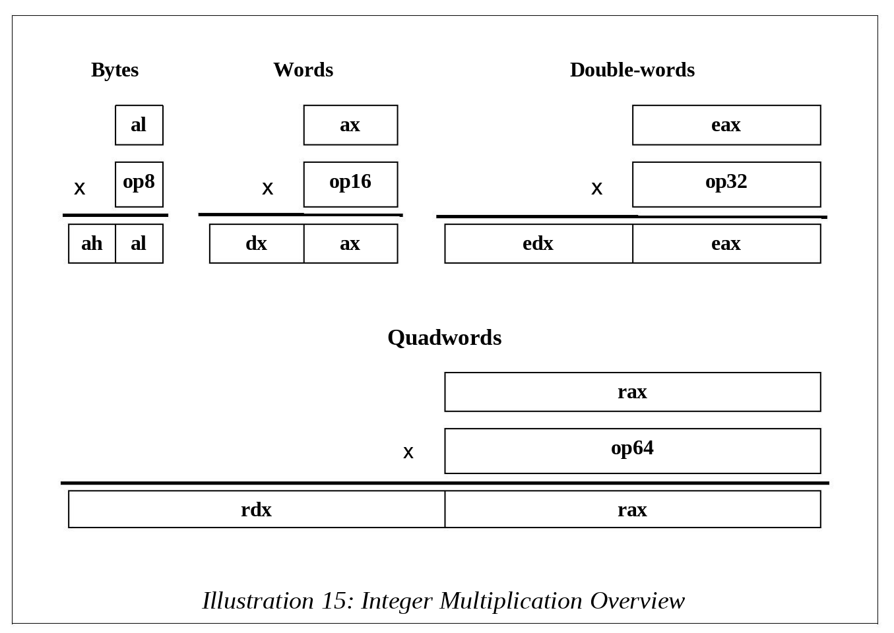

如表格所示，大多数情况下整数乘法指令会同时使用**累加器（A寄存器）**和**数据寄存器（D寄存器）**存储运算结果，这一点极易造成困惑。

例如，当`rax`（64位）与另一个四字操作数（64位）相乘时，乘法指令会产生**双四字（128位）**结果。这在处理超大规模整数时非常实用。由于64位架构的通用寄存器最大位宽为64位，128位的结果必须拆分存储到两个不同的四字寄存器中：高64位存入`rdx`，低64位存入`rax`，按惯例记为`rdx:rax`。

然而这种双寄存器存储模式同样适用于更小位宽的乘法。例如`ax`（16位）与另一个字操作数（16位）相乘，得到32位双字结果，但该结果并不会存放在更易用的`eax`中，而是拆分存储到`dx`（高16位）和`ax`（低16位）中，按惯例记为`dx:ax`。由于32位结果分散在两个寄存器中，保存时通常需要两条传送指令。这种即使在非必要场景下仍绑定双寄存器的设计，是为了兼容早期x86架构的遗留行为——虽然保证了向后兼容性，但也增加了学习成本。

例如，假设有以下数据定义（原文存在排版错乱，已根据后续运算式修正）：

```asm
bNumA  db  42              ; 8位字节变量
bNumB  db  73              ; 8位字节变量
wAns   dw  0               ; 16位字变量，存放bNumA的平方
bAns1  db  0               ; 8位字节变量，存放bNumA*bNumB的低8位
wAns1  dw  0               ; 16位字变量，存放bNumA*bNumB的完整16位结果
wNumA  dw  4321            ; 16位字变量
wNumB  dw  1234            ; 16位字变量
dAns2  dd  0               ; 32位双字变量，存放wNumA*wNumB的完整32位结果
dNumA  dd  42000           ; 32位双字变量
dNumB  dd  73000           ; 32位双字变量
qAns3  dq  0               ; 64位四字变量，存放dNumA*dNumB的低64位
dAns3  dd  0               ; 32位双字变量，存放dNumA*dNumB的低32位
qNumA  dq  420000          ; 64位四字变量
qNumB  dq  730000          ; 64位四字变量
dqAns4 ddq 0               ; 128位双四字变量，存放qNumA*qNumB的完整128位结果
```

若要实现以下基本乘法运算：

```c
wAns   = bNumA²;                  // bNumA的平方
bAns1  = bNumA * bNumB;          // 仅取8位乘积
wAns1  = bNumA * bNumB;          // 取完整16位乘积
wAns2  = wNumA * wNumB;          // 原文笔误，实际为dAns2的赋值
dAns2  = wNumA * wNumB;
dAns3  = dNumA * dNumB;          // 仅取低32位乘积
qAns3  = dNumA * dNumB;          // 取完整64位乘积
qAns4  = qNumA * qNumB;          // 原文笔误，实际为dqAns4的赋值
dqAns4 = qNumA * qNumB;          // 取完整128位乘积
```

可使用如下指令：

```asm
; wAns = bNumA²（bNumA的平方）
mov  al, byte [bNumA]     ; 被乘数放入al（隐含操作数）
mul  al                   ; 8位乘法，结果存ax（16位）
mov  word [wAns], ax      ; 保存16位结果到wAns

; wAns1 = bNumA * bNumB
mov  al, byte [bNumA]     ; 被乘数放入al
mul  byte [bNumB]         ; 8位乘法，结果存ax
mov  word [wAns1], ax     ; 保存完整16位结果
; 若仅需低8位，可直接 mov byte [bAns1], al

; dAns2 = wNumA * wNumB
mov  ax, word [wNumA]     ; 被乘数放入ax
mul  word [wNumB]         ; 16位乘法，结果存dx:ax（32位）
mov  word [dAns2], ax     ; 保存低16位到dAns2
mov  word [dAns2+2], dx   ; 保存高16位到dAns2+2（+2是因为字占2字节）

; qAns3 = dNumA * dNumB
mov  eax, dword [dNumA]   ; 被乘数放入eax
mul  dword [dNumB]        ; 32位乘法，结果存edx:eax（64位）
mov  dword [qAns3], eax   ; 保存低32位到qAns3
mov  dword [qAns3+4], edx ; 保存高32位到qAns3+4（+4是因为双字占4字节）
; 若仅需低32位，可直接 mov dword [dAns3], eax

; dqAns4 = qNumA * qNumB
mov  rax, qword [qNumA]   ; 被乘数放入rax
mul  qword [qNumB]        ; 64位乘法，结果存rdx:rax（128位）
mov  qword [dqAns4], rax  ; 保存低64位到dqAns4
mov  qword [dqAns4+8], rdx; 保存高64位到dqAns4+8（+8是因为四字占8字节）
```

对于上述部分指令，**必须**显式指定类型说明符（如`byte`、`word`、`dword`、`qword`）以明确操作数尺寸。

无符号整数乘法指令的汇总说明如下：

无符号乘法指令（`mul`）汇总

| 指令        | 说明                                                         |
| ----------- | ------------------------------------------------------------ |
| `mul <src>` | 将隐含的累加器操作数与源操作数相乘，双倍位宽结果存入约定的寄存器对。 注1：源操作数必须是寄存器或内存单元，**不允许为立即数**。 注2：累加器由操作数位宽决定：8位用`al`，16位用`ax`，32位用`eax`，64位用`rax`。 注3：结果存放位置： • 8位乘法→`ax`（16位） • 16位乘法→`dx:ax`（32位） • 32位乘法→`edx:eax`（64位） • 64位乘法→`rdx:rax`（128位） |
| 示例        | `mul bl`     ; al × bl，结果存ax `mul word [wVar]` ; ax × 16位内存值，结果存dx:ax `mul dword [dVar]` ; eax × 32位内存值，结果存edx:eax `mul qword [qVar]` ; rax × 64位内存值，结果存rdx:rax |

本书涉及指令的完整汇总参见附录B。


------

### 7.5.3.2 有符号乘法

有符号乘法指令支持更灵活的操作数组合与位宽。其一般形式如下：

```
imul <源操作数>                    ; 单操作数形式
imul <目的操作数>, <源操作数/立即数>   ; 双操作数形式
imul <目的操作数>, <源操作数>, <立即数> ; 三操作数形式
```

在所有形式中，**目的操作数必须是寄存器**。双操作数和三操作数形式的`imul`**不支持字节（8位）操作数**。

**单操作数形式**：布局与无符号`mul`指令完全相同（结果存放于约定的寄存器对中），但操作数被解释为**有符号数**。

**双操作数形式**：将目的操作数与源操作数（或立即数）相乘，结果截断后写回目的操作数：

```
<目的操作数> = <目的操作数> × <源操作数/立即数>
```

源操作数/立即数可以是寄存器、内存单元或立即数。立即数的位宽受限于源操作数的位宽，**最大不超过双字（32位）**，即便是在四字（64位）乘法中也是如此。最终结果会被**截断**为目的操作数的位宽。字节型目的操作数不被支持。

**三操作数形式**：将两个源操作数相乘，结果截断后写入目的操作数：

```
<目的操作数> = <源操作数> × <立即数>
```

其中源操作数必须是寄存器或内存单元（不能是立即数），立即数必须是立即数值。立即数的位宽同样受限于源操作数位宽，**最大不超过双字（32位）**，即便是在四字乘法中。最终结果被截断为目的操作数的位宽。字节型目的操作数不被支持。

> **注意**：当乘法指令产生双倍位宽结果时，程序员可以选择只使用低半部分（即原操作数位宽）。这要求乘积必须能容纳于较小的位宽内，从而限制了数据范围。例如，两个双字相乘产生四字结果时，若数值足够小，四字结果的低双字部分就包含了正确答案——这正是高级语言中`int × int → int`赋值时的典型行为。

例如，假设有以下数据定义：

```asm
wNumA  dw  1200        ; 16位字变量
wNumB  dw  -2000
wAns1  dw  0           ; 存放结果
wAns2  dw  0
dNumA  dd  42000       ; 32位双字变量
dNumB  dd  -13000
dAns1  dd  0
dAns2  dd  0
qNumA  dq  120000      ; 64位四字变量
qNumB  dq  -230000
qAns1  dq  0
qAns2  dq  0
```

若要实现以下运算：

```c
wAns1 = wNumA * -13;
wAns2 = wNumA * wNumB;
dAns1 = dNumA * 113;
dAns2 = dNumA * dNumB;
qAns1 = qNumA * 7096;
qAns2 = qNumA * qNumB;
```

可使用如下指令：

```asm
; wAns1 = wNumA * -13
mov  ax, word [wNumA]
imul ax, -13            ; ax = ax × (-13)，结果截断为16位
mov  word [wAns1], ax

; wAns2 = wNumA * wNumB
mov  ax, word [wNumA]
imul ax, word [wNumB]  ; ax = ax × wNumB，结果截断为16位
mov  word [wAns2], ax

; dAns1 = dNumA * 113
mov  eax, dword [dNumA]
imul eax, 113          ; eax = eax × 113，结果截断为32位
mov  dword [dAns1], eax

; dAns2 = dNumA * dNumB
mov  eax, dword [dNumA]
imul eax, dword [dNumB] ; eax = eax × dNumB，结果截断为32位
mov  dword [dAns2], eax

; qAns1 = qNumA * 7096
mov  rax, qword [qNumA]
imul rax, 7096         ; rax = rax × 7096，结果截断为64位
mov  qword [qAns1], rax

; qAns2 = qNumA * qNumB
mov  rax, qword [qNumA]
imul rax, qword [qNumB] ; rax = rax × qNumB，结果截断为64位
mov  qword [qAns2], rax
```

`qAns1 = qNumA × 7096` 也可以通过三操作数形式实现：

```asm
; qAns1 = qNumA * 7096（三操作数形式）
mov  rcx, qword [qNumA]
imul rbx, rcx, 7096    ; rbx = rcx × 7096，结果截断为64位
mov  qword [qAns1], rbx
```

此例展示了三操作数形式使用不同寄存器的灵活性。

在上述示例中，乘法结果均被**截断**为目的操作数的位宽。若需要完整位宽的结果，应使用**单操作数形式**（详见7.5.3.1节无符号乘法说明）。

对于部分指令（如三操作数形式），由于寄存器本身已隐含位宽信息，可省略显式类型说明符（如`byte`、`word`、`dword`、`qword`）。

有符号整数乘法指令（`imul`）汇总

| **指令形式**               | **说明**                                                     |
| -------------------------- | ------------------------------------------------------------ |
| `imul <src>`               | 单操作数形式。将隐含的A寄存器与源操作数相乘，双倍位宽结果存入约定寄存器对。操作数解释为有符号数。源操作数不能为立即数。 |
| `imul <reg>, <r/m/imm>`    | 双操作数形式。结果截断为目的寄存器位宽。目的操作数必须是寄存器；源操作数可为寄存器、内存或立即数（立即数最大32位）。不支持8位操作数。 |
| `imul <reg>, <r/m>, <imm>` | 三操作数形式。结果截断为目的寄存器位宽。目的操作数和源操作数必须为寄存器或内存（源操作数不能为立即数）；立即数最大32位。不支持8位操作数。 |

本书涉及指令的完整汇总参见附录B。

### 7.5.4 整数除法

除法指令用于将两个整数操作数相除。从数学逻辑上讲，有符号数的除法运算有特殊规则，因此无符号除法（`div`）和有符号除法（`idiv`）使用不同的指令。

回顾除法的基本关系：

```
被除数 ÷ 除数 = 商 …… 余数
```

除法要求**被除数的位宽必须大于除数的位宽**。例如，除以8位除数时，被除数必须是16位（即更大的位宽）。同理，16位除数需要32位被除数，32位除数需要64位被除数。

与乘法类似，大多数情况下整数除法会同时使用**累加器（A寄存器）**和**数据寄存器（D寄存器）**。这种双寄存器配对模式是为了兼容早期x86架构的遗留设计，虽然保证了向后兼容性，但也增加了理解难度。

此外，被除数必须正确设置在A寄存器和（必要时）D寄存器的组合中：

- **8位除法**：被除数存放在 `ax`（16位）
- **16位除法**：被除数存放在 `dx:ax`（32位，`dx`为高16位，`ax`为低16位）
- **32位除法**：被除数存放在 `edx:eax`（64位，`edx`为高32位，`eax`为低32位）
- **64位除法**：被除数存放在 `rdx:rax`（128位，`rdx`为高64位，`rax`为低64位）

正确设置被除数是最常见的错误来源。对于16位、32位和64位除法操作，被除数需要同时使用D寄存器（存放高序部分）和A寄存器（存放低序部分）。

如何正确设置取决于数据类型：如果此前刚执行过乘法指令，D和A寄存器可能已经包含了正确的被除数值；否则，需要将数据从当前位宽转换为更大的位宽，并将高序部分放入D寄存器。对于无符号数据，高序部分始终为零；对于有符号数据，必须按前文"有符号转换"一节所述进行符号扩展。

除数可以是内存单元或寄存器，但**不能为立即数**。运算结果中，**商**存放在A寄存器（`al`/`ax`/`eax`/`rax`）中，**余数**存放在相应的高位寄存器（`ah`/`dx`/`edx`/`rdx`）中。具体布局可参考后文的"整数除法概览表"。

被除数采用更大位宽的要求，与单操作数乘法的结果存放规则完全对应。对于简单除法场景，可能需要先进行适当的位宽转换，以确保被除数被正确设置：无符号除法中，被除数的高序部分可直接置零；有符号除法中，被除数的高序部分需通过对应的符号扩展指令来设置。

老规矩：除零会直接导致程序崩溃，甚至撕裂时空连续体。所以，千万别搞除零操作。

整数除法指令概览表

下表汇总了字节、字、双字和四字除法的寄存器布局与结果存放规则：

| 除数位宽 | 被除数（隐含）     | 除数            | 商    | 余数  |
| -------- | ------------------ | --------------- | ----- | ----- |
| **8位**  | `ax`（16位）       | 8位寄存器/内存  | `al`  | `ah`  |
| **16位** | `dx:ax`（32位）    | 16位寄存器/内存 | `ax`  | `dx`  |
| **32位** | `edx:eax`（64位）  | 32位寄存器/内存 | `eax` | `edx` |
| **64位** | `rdx:rax`（128位） | 64位寄存器/内存 | `rax` | `rdx` |

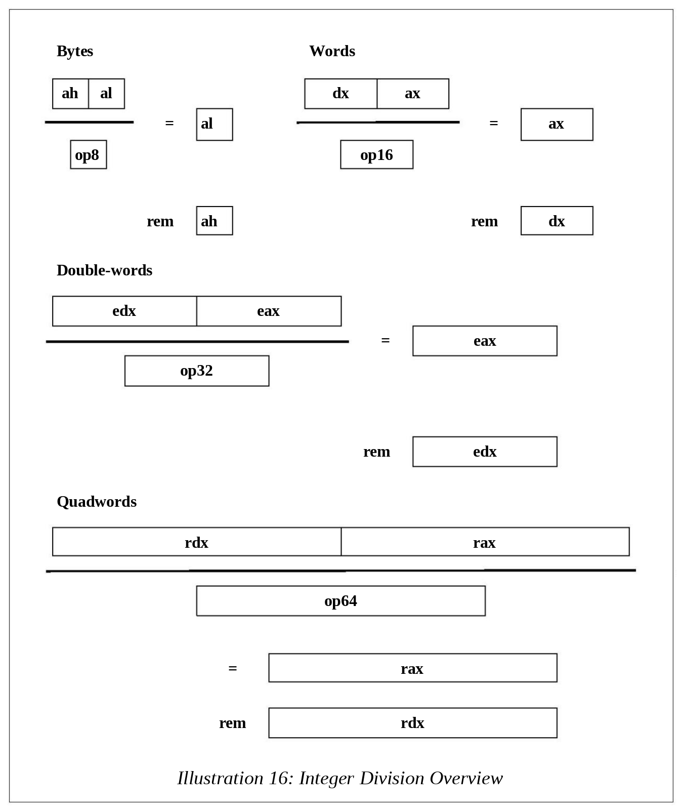

有符号和无符号除法指令的操作方式相同，但可处理的数据值范围不同。程序员需自行确保参与运算的数值适配所选操作数的位宽要求。

无符号和有符号除法指令的一般形式如下：

```
div <src>     ; 无符号除法
idiv <src>    ; 有符号除法
```

源操作数及目的操作数（A寄存器和D寄存器）的布局规则参见前文表格。

例如，假设有以下数据定义：

```asm
; ===== 字节级（8位）变量 =====
bNumA  db  63
bNumB  db  17
bNumC  db  5
bAns1  db  0
bAns2  db  0
bRem2  db  0      ; 余数
bAns3  db  0

; ===== 字级（16位）变量 =====
wNumA  dw  4321
wNumB  dw  1234
wNumC  dw  167
wAns1  dw  0
wAns2  dw  0
wRem2  dw  0      ; 余数
wAns3  dw  0

; ===== 双字级（32位）变量 =====
dNumA  dd  42000
dNumB  dd  -3157
dNumC  dd  -293
dAns1  dd  0
dAns2  dd  0
dRem2  dd  0      ; 余数
dAns3  dd  0

; ===== 四字级（64位）变量 =====
qNumA  dq  730000
qNumB  dq  -13456
qNumC  dq  -1279
qAns1  dq  0
qAns2  dq  0
qRem2  dq  0      ; 余数
qAns3  dq  0
```

若要实现以下基本运算（`%`表示取模运算）：

```c
// --- 字节级（无符号）---
bAns1 = bNumA / 3;
bAns2 = bNumA / bNumB;
bRem2 = bNumA % bNumB;
bAns3 = (bNumA * bNumC) / bNumB;

// --- 字级（无符号）---
wAns1 = wNumA / 5;
wAns2 = wNumA / wNumB;
wRem2 = wNumA % wNumB;
wAns3 = (wNumA * wNumC) / wNumB;

// --- 双字级（有符号）---
dAns1 = dNumA / 7;
dAns2 = dNumA / dNumB;
dRem2 = dNumA % dNumB;
dAns3 = (dNumA * dNumC) / dNumB;

// --- 四字级（有符号）---
qAns1 = qNumA / 9;
qAns2 = qNumA / qNumB;
qRem2 = qNumA % qNumB;
qAns3 = (qNumA * dNumC) / dNumB;
```

可使用如下指令：

```asm
; ============================================================
; 字节级运算（无符号）
; ============================================================

; bAns1 = bNumA / 3
mov  al, byte [bNumA]    ; 被除数低8位
mov  ah, 0               ; 无符号扩展：高8位清零
mov  bl, 3
div  bl                  ; ax / 3，商→al，余数→ah
mov  byte [bAns1], al

; bAns2 = bNumA / bNumB, bRem2 = bNumA % bNumB
mov  ax, 0               ; 清空ax（确保ah=0）
mov  al, byte [bNumA]    ; 被除数放入al
div  byte [bNumB]        ; ax / bNumB，商→al，余数→ah
mov  byte [bAns2], al    ; 保存商
mov  byte [bRem2], ah    ; 保存余数

; bAns3 = (bNumA * bNumC) / bNumB
mov  al, byte [bNumA]
mul  byte [bNumC]        ; 8位乘法，16位结果存ax
div  byte [bNumB]        ; ax / bNumB，商→al
mov  byte [bAns3], al

; ============================================================
; 字级运算（无符号）
; ============================================================

; wAns1 = wNumA / 5
mov  ax, word [wNumA]    ; 被除数低16位
mov  dx, 0               ; 无符号扩展：高16位清零
mov  bx, 5
div  bx                  ; dx:ax / 5，商→ax，余数→dx
mov  word [wAns1], ax

; wAns2 = wNumA / wNumB, wRem2 = wNumA % wNumB
mov  dx, 0               ; 高16位清零
mov  ax, word [wNumA]    ; 被除数放入ax
div  word [wNumB]        ; dx:ax / wNumB，商→ax，余数→dx
mov  word [wAns2], ax    ; 保存商
mov  word [wRem2], dx    ; 保存余数

; wAns3 = (wNumA * wNumC) / wNumB
mov  ax, word [wNumA]
mul  word [wNumC]        ; 16位乘法，32位结果存dx:ax
div  word [wNumB]        ; dx:ax / wNumB，商→ax
mov  word [wAns3], ax

; ============================================================
; 双字级运算（有符号）
; ============================================================

; dAns1 = dNumA / 7
mov  eax, dword [dNumA]
cdq                      ; 有符号扩展：eax → edx:eax
mov  ebx, 7
idiv ebx                 ; edx:eax / 7，商→eax，余数→edx
mov  dword [dAns1], eax

; dAns2 = dNumA / dNumB, dRem2 = dNumA % dNumB
mov  eax, dword [dNumA]
cdq                      ; 有符号扩展
idiv dword [dNumB]       ; edx:eax / dNumB，商→eax，余数→edx
mov  dword [dAns2], eax  ; 保存商
mov  dword [dRem2], edx  ; 保存余数

; dAns3 = (dNumA * dNumC) / dNumB
mov  eax, dword [dNumA]
imul dword [dNumC]       ; 32位有符号乘法，64位结果存edx:eax
idiv dword [dNumB]       ; edx:eax / dNumB，商→eax
mov  dword [dAns3], eax

; ============================================================
; 四字级运算（有符号）
; ============================================================

; qAns1 = qNumA / 9
mov  rax, qword [qNumA]
cqo                      ; 有符号扩展：rax → rdx:rax
mov  rbx, 9
idiv rbx                 ; rdx:rax / 9，商→rax，余数→rdx
mov  qword [qAns1], rax

; qAns2 = qNumA / qNumB, qRem2 = qNumA % qNumB
mov  rax, qword [qNumA]
cqo                      ; 有符号扩展
idiv qword [qNumB]       ; rdx:rax / qNumB，商→rax，余数→rdx
mov  qword [qAns2], rax  ; 保存商
mov  qword [qRem2], rdx  ; 保存余数

; qAns3 = (qNumA * qNumC) / qNumB
mov  rax, qword [qNumA]
imul qword [qNumC]       ; 64位有符号乘法，128位结果存rdx:rax
idiv qword [qNumB]       ; rdx:rax / qNumB，商→rax
mov  qword [qAns3], rax
```

对于上述部分指令，**必须**显式指定类型说明符（如`byte`、`word`、`dword`、`qword`）以明确操作数尺寸。

------

### 7.6.1 逻辑运算

想必你还记得，以下是基本逻辑运算的真值表：

| A    | B    | **AND**（与） | **OR**（或） | **XOR**（异或） |
| ---- | ---- | :-----------: | :----------: | :-------------: |
| 0    | 0    |       0       |      0       |        0        |
| 0    | 1    |       0       |      1       |        1        |
| 1    | 0    |       0       |      1       |        1        |
| 1    | 1    |       1       |      1       |        0        |

|  A   | **NOT**（非） |
| :--: | :-----------: |
|  0   |       1       |
|  1   |       0       |

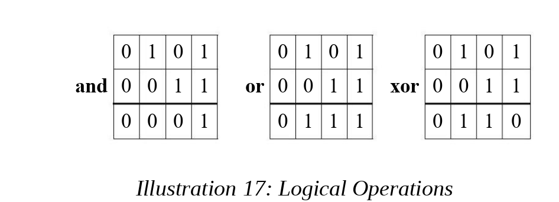

------

`&`对应逻辑与（AND）运算，`||`对应逻辑或（OR）运算，`^`对应逻辑异或（XOR）运算，均遵循C/C++语法约定；`¬`对应逻辑非（NOT）运算。

本书涉及指令的完整汇总参见附录B。

------

### 7.6.2 移位操作

移位操作将操作数内的所有位向左或向右移动指定数量的位置，主要有两类典型用途：一是为特定需求提取操作数中的指定位段；二是实现以2的幂为乘数的乘法或无符号除法。

所有位均按指定数量平移。被移出操作数有效位范围的位会被永久丢弃，另一侧空出的位则补0。

#### 7.6.2.1 逻辑移位

逻辑移位是一种按位运算，它将源寄存器的所有位按指定位数移动，并将结果存入目的寄存器。可根据需求选择向左或向右移动：源操作数的每一位都移动指定的位位置，新产生的空位全部补0。

下图展示了字节型操作数的左移和右移操作原理：

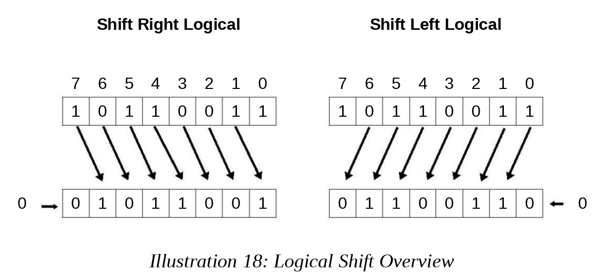

逻辑移位将操作数视作**一串独立的位序列**，而非一个数值。

移位指令可用于实现以2的幂为乘数的无符号整数乘法和无符号整数除法。2的幂包括2、4、8等，其上限受操作数位宽限制（寄存器操作数最大为32位）。

下例中，通过将23向右逻辑移1位实现除以2的运算，得到的二进制结果为11；接着，通过将13向左逻辑移2位实现乘以4的运算，得到的二进制结果为52。

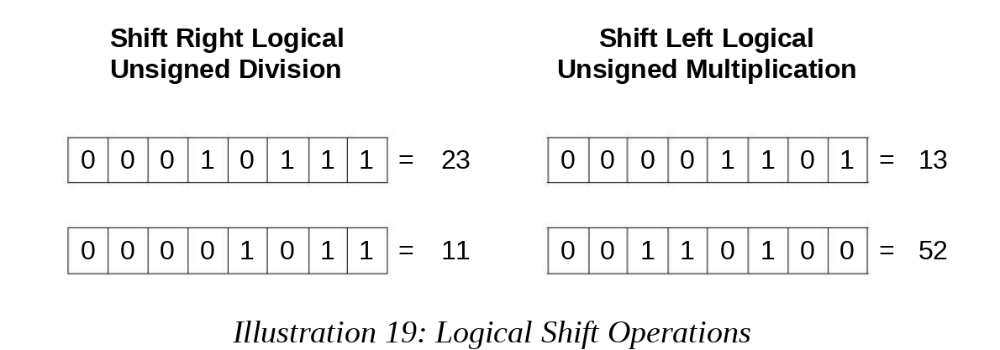

逻辑移位指令汇总

| 指令                                 | 说明                                                         |
| ------------------------------------ | ------------------------------------------------------------ |
| `shl <dest>, <imm>` `shl <dest>, cl` | 对目的操作数执行**逻辑左移**操作，右侧空位补0。 • `<imm>`为1~64的立即数，或`cl`寄存器中存储的1~64的移位量。 • 注：目的操作数不能为立即数。 |
| 示例                                 | `shl ax, 8`    ; 将16位寄存器ax左移8位 `shl rcx, 32`   ; 将64位寄存器rcx左移32位 `shl eax, cl`    ; 将eax左移`cl`中指定的位数 `shl qword [qNum], cl` ; 将64位内存变量qNum左移`cl`中指定的位数 |
| `shr <dest>, <imm>` `shr <dest>, cl` | 对目的操作数执行**逻辑右移**操作，左侧空位补0。 • `<imm>`为1~64的立即数，或`cl`寄存器中存储的1~64的移位量。 • 注：目的操作数不能为立即数。 |
| 示例                                 | `shr ax, 8`    ; 将16位寄存器ax右移8位 `shr rcx, 32`   ; 将64位寄存器rcx右移32位 `shr eax, cl`    ; 将eax右移`cl`中指定的位数 `shr qword [qNum], cl` ; 将64位内存变量qNum右移`cl`中指定的位数 |

本书涉及指令的完整汇总参见附录B。

算术移位同样是一种按位运算，将源寄存器的所有位按指定位数移动，并将结果存入目的寄存器。源操作数的每一位都移动指定的位位置，新产生的空位按规则填充。

> ⚠️ **原文勘误**：原文称算术左移"将原最高位（符号位）复制到所有空位中"的说法有误。x86架构中，**算术左移（`sal`）与逻辑左移（`shl`）的操作完全一致**，均为右侧空位补0，二者共享同一条机器码指令，助记符可互换使用。只有**算术右移（`sar`）**才需要从左侧补符号位，以保留有符号数的正负属性

下文通过示意图展示字节型操作数执行算术左移（`sal`）与算术右移（`sar`）时的位级变化过程：

**算术左移（`sal`，字节操作数）**

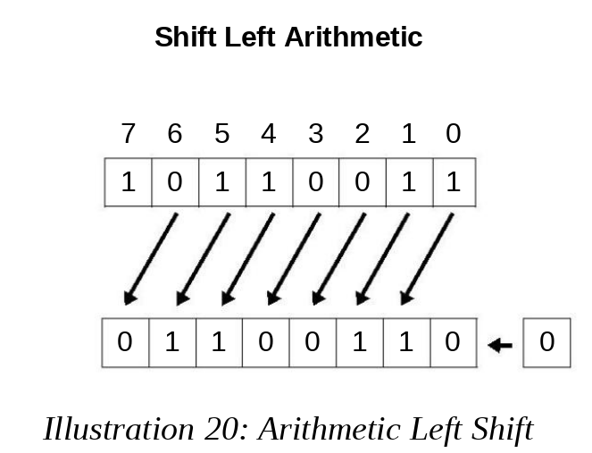

```
初始值：  1 0 1 1 0 1 0 0   （十进制 -76，最高位1为符号位）
             ↓ ↓ ↓ ↓ ↓ ↓ ↓
左移1位： 0 1 1 0 1 0 0 0   （十进制 -56）
           ↑
         右侧空位补0（与逻辑左移`shl`行为完全一致）
```

> ⚠️ **原文勘误提示**：原文称"算术左移会复制符号位填充空位"是错误的。x86架构中**算术左移（`sal`）与逻辑左移（`shl`）是同一指令的两种助记符写法，硬件行为完全一致**：均为低位补0，高位移入进位标志CF。所谓"复制符号位填充空位"是算术右移的特性，并非左移行为。

**算术右移（`sar`，字节操作数）**

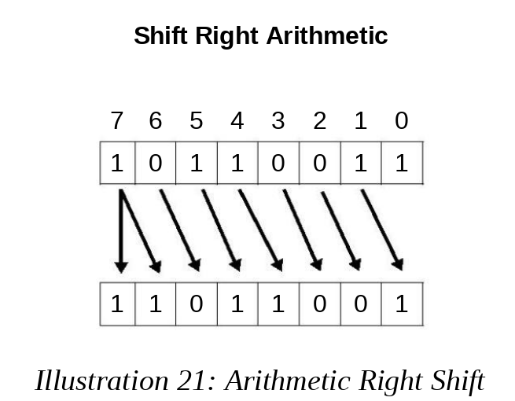

```
初始值：  1 0 1 1 0 1 0 0   （十进制 -76，最高位1为符号位）
          ↓ ↓ ↓ ↓ ↓ ↓ ↓
右移1位： 1 1 0 1 1 0 1 0   （十进制 -38）
            ↑
         左侧空位补原符号位1（保留数值正负属性）
```

> 算术右移是唯一会复制符号位的移位操作，其设计目的是保证有符号数右移n位等价于除以2ⁿ（向下取整），不会出现符号翻转错误。

算术移位指令汇总

| 指令                                 | 说明                                                         |
| ------------------------------------ | ------------------------------------------------------------ |
| `sal <dest>, <imm>` `sal <dest>, cl` | 对目的操作数执行**算术左移**操作，右侧空位补0。 • `<imm>`为1~64的立即数，或`cl`寄存器中存储的1~64的移位量。 • 注：目的操作数不能为立即数。 • ⚠️ **硬件行为**：`sal`与逻辑左移`shl`**执行完全相同的操作**（低位补0），二者是同一机器指令的两种助记符写法。 |
| 示例                                 | `sal ax, 8`    ; 将16位寄存器ax左移8位 `sal rcx, 32`   ; 将64位寄存器rcx左移32位 `sal eax, cl`    ; 将eax左移`cl`中指定的位数 `sal qword [qNum], cl` ; 将64位内存变量qNum左移`cl`中指定的位数 |
| `sar <dest>, <imm>` `sar <dest>, cl` | 对目的操作数执行**算术右移**操作，左侧空位补**符号位**（原最高位的值）。 • `<imm>`为1~64的立即数，或`cl`寄存器中存储的1~64的移位量。 • 注：目的操作数不能为立即数。 |
| 示例                                 | `sar ax, 8`    ; 将16位寄存器ax右移8位 `sar rcx, 32`   ; 将64位寄存器rcx右移32位 `sar eax, cl`    ; 将eax右移`cl`中指定的位数 `sar qword [qNum], cl` ; 将64位内存变量qNum右移`cl`中指定的位数 |

本书涉及指令的完整汇总参见附录B。

------

### 7.6.3 循环移位操作

循环移位（Rotate）操作将操作数内的所有位向左或向右移动指定位数，但**被移出有效位范围的位不会丢失，而是绕回到另一端**，形成一个闭环。

例如，字节型操作数 `10010110₂` 向右循环移1位，结果为 `01001011₂`（最低位的`0`移出后补到最高位）。若同一操作数向左循环移1位，结果为 `00101101₂`（最高位的`1`移出后补到最低位）。

循环移位指令汇总

| 指令                                 | 说明                                                         |
| ------------------------------------ | ------------------------------------------------------------ |
| `rol <dest>, <imm>` `rol <dest>, cl` | 对目的操作数执行**循环左移**操作。移出最高位的位绕回至最低位。 • `<imm>`为1~64的立即数，或`cl`寄存器中存储的1~64的移位量。 • 注：目的操作数不能为立即数。 |
| 示例                                 | `rol ax, 8`    ; 16位寄存器ax循环左移8位 `rol rcx, 32`   ; 64位寄存器rcx循环左移32位 `rol eax, cl`    ; eax循环左移`cl`中指定的位数 `rol qword [qNum], cl` ; 64位内存变量qNum循环左移`cl`中指定的位数 |
| `ror <dest>, <imm>` `ror <dest>, cl` | 对目的操作数执行**循环右移**操作。移出最低位的位绕回至最高位。 • `<imm>`为1~64的立即数，或`cl`寄存器中存储的1~64的移位量。 • 注：目的操作数不能为立即数。 |
| 示例                                 | `ror ax, 8`    ; 16位寄存器ax循环右移8位 `ror rcx, 32`   ; 64位寄存器rcx循环右移32位 `ror eax, cl`    ; eax循环右移`cl`中指定的位数 `ror qword [qNum], cl` ; 64位内存变量qNum循环右移`cl`中指定的位数 |

本书涉及指令的完整汇总参见附录B。

------

### 7.7 控制指令

程序控制指IF语句、循环等基本程序结构的实现。高级语言中的各类控制结构在汇编层面必须通过有限的底层控制指令来模拟。例如，汇编语言层面**不存在**IF-THEN-ELSE这类复合语句语法；汇编语言仅提供**无条件分支（跳转）**和**条件分支**两种基本机制——条件分支本质上就是一个"根据条件判断是否跳转到目标标号"的原子操作。

控制指令即指无条件跳转和条件跳转指令。跳转是实现基本条件语句（如IF语句）和循环结构的必要手段。


### 7.7.1 标号

程序标号是控制语句跳转的**目标位置**。例如，循环的起始位置可以用`loopStart`这类标号标记，通过跳转到该标号即可重新执行循环体。

标号的通用命名规则为：以字母开头，后续可接字母、数字或下划线（`_`），并以冒号（`:`）结尾。虽然语法上也支持以非字母字符（数字、`_`、`$`、`#`、`@`、`~`、`?`）作为标号开头，但这类字符通常有预定义特殊含义，**不建议在用户代码中自行使用**。此外yasm汇编器对标号**大小写敏感**（`LoopStart`与`loopStart`会被视为两个不同标号）。

以下均为合法标号：

```asm
loopStart:
last:
```

每个标号在作用域内只能定义一次。标号的具体用法将在后续小节中展开。

------

**译注：**

1. **冒号的使用边界**：冒号仅用于标号的定义处，跳转指令中引用标号时无需加冒号。例如定义`loopStart:`后，跳转应写为`jmp loopStart`，而非`jmp loopStart:`。
2. **特殊前缀的预定义含义**：yasm/NASM中以点号（`.`）开头的标号为局部标号，仅在当前上下文可见；以下划线开头的标号可能与C语言的符号修饰规则冲突（C函数名默认加前缀`_`，方便链接时区分），因此用户代码应避免使用这类特殊前缀。
3. **重复定义错误**：若同一作用域内出现两个同名标号，汇编器会报`symbol redefined`错误，需确保标号全局唯一。

------

### 7.7.2 无条件控制指令

无条件控制指令即**无条件跳转指令**，会直接跳转到标号指定的程序位置执行。目标标号必须满足三个条件：唯一定义、可被当前模块访问、处于跳转指令的作用域内。

无条件跳转指令汇总如下：

| 指令          | 说明                                                         |
| ------------- | ------------------------------------------------------------ |
| `jmp <label>` | 跳转到指定标号处执行。 注：目标标号必须唯一定义。            |
| 示例          | `jmp startLoop` ; 跳转到循环起始标号 `jmp ifDone`  ; 跳转到条件满足后的分支 `jmp last`   ; 跳转到程序末尾标号 |

本书涉及指令的完整汇总参见附录B。

------

**译注：**

1. **跳转范围的分类**：x86架构的`jmp`按跳转距离可分为短跳转（±127字节内，单字节偏移）、近跳转（同一段内，4字节偏移）和远跳转（跨段，需指定段选择子），但yasm会根据标号位置自动选择合适的编码，用户无需手动指定。
2. **与高级语言的对标**：`jmp`对应高级语言中的`goto`语句，但由于其会破坏代码可读性，除循环实现外应尽量避免滥用。

------

### 7.7.3 条件控制指令

条件控制指令会根据**标志寄存器的状态**（通常由前序的比较或运算指令设置）决定是否执行跳转，从而实现高级语言中IF语句的基础功能。

------

条件判断需要两步操作：**比较指令**和**条件跳转指令**。条件跳转指令会根据前序比较操作的结果，决定是否跳转到指定标号处。比较指令会对比两个操作数，并将比较结果写入`rFlag`（即RFLAGS）寄存器；条件跳转指令则根据`rFlag`寄存器的状态决定是否执行跳转。这就要求比较指令必须紧跟条件跳转指令——如果二者之间插入了其他指令，`rFlag`寄存器的值可能被修改，导致条件跳转的判断结果偏离预期。

比较指令的一般形式如下：

```
cmp <操作数1>, <操作数2>
```

执行时`<操作数1>`和`<操作数2>`的值均保持不变，且二者位宽必须一致。两个操作数不能同时为内存操作数，`<操作数1>`不能为立即数，但`<操作数2>`可以是立即数。

条件控制指令包含两组独立的指令集，分别适用于有符号和无符号数据：

- **通用条件跳转**（有符号/无符号数据通用）：相等跳转`je`、不等跳转`jne`

- **有符号条件跳转**：小于跳转`jl`、小于等于跳转`jle`、大于跳转`jg`、大于等于跳转`jge`

- **无符号条件跳转**：低于跳转`jb`、低于或等于跳转`jbe`、高于跳转`ja`、高于或等于跳转`jae`

各类条件跳转指令的一般形式及语义注释如下：

| 指令          | 语义注释                                       |
| ------------- | ---------------------------------------------- |
| `je <label>`  | 若`<操作数1> == <操作数2>`，则跳转             |
| `jne <label>` | 若`<操作数1> != <操作数2>`，则跳转             |
| `jl <label>`  | 有符号比较，若`<操作数1> < <操作数2>`，则跳转  |
| `jle <label>` | 有符号比较，若`<操作数1> <= <操作数2>`，则跳转 |
| `jg <label>`  | 有符号比较，若`<操作数1> > <操作数2>`，则跳转  |
| `jge <label>` | 有符号比较，若`<操作数1> >= <操作数2>`，则跳转 |
| `jb <label>`  | 无符号比较，若`<操作数1> < <操作数2>`，则跳转  |
| `jbe <label>` | 无符号比较，若`<操作数1> <= <操作数2>`，则跳转 |
| `ja <label>`  | 无符号比较，若`<操作数1> > <操作数2>`，则跳转  |
| `jae <label>` | 无符号比较，若`<操作数1> >= <操作数2>`，则跳转 |

------

#### 示例1：单分支IF语句

给定有符号数据的伪代码如下：

```c
if (currNum > myMax) {
    myMax = currNum;
}
```

假设已有如下数据定义：

```asm
currNum dq 0
myMax  dq 0
```

且`currNum`和`myMax`已在程序其他部分被正确更新，对应汇编实现如下：

```asm
mov  rax, qword [currNum]
cmp  rax, qword [myMax]
jle  notNewMax          ; 若currNum <= myMax，跳过更新逻辑
mov  qword [myMax], rax ; 否则更新myMax为新值
notNewMax:              ; 跳转目标标号，后续代码从此处继续
```

> 💡 注意：汇编实现中反转了原IF语句的判断逻辑。因为条件跳转指令只有"满足条件则跳转"和"不满足条件则顺序执行"两种行为，所以原逻辑"条件为真时执行代码块"需要转换为"条件为假时跳过程序块"。本例中若`currNum > myMax`不成立（即`currNum <= myMax`），就跳转到`notNewMax`标号处跳过更新操作；若条件成立，则顺序执行后续的赋值指令。本例仅有一条指令需要跳过，实际场景中可跳过任意长度的代码块。

------

#### 示例2：IF-ELSE双分支结构

更复杂的IF-ELSE结构需要手动构造跳转逻辑，对应伪代码如下：

```c
if (x != 0) {
    ans = x / y;
    errFlg = FALSE;
} else {
    ans = 0;
    errFlg = TRUE;
}
```

假设`x`和`y`为有符号双字变量，程序运行中会被赋值，且已有如下数据定义：

```asm
TRUE   equ 1
FALSE  equ 0
x      dd 0
y      dd 0
ans    dd 0
errFlg db FALSE
```

对应汇编实现如下：

```asm
cmp  dword [x], 0
je   doElse              ; 若x == 0，跳转到else分支
; ---------- then分支 ----------
mov  eax, dword [x]
cdq                      ; 符号扩展eax到edx:eax，为有符号除法做准备
idiv dword [y]           ; 有符号除法：edx:eax / y，商存eax，余数存edx
mov  dword [ans], eax    ; 保存商到ans
mov  byte [errFlg], FALSE; 设置错误标志为FALSE
jmp  skpElse             ; 跳过else分支
; ---------- else分支 ----------
doElse:
mov  dword [ans], 0      ; ans赋值为0
mov  byte [errFlg], TRUE ; 设置错误标志为TRUE
; ---------- 分支汇合点 ----------
skpElse:
; 后续代码从此处继续
```

在本例中，由于数据为有符号类型，因此需要使用有符号除法指令（`idiv`）及相应的符号扩展操作（此处为`cdq`）。还需特别注意，`edx`寄存器会被**隐式覆盖**，即便代码中并未显式出现该寄存器。如果此前`edx`（或`rdx`）中存有需要保留的数据，其值将遭到破坏。

### 7.7.3.1 跳转范围超限

条件跳转的目标标号默认采用**短跳转（short-jump）**编码，即目标标号必须位于条件跳转指令所在地址的±128字节范围内。虽然这一限制在常规代码中通常不会触发问题，但对于体量非常大的循环，汇编器可能报出"jump out-of-range"（跳转范围超限）错误。相比之下，无条件跳转指令`jmp`**不受此距离限制**。

若遭遇"jump out-of-range"错误，可通过**反转判断逻辑**、将远距离跳转改为无条件跳转来解决。例如，以下代码：

```asm
cmp  rcx, 0
jne  startOfLoop    ; 若startOfLoop距离过远，可能触发汇编错误
```

如果`startOfLoop`标号距离当前位置过远，会触发跳转范围超限错误。可通过以下改写消除该错误：

```asm
cmp  rcx, 0
je   endOfLoop      ; 条件取反，跳转到附近的标号
jmp  startOfLoop    ; 无条件跳转不受距离限制
endOfLoop:          ; 分支汇合点
```

该写法利用无条件跳转覆盖远距离目标，而条件跳转仅跳转到相邻的就近标号，从而规避了短跳转的范围限制。

条件控制指令汇总

| 指令               | 说明                                                         |
| ------------------ | ------------------------------------------------------------ |
| `cmp <op1>, <op2>` | 比较`<op1>`与`<op2>`，结果存入rFlag寄存器。 • 注1：两个操作数的值均保持不变。 • 注2：两个操作数不能同时为内存操作数。 • 注3：`<op1>`不能为立即数。 |
| 示例               | `cmp rax, 5`    ; 比较rax与5 `cmp ecx, edx`   ; 比较ecx与edx `cmp ax, word [wNum]` ; 比较ax与16位内存值 |

| 指令          | 说明                                                         | 示例                                 |
| ------------- | ------------------------------------------------------------ | ------------------------------------ |
| `je <label>`  | 基于前序比较结果，若`<op1> == <op2>`则跳转到`<label>`。目标标号必须唯一定义。 | `cmp rax, 5` `je wasEqual`           |
| `jne <label>` | 基于前序比较结果，若`<op1> != <op2>`则跳转到`<label>`。目标标号必须唯一定义。 | `cmp rax, 5` `jne wasNotEqual`       |
| `jl <label>`  | **有符号比较**，若`<op1> < <op2>`则跳转。目标标号必须唯一定义。 | `cmp rax, 5` `jl wasLess`            |
| `jle <label>` | **有符号比较**，若`<op1> <= <op2>`则跳转。目标标号必须唯一定义。 | `cmp rax, 5` `jle wasLessOrEqual`    |
| `jg <label>`  | **有符号比较**，若`<op1> > <op2>`则跳转。目标标号必须唯一定义。 | `cmp rax, 5` `jg wasGreater`         |
| `jge <label>` | **有符号比较**，若`<op1> >= <op2>`则跳转。目标标号必须唯一定义。 | `cmp rax, 5` `jge wasGreaterOrEqual` |
| `jb <label>`  | **无符号比较**，若`<op1> < <op2>`则跳转。目标标号必须唯一定义。 | `cmp rax, 5` `jb wasLess`            |
| `jbe <label>` | **无符号比较**，若`<op1> <= <op2>`则跳转。目标标号必须唯一定义。 | `cmp rax, 5` `jbe wasLessOrEqual`    |
| `ja <label>`  | **无符号比较**，若`<op1> > <op2>`则跳转。目标标号必须唯一定义。 | `cmp rax, 5` `ja wasGreater`         |
| `jae <label>` | **无符号比较**，若`<op1> >= <op2>`则跳转。目标标号必须唯一定义。 | `cmp rax, 5` `jae wasGreaterOrEqual` |

本书涉及指令的完整汇总参见附录B。

### 7.7.4 迭代

前述基本控制指令为实现循环（迭代）提供了基础手段。

最简单的循环结构可通过一个计数器实现：在循环顶部或底部通过`cmp`比较和`jne`条件跳转检查计数器值，从而控制循环执行次数。

例如，假设有如下数据定义：

```asm
lpCnt  dq  15    ; 循环计数器，控制循环执行15次
sum    dq  0     ; 累加和，存放最终结果
```

以下代码可实现1~30内所有奇数的求和：

```asm
mov  rcx, qword [lpCnt]  ; 将循环次数载入rcx
mov  rax, 1              ; rax用作当前奇数，初始化为1，每次递增2
sumLoop:
add   qword [sum], rax    ; 将当前奇数累加到sum
add   rax, 2              ; 生成下一个奇数
dec  rcx                  ; 循环计数器减1
cmp  rcx, 0               ; 判断计数器是否为0（注：此行实际冗余，见译注）
jne  sumLoop              ; 若计数器不为0，跳转回循环起始处继续
```

这只是实现奇数求和任务的诸多方式之一。本例中`rcx`用作循环计数器，`rax`用作当前奇数（初始化为1，每次递增2）。

当需要固定次数的循环时，上述以`rcx`为计数器的模式非常实用。x86架构专门提供了`loop`指令来简化这类循环逻辑，其一般形式如下：

```
loop <label>
```

该指令的执行逻辑为：**先将`rcx`寄存器的值减1，然后判断`rcx`是否不为0，若不为0则跳转到指定标号处**。目标标号必须唯一定义。

因此，`loop`指令的功能与上述示例中的后三行代码完全等价。以下两组代码的效果完全一致：

| 代码组1（`loop`指令版） | 代码组2（手动实现版）   |
| ----------------------- | ----------------------- |
| `loop <label>`          | `dec rcx` `jne <label>` |

> 💡 原文等价代码中额外添加了`cmp rcx, 0`，该指令实际是冗余的：`dec`指令执行后已根据结果更新了零标志ZF，`jne`直接根据ZF是否为0判断是否跳转，无需额外比较。

例如，上述奇数求和程序可改写为`loop`指令版本：

```asm
mov  rcx, qword [lpCnt]  ; 循环计数器，初始化为15
mov  rax, 1              ; 当前奇数，初始化为1
sumLoop:
add   qword [sum], rax    ; 累加当前奇数
add   rax, 2              ; 生成下一个奇数
loop sumLoop              ; rcx减1，若不为0则跳转回sumLoop继续循环
```

两段代码以完全相同的方式产生完全一致的结果。

由于`loop`指令会先递减`rcx`再判断，如果忘记初始化`rcx`，其初始值为随机残留值，会导致循环执行未知次数，很可能在运行时触发错误，给调试带来极大困扰。

`loop`指令虽然编码简洁，但存在两个固有限制：① 计数器必须绑定`rcx`寄存器；② 只能实现递减计数。如果需要嵌套循环，内外层循环都使用`loop`指令会引发寄存器冲突，除非采取额外措施（例如在进入内层循环前将外层`rcx`压栈保存，内层循环结束后再弹栈恢复）。

本书的部分示例会使用`loop`指令，但它并非必选项，手动实现计数逻辑同样可行。

`loop`指令汇总

| 指令           | 说明                                                         |
| -------------- | ------------------------------------------------------------ |
| `loop <label>` | 将`rcx`减1，若`rcx ≠ 0`则跳转到`<label>`。 注：目标标号必须唯一定义，且跳转距离不能超过±128字节。 |
| 示例           | `loop startLoop` ; 跳回循环起始 `loop ifDone`  ; 循环未结束则跳转 `loop sumLoop`  ; 奇数求和循环 |

本书涉及指令的完整汇总参见附录B。

### 7.8 示例程序：平方和求和

以下是一份完整的示例程序，用于计算1到n之间所有整数的平方和。例如，当n=10时，平方和为：

```
12+22+⋯+102=385
```

本示例的主程序将n初始化为10，与上方示例对应。

```asm
; *******************************************************
;  简单示例程序：计算1到n的整数平方和
; *******************************************************

; ----- 数据段 -----
section .data
    ; 常量定义
    SUCCESS     equ 0        ; 程序成功退出的状态码
    SYS_exit    equ 60       ; Linux x86-64 系统调用号：exit
    
    ; 数据定义
    n           dd  10       ; 求和上限n，此处初始化为10
    sumOfSquares dq 0        ; 平方和结果存储，初始化为0

; ----- 代码段 -----
section .text
    global _start            ; 导出程序入口符号

_start:
    ; ----- 计算1到n的平方和 -----
    ; 对应C语言逻辑：
    ; int i = 1;
    ; int n = 10;
    ; for (; i <= n; i++) {
    ;     sumOfSquares += i * i;
    ; }
    
    mov  rbx, 1              ; rbx = i，循环变量初始化为1
    mov  ecx, dword [n]      ; rcx = 循环计数器，初始值为n（共循环n次）
    
sumLoop:
    mov  rax, rbx            ; 将当前i送入rax
    mul  rax                 ; rax = rax * rax = i²，结果存于rdx:rax
    add  qword [sumOfSquares], rax  ; 将i²累加到sumOfSquares
    inc  rbx                 ; i++，准备下一次循环的取值
    loop sumLoop             ; rcx减1，若rcx≠0则跳回sumLoop继续循环
    
    ; ----- 程序结束，调用系统调用退出 -----
last:
    mov  rax, SYS_exit       ; 系统调用号：exit
    mov  rdi, SUCCESS        ; 退出状态码：0（成功）
    syscall                  ; 触发系统调用
```

程序运行后，可使用调试器（如`gdb`）检查`sumOfSquares`内存单元的值，验证程序是否正确执行。

## 第8章 寻址方式

 本章将介绍x86-64架构下寻址模式的基础知识，以及与之相关的地址操作方法。

寻址模式是指借助被访问数据项（读/写操作的对象）的地址来访问内存中数值的合法方式，访问对象可以是变量名，也可以是数组中的某个元素位置。

基础寻址模式分为三类：

- 寄存器寻址

- 立即数寻址

- 内存寻址

  后续小节将结合示例逐一介绍上述模式，最后还会给出一个数组访问的简单示例。

------

### 8.1 地址与数值

在64位架构下，地址本身需要占用64位存储空间。

如前一章所述，**访问内存的唯一方式是在操作数外加方括号（`[]`）**。若省略方括号，则不会触发内存访问，而是获取该数据项的地址。例如：

```asm
mov rax, qword [var1]   ; 将var1存储的数值载入rax
mov rax, var1           ; 将var1的内存地址载入rax
```

由于省略方括号本身是合法语法，汇编器不会对此生成错误或警告信息。

访问内存时，多数情况下操作数的位宽是明确的。例如指令：

```asm
mov eax, [rbx]
```

会从内存中读取一个双字。但某些指令的操作数位宽可能存在歧义，例如：

```asm
inc [rbx]    ; 错误
```

这条指令的歧义在于：无法确定要访问的是字节、字还是双字内存单元。此类场景下，必须通过`byte`/`word`/`dword`/`qword`显式指定操作数尺寸，例如：

```asm
inc byte [rbx]    ; 递增1字节内存单元
inc word [rbx]    ; 递增2字节内存单元
inc dword [rbx]   ; 递增4字节内存单元
```

上述每条指令都必须显式标注尺寸才能合法汇编。

------

#### 8.1.1 寄存器寻址

寄存器寻址指操作数存储在CPU寄存器中（如`eax`、`ebx`等）。例如：

```asm
mov eax, ebx
```

源操作数`ebx`和目的操作数`eax`均采用寄存器寻址。

------

#### 8.1.2 立即数寻址

立即数寻址指操作数为直接嵌入指令流的常量值。例如：

```asm
mov eax, 123
```

目的操作数`eax`采用寄存器寻址，源操作数`123`采用立即数寻址。显然，本例中的目的操作数不能采用立即数寻址（不能给常量赋值）。

------

#### 8.1.3 内存寻址

内存寻址指操作数位于内存的某个地址处，通过地址访问该位置的值。这种方式也称为**间接寻址**或**解引用**。

内存寻址的最基础形式在前一章已广泛使用，例如：

```asm
mov rax, qword [qNum]
```

该指令会访问变量`qNum`的内存位置，并读取其中存储的数值。由于CPU必须等待内存数据读取完成后才能执行完该指令，因此其执行耗时略长于使用立即数或寄存器的同类操作。

访问数组时需要更通用的内存寻址方式：可以将数组首地址存入寄存器，通过寄存器间接访问数组元素（而非直接使用变量名）。

例如，假设有如下数据定义：

```asm
lst dd 101, 103, 105, 107    ; 4个32位双字组成的数组
```

十进制值101对应的十六进制为`0x00000065`，其在内存中的布局如下：

根据上述`lst dd 101, 103, 105, 107`的定义，数组在内存中的布局如下（x86采用小端序存储）：

| 内存地址 | 存储值（十六进制） |  偏移量  | 数组索引 | 说明             |
| :------: | :----------------: | :------: | :------: | ---------------- |
| 0x6000e0 |    65 00 00 00     | lst + 0  |  lst[0]  | 101 = 0x00000065 |
| 0x6000e4 |    67 00 00 00     | lst + 4  |  lst[1]  | 103 = 0x00000067 |
| 0x6000e8 |    69 00 00 00     | lst + 8  |  lst[2]  | 105 = 0x00000069 |
| 0x6000ec |    6B 00 00 00     | lst + 12 |  lst[3]  | 107 = 0x0000006B |
|   ...    |        ...         |   ...    |   ...    | ...              |

------

访问数组第一个元素`lst[0]`有以下几种等价方式：

```asm
; 方式1：直接使用变量名（基址）
mov eax, dword [lst]        ; eax = 101

; 方式2：将基址载入寄存器后间接访问
mov rbx, lst                ; rbx = 数组首地址（原书笔误写作"list"，已修正）
mov eax, dword [rbx]        ; eax = 101
```

第二种方式中，数组的起始地址（基址）先存入`rbx`，再通过`[rbx]`解引用获取该地址处的数值。这种寄存器间接寻址为访问其他数组元素提供了灵活性。

**内存按字节编址**：每个内存地址对应1字节。双字（dword）变量占32位即4字节，因此数组中每个元素占用4个连续内存单元。第二个元素`lst[1]`的地址为首地址`lst + 4`，第三个元素`lst[2]`的地址为`lst + 8`，依此类推。每访问下一个元素，地址需增加4字节。

> 📌 **不同数据类型的地址增量**：
>
> - 字节数组（byte）：增量 = 1
> - 字数组（word）：增量 = 2
> - 双字数组（dword）：增量 = 4
> - 四字数组（qword）：增量 = 8

**偏移量（Displacement）**是加到基址上的固定常数；**索引（Index）**是高级语言中使用的数组下标（如`lst[2]`中的`2`）。二者通过元素大小关联：`偏移量 = 索引 × 元素大小`。

------

#### 使用基址+位移访问数组元素

以下示例均访问数组的第三个元素`lst[2]`（值为105）：

```asm
mov rbx, lst                ; rbx = 数组首地址
mov rsi, 8                 ; rsi = 偏移量8（对应索引2）

mov eax, dword [lst+8]     ; 方式1：基址+立即数位移
mov eax, dword [rbx+8]     ; 方式2：寄存器基址+立即数位移
mov eax, dword [rbx+rsi]   ; 方式3：寄存器基址+寄存器位移
```

上述三条指令都访问`首地址 + 8`处的内存，将值105载入`eax`。值得注意的是，**位移的计算发生在地址生成阶段，不会改变源寄存器（`rbx`、`rsi`）的原始值**。具体使用哪种方式取决于程序员的偏好和场景需求。

此外，位移还可以通过更复杂的方式计算得出（例如通过算术指令动态计算偏移量后再访问内存）。

### 通用内存寻址格式

内存寻址的通用格式如下：

```
[ baseAddr + (indexReg * scaleValue) + displacement ]
```

其中：

- **`baseAddr`**：基址，可以是寄存器或变量名（标签）

- **`indexReg`**：变址寄存器，**必须是寄存器**

- **`scaleValue`**：比例因子，只能是立即数 **1、2、4、8**（1虽然合法但实际很少单独使用）

- **`displacement`**：位移量，必须是立即数

三者可按任意组合使用，只要合法并能生成有效的64位地址即可。

以下是源操作数采用内存寻址的若干示例：

```asm
mov eax, dword [var1]           ; 直接寻址：基址仅为变量名
mov rax, qword [rbx+rsi]        ; 基址+变址：无比例因子和位移
mov ax, word [lst+4]            ; 基址+位移：访问lst[1]（字数组，+4=2个元素）
mov bx, word [lst+rdx+2]        ; 基址+变址+位移
mov rcx, qword [lst+(rsi*8)]    ; 基址+比例变址（括号可选，仅为可读性）
mov al, byte [buff-1+rcx]       ; 基址+位移+变址：负位移访问buff前一个字节
mov eax, dword [rbx+(rsi*4)+16] ; 完整形式：基址+比例变址+位移
```

------

#### 数组访问示例

以前文定义的双字数组`lst`为例，要访问第3个元素（即索引为2的元素，因为数组下标从0开始）：

```asm
mov rsi, 2                  ; rsi = 索引值 2
mov eax, dword [lst+rsi*4]  ; 获取 lst[2]，值为105
```

由于64位架构下地址始终是四字宽度，内存寻址时必须使用64位寄存器（即使访问的是双字数据）。这使得寄存器可以像高级语言中的数组索引一样使用。

例如，内存操作数`[lst+rsi*4]`在语义上完全对应于高级语言中的`lst[rsi]`。`rsi`寄存器中的值会自动乘以数据元素的大小（本例中每个双字元素占4字节），从而准确定位到目标元素。

### 8.2 示例程序：列表求和

以下示例程序用于计算列表中所有数值的总和。

```asm
; *****************************************************
;  简单示例：计算数值列表的总和与平均值
; *****************************************************

; ----- 数据段 -----
section .data
    ; 常量定义
    EXIT_SUCCESS equ 0        ; 程序成功退出状态码
    SYS_exit    equ 60       ; Linux x86-64 exit系统调用号
    
    ; 数据定义
    lst dd 1002, 1004, 1006, 1008, 10010   ; 待求和的5元素列表
    len dd 5                                ; 列表长度
    sum dd 0                                ; 总和结果存储

; ----- 代码段 -----
section .text
    global _start

_start:
    ; ----- 求和循环 -----
    mov  ecx, dword [len]      ; ecx = 循环次数（列表长度）
    mov  rsi, 0                ; rsi = 数组索引，初始化为0
    
sumLoop:
    mov  eax, dword [lst + rsi*4]   ; 取lst[rsi]（每个元素4字节，索引×4）
    add  dword [sum], eax            ; 累加到sum
    inc  rsi                        ; 索引+1，指向下一个元素
    loop sumLoop                    ; rcx减1，若不为0则跳转回sumLoop继续
    
    ; ----- 程序结束，退出 -----
last:
    mov  rax, SYS_exit
    mov  rdi, EXIT_SUCCESS
    syscall
```

> 💡 原文说明：方括号内的圆括号`()`不是必需的，仅为增强可读性。例如`[lst+(rsi*4)]`与`[lst+rsi*4]`完全等价。

### 8.3 示例程序：正方形金字塔的面积与体积

本示例用于计算一系列正方形金字塔的几何参数：每个金字塔的**总表面积（含底面）**和**体积**，随后统计所有金字塔的总表面积和体积的最小值、最大值、总和与平均值。

所有数据均为无符号整数，因此使用无符号乘除法指令`mul`/`div`。

程序基本逻辑：

1. 第一遍循环：计算每个金字塔的总表面积和体积，存入对应数组。

2. 第二遍循环：遍历两个结果数组，求最小值、最大值和总和。求最值时先将最值变量初始化为数组第一个元素，随后逐个比较更新。

3. 最后计算平均值（总和÷元素个数）。

```asm
; *************************************************
;  示例：计算一系列正方形金字塔的几何参数
;  每个金字塔计算总表面积和体积，随后统计
;  所有金字塔的最值、总和与平均值
; *************************************************

; ----- 数据段 -----
section .data
    ; 常量定义
    EXIT_SUCCESS equ 0
    SYS_exit    equ 60

    ; ----- 输入数据 -----
    ; 底面边长a（字节数组，每个元素1字节）
    aSides db 10,14,13,37,54, 31,13,20,61,36
           db 14,53,44,19,42, 27,41,53,62,10
           db 19,18,14,10,15, 15,11,22,33,70
           db 15,23,15,63,26, 24,33,10,61,15
           db 14,34,13,71,81, 38,13,29,17,93
    ; 侧面斜高s（字数组，每个元素2字节）
    sSides dw 1233,1114,1773,1131,1675, 1164,1973,1974,1123,1156
           dw 1344,1752,1973,1142,1456, 1165,1754,1273,1175,1546
           dw 1153,1673,1453,1567,1535, 1144,1579,1764,1567,1334
           dw 1456,1563,1564,1753,1165, 1646,1862,1457,1167,1534
           dw 1867,1864,1757,1755,1453, 1863,1673,1275,1756,1353
    ; 金字塔高度h（双字数组，每个元素4字节）
    heights dd 14145,11134,15123,15123,14123, 18454,15454,12156,12164,12542
            dd 18453,18453,11184,15142,12354, 14564,14134,12156,12344,13142
            dd 11153,18543,17156,12352,15434, 18455,14134,12123,15324,13453
            dd 11134,14134,15156,15234,17142, 19567,14134,12134,17546,16123
            dd 11134,14134,14576,15457,17142, 13153,11153,12184,14142,17134
    length  dd 50                     ; 金字塔总数（50个）

    ; ----- 结果存储变量 -----
    taMin   dd 0                      ; 总表面积最小值
    taMax   dd 0                      ; 总表面积最大值
    taSum   dd 0                      ; 总表面积总和
    taAve   dd 0                      ; 总表面积平均值
    volMin  dd 0                      ; 体积最小值
    volMax  dd 0                      ; 体积最大值
    volSum  dd 0                      ; 体积总和
    volAve  dd 0                      ; 体积平均值

    ; ----- 辅助常量 -----
    ddTwo   dd 2
    ddThree dd 3

; ----- 未初始化数据段 -----
section .bss
    totalAreas resd 50                ; 总表面积数组（50个双字）
    volumes    resd 50                ; 体积数组（50个双字）

; ----- 代码段 -----
section .text
    global _start

_start:
    ; ==================================================
    ; 第一遍循环：计算每个金字塔的总表面积和体积
    ; ==================================================
    mov  ecx, dword [length]          ; ecx = 循环次数（50次）
    mov  rsi, 0                       ; rsi = 数组索引，初始化为0

calculationLoop:
    ; ----- 计算总表面积：totalAreas[i] = a * (2*a*s) -----
    movzx r8d, byte [aSides + rsi]            ; r8d = aSides[i]（字节零扩展为32位）
    movzx r9d, word [sSides + rsi*2]          ; r9d = sSides[i]（字零扩展为32位，每个元素2字节，索引×2）
    
    mov  eax, r8d                             ; eax = a
    mul  dword [ddTwo]                        ; eax = a * 2
    mul  r9d                                  ; eax = (a*2) * s
    mul  r8d                                  ; eax = (a*2*s) * a = a*(2*a*s)
    mov  dword [totalAreas + rsi*4], eax      ; 存储结果到totalAreas[i]

    ; ----- 计算体积：volumes[i] = (a² * h) / 3 -----
    movzx eax, byte [aSides + rsi]            ; eax = a
    mul  eax                                  ; eax = a²
    mul  dword [heights + rsi*4]              ; edx:eax = a² * h（64位结果）
    div  dword [ddThree]                      ; eax = (a²*h)/3，余数在edx
    mov  dword [volumes + rsi*4], eax         ; 存储结果到volumes[i]

    inc  rsi                                  ; 索引+1
    loop calculationLoop                      ; 循环直到处理完50个金字塔

    ; ==================================================
    ; 第二遍循环：统计总表面积和体积的最值、总和
    ; ==================================================
    ; 初始化最值为数组第一个元素
    mov  eax, dword [totalAreas]
    mov  dword [taMin], eax
    mov  dword [taMax], eax
    mov  eax, dword [volumes]
    mov  dword [volMin], eax
    mov  dword [volMax], eax

    ; 初始化总和为0
    mov  dword [taSum], 0
    mov  dword [volSum], 0

    mov  ecx, dword [length]                  ; ecx = 循环次数（50次）
    mov  rsi, 0                               ; rsi = 数组索引，初始化为0

statsLoop:
    ; ----- 处理总表面积 -----
    mov  eax, dword [totalAreas + rsi*4]      ; eax = 当前总表面积值
    add  dword [taSum], eax                   ; 累加到总和

    ; 更新最小值：若当前值 < 现有最小值，则更新
    cmp  eax, dword [taMin]
    jae  notNewTaMin                          ; 若当前值 >= 最小值，无需更新
    mov  dword [taMin], eax
notNewTaMin:

    ; 更新最大值：若当前值 > 现有最大值，则更新
    cmp  eax, dword [taMax]
    jbe  notNewTaMax                          ; 若当前值 <= 最大值，无需更新
    mov  dword [taMax], eax
notNewTaMax:

    ; ----- 处理体积 -----
    mov  eax, dword [volumes + rsi*4]         ; eax = 当前体积值
    add  dword [volSum], eax                  ; 累加到总和

    ; 更新最小值
    cmp  eax, dword [volMin]
    jae  notNewVolMin                         ; 若当前值 >= 最小值，无需更新
    mov  dword [volMin], eax
notNewVolMin:

    ; 更新最大值
    cmp  eax, dword [volMax]
    jbe  notNewVolMax                         ; 若当前值 <= 最大值，无需更新
    mov  dword [volMax], eax
notNewVolMax:

    inc  rsi                                  ; 索引+1
    loop statsLoop                            ; 循环直到处理完50个元素

    ; ==================================================
    ; 计算平均值：总和 ÷ 元素个数
    ; ==================================================
    ; 总表面积平均值
    mov  eax, dword [taSum]
    mov  edx, 0                               ; 无符号除法，高32位清零
    div  dword [length]
    mov  dword [taAve], eax

    ; 体积平均值
    mov  eax, dword [volSum]
    mov  edx, 0
    div  dword [length]
    mov  dword [volAve], eax

    ; ----- 程序结束，退出 -----
last:
    mov  rax, SYS_exit
    mov  rdi, EXIT_SUCCESS
    syscall
```

> 本示例仅为多种实现方案中的一种，解决该问题的其他合法方案有很多。

## 第9章 进程栈（Process Stack）

在计算机中，栈（Stack）是一种特殊的数据结构：数据项按加入的顺序反向取出，即最后加入的数据项最先被移除。这种特性被称为**后进先出（LIFO, Last-In, First-Out）**。

栈在函数或过程调用中被广泛用于临时信息的存储，后续章节将详细介绍栈的具体用法和示例。

向栈中放入数据称为**压栈（push）**操作，从栈中取出数据称为**弹栈（pop）**操作。

本书默认读者已了解栈的基本概念。

------

### 9.1 栈操作示例

以数组 `a = {7, 19, 37}` 为例，演示栈的基本用法。

首先执行三次压栈操作：

```asm
push a[0]    ; 将7压栈
push a[1]    ; 将19压栈
push a[2]    ; 将37压栈
```

随后执行三次弹栈操作：

```asm
pop a[0]     ; 弹栈值存入a[0]
pop a[1]     ; 弹栈值存入a[1]
pop a[2]     ; 弹栈值存入a[2]
```

三次压栈依次将7、19、37放入栈中。由于栈遵循后进先出原则，第一次弹栈取出的将是最后压入的值37，并存入数组的第一个元素（覆盖原有的7）。依此类推，最终数组元素的顺序被完全**反转**。

下图展示了上述操作的执行过程及最终结果：

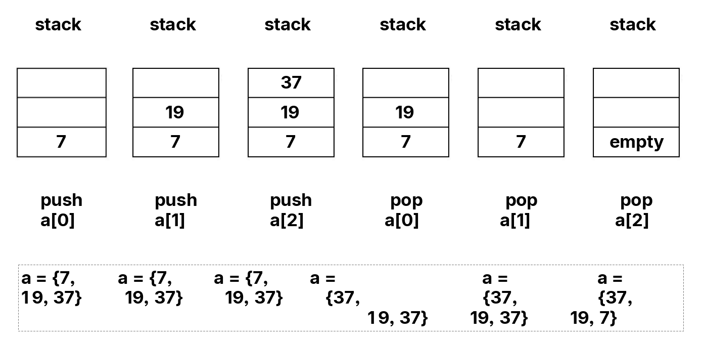

### 9.2 栈指令

压栈（push）操作将数据放入栈中，弹栈（pop）操作从栈中取出数据。指令格式如下：

```
push <操作数64>
pop  <操作数64>
```

操作数可以是寄存器或内存单元，但**不允许是立即数**。在64位架构下，`push`和`pop`默认操作四字（quadword，8字节）数据。

栈在内存中以**反向（从高地址向低地址）**的方式实现，具体原因将在后续小节详述。

------

#### 栈指令汇总

| 指令          | 说明                                                         |
| ------------- | ------------------------------------------------------------ |
| `push <op64>` | 将64位操作数压入栈中。 执行流程：先将`rsp`减8（指向新的栈顶），再将操作数复制到`[rsp]`处。 • 操作数不能是立即数 • 操作数本身的值不变 |
| 示例          | `push rax`    ; 将rax的值压栈 `push qword [qVal]` ; 将内存中qVal的值压栈 `push qVal`    ; 将qVal的**地址值**压栈（不是地址中的内容） |
| `pop <op64>`  | 从栈中弹出64位数据。 执行流程：从`[rsp]`处读取数据到操作数，再将`rsp`加8。 • 操作数不能是立即数 • 操作数的原值被覆盖 |
| 示例          | `pop rax`    ; 弹栈值存入rax `pop qword [qVal]` ; 弹栈值存入内存qVal `pop rsi`    ; 弹栈值存入rsi |

> 💡 若需压入超过64位的数据（如128位SSE寄存器内容），则需要多次`push`操作。虽然技术上可以压入少于64位的数据（如`push ax`），但**强烈不建议这样做**，因为这会破坏栈的16字节对齐要求（见译注）。

本书涉及指令的完整汇总参见附录B。

------

### 9.3 栈的实现

`rsp`寄存器始终指向当前栈顶在内存中的位置。与大多数架构一样，x86-64的栈在内存中**向下生长**（即从高地址向低地址扩展）。

#### 9.3.1 栈的内存布局

如第2章"体系结构"所述，程序的整体内存布局如下：

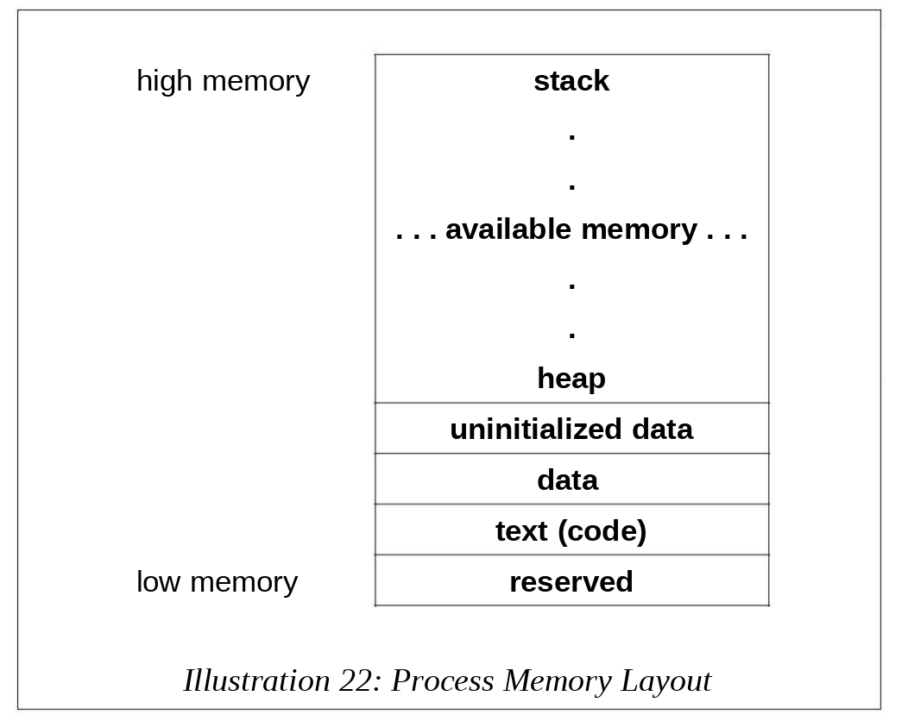

堆（Heap）用于存放动态分配的数据，例如C++中`new`操作符或C语言中`malloc()`系统调用申请的内存。由于动态数据是在运行时创建的，堆通常**向上生长**（从低地址向高地址扩展）。而栈则起始于高地址区域，**向下生长**（从高地址向低地址扩展），用于临时存储函数调用过程中的调用帧（call frame）等信息。大型程序或递归函数可能会消耗大量的栈空间。

随着堆和栈的不断扩展，二者相向生长、逐渐靠近。这种设计旨在确保内存得到最有效的整体利用。

因此，一个消耗大量栈空间但几乎不使用堆空间的程序（进程A）可以正常运行；而一个仅使用少量栈空间但申请了海量堆空间的程序（进程B）同样可以正常运行。

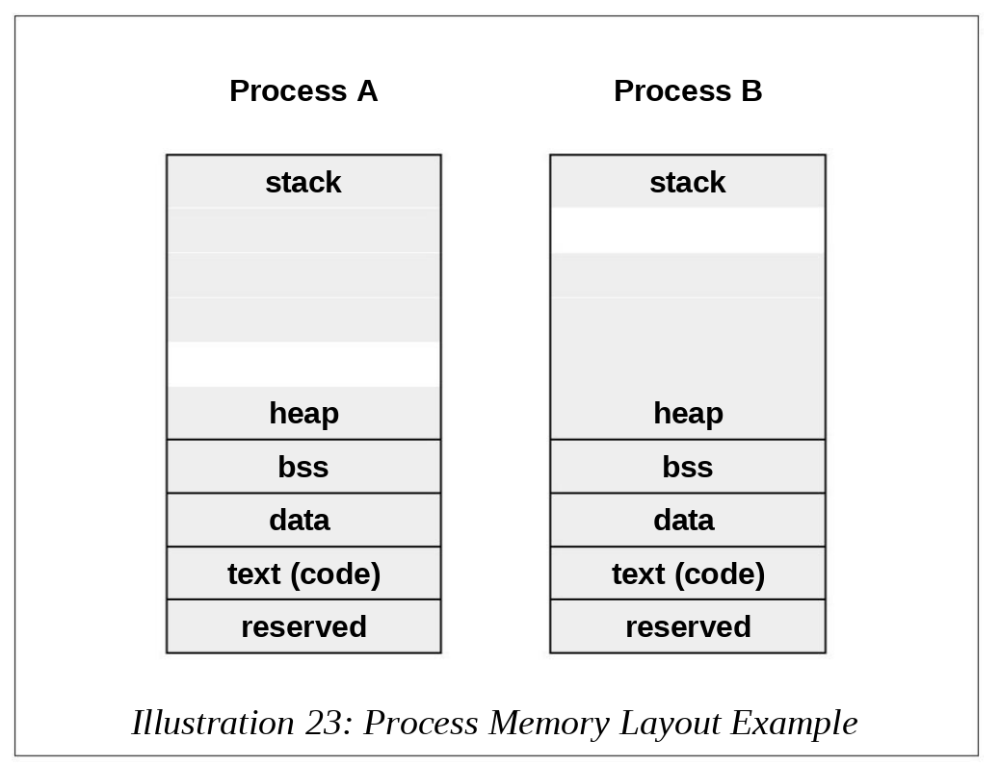

------

### 9.3.2 栈操作

当然，如果栈和堆的扩展区域相遇，程序就会崩溃——这意味着进程的可用内存已经耗尽。

基础的栈操作`push`和`pop`执行时会自动调整栈指针寄存器`rsp`：

- **`push`操作的执行步骤**：

  1. 将`rsp`的值减8（对应1个四字的长度）；

  2. 将操作数的内容复制到`[rsp]`指向的内存地址。

     操作数本身的值不会被修改，且这两步的执行顺序至关重要。

- **`pop`操作的执行步骤**：

  1. 将`[rsp]`指向的栈顶数据复制到目标操作数；

  2. 将`rsp`的值加8（对应1个四字的长度）。

     该顺序与`push`完全相反。弹栈操作并不会真正"删除"栈中的数据，但程序员**绝不能假设**弹栈后原数据还会保留在栈中（后续压栈操作会直接覆盖该区域）。不过，对于那些已被压栈但尚未弹出的数据，是可以通过地址偏移直接访问的。

例如，执行以下指令：

```asm
mov rax, 6700      ; 6700（十进制）= 0x00001A2C（十六进制）
push rax
mov rax, 31        ; 31（十进制）= 0x0000001F（十六进制）
push rax
```

将生成如下栈布局（每个小方格代表1字节内存）：

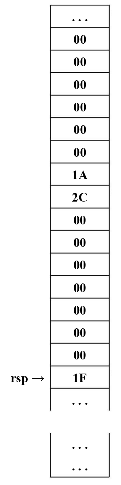

该布局图清晰地体现了x86架构的**小端序（Little-Endian）**特性：最低有效字节（Least Significant Byte）被存放在最低的内存地址处。

### 9.4 栈操作示例

以下示例程序演示如何使用栈**原地反转**一个四字数组。具体方法为：第一轮循环将数组中的每个值依次压入栈中；第二轮循环从栈中依次弹出每个值，并将其写回原数组（覆盖原有值），从而实现反转效果。

```asm
; *****************************************************
;  简单示例：演示基本栈操作
;  原地反转数值列表
;  方法：将每个数值压栈，再弹栈写回内存
; *****************************************************

; ----- 数据段 -----
section .data
    ; 常量定义
    EXIT_SUCCESS equ 0        ; 成功退出状态码
    SYS_exit    equ 60       ; Linux x86-64 exit系统调用号
    
    ; 数据定义
    numbers dq 121, 122, 123, 124, 125   ; 待反转的四字数组
    len     dq 5                         ; 数组长度

; ----- 代码段 -----
section .text
    global _start

_start:
    ; ==================================================
    ; 第一轮循环：将所有数值压入栈中
    ; ==================================================
    mov  rcx, qword [len]      ; rcx = 循环次数（数组长度）
    mov  rbx, numbers          ; rbx = 数组首地址
    mov  r12, 0                ; r12 = 数组索引，初始化为0
    mov  rax, 0                ; rax 清零（实际使用时会覆盖）

pushLoop:
    push qword [rbx + r12 * 8]   ; 将numbers[r12]压栈（每个元素8字节，索引×8）
    inc  r12                   ; 索引+1
    loop pushLoop              ; rcx减1，若不为0则继续循环

    ; ==================================================
    ; 此时所有数值均已按反序压入栈中
    ; 第二轮循环：从栈中弹出数值并写回原数组
    ; ==================================================
    mov  rcx, qword [len]      ; rcx = 循环次数（数组长度）
    mov  rbx, numbers          ; rbx = 数组首地址
    mov  r12, 0                ; r12 = 数组索引，初始化为0

popLoop:
    pop  rax                   ; 弹栈值存入rax（最先弹出的是原数组最后一个元素）
    mov  qword [rbx + r12 * 8], rax   ; 写回数组第r12个位置
    inc  r12                   ; 索引+1
    loop popLoop               ; rcx减1，若不为0则继续循环

    ; ==================================================
    ; 程序结束，退出
    ; ==================================================
last:
    mov  rax, SYS_exit
    mov  rdi, EXIT_SUCCESS
    syscall
```

> 💡 虽然反转数组还有其他实现方式（如双指针交换），但本示例旨在演示栈操作的基本原理。

## 第10章 程序开发

遵循清晰的开发方法能让程序的编写和实现更加顺畅。一套完整的方法论通常包含以下四个主要步骤：

1. **理解问题**
2. **设计算法**
3. **实现程序**
4. **测试与调试**

为详细演示这一过程，后续小节将通过一个简单的示例问题，逐步展示上述每一步的具体实践。

### 10.1 理解问题

在着手编写解决方案前，必须充分理解问题本身。彻底厘清需求能有效减少后续错误，节省开发时间和精力。第一步要明确核心需求，尤其是可用的输入信息和预期的输出结果。

以"将单个整数转换为表示该整数的字符串（字符序列）"为例：整数用于数值计算，但无法直接输出到控制台；而字符串可以输出到控制台，却不能参与数值运算。本例仅考虑**无符号（非负）整数**，有符号数的处理留作读者练习。

对于32位无符号双字整数，数值1498的十六进制表示为`0x000005DA`。而字符串形式的"1498"由字符`'1'`、`'4'`、`'9'`、`'8'`和一个NULL终止符组成，共需5字节存储空间（本例无需符号位或前导空格）。因此字符串"1498"的内存表示如下：

| 字符                | `'1'` | `'4'` | `'9'` | `'8'` | NULL |
| ------------------- | ----- | ----- | ----- | ----- | ---- |
| ASCII值（十进制）   | 49    | 52    | 57    | 56    | 0    |
| ASCII值（十六进制） | 0x31  | 0x34  | 0x39  | 0x38  | 0x00 |

本例的目标是将单个整数转换为以NULL结尾的对应字符串。

------

### 10.2 创建算法

算法是解决某一问题的明确、有序的步骤序列。充分理解问题后，即可设计一系列步骤来达成目标。同一个问题通常存在多种正确的解决方案。

不同人设计算法的习惯可能不同，但核心流程一般是：先花时间推演可能的实现思路（例如在草稿纸上演算），选定方案后再将其完善为正式算法，经过审核和优化后，作为程序实现的骨架。

以10.1节的整数转ASCII字符串问题为例：要将单个数字（0~9）转换为对应字符，只需给该数字加上48（即字符`'0'`的ASCII值`0x30`）即可。例如`0x01 + 0x30 = 0x31`，正好是字符`'1'`的ASCII值。显然，这个技巧仅对0~9的单数字有效。

要转换≥10的多位整数，需要将其分解为各个数位。例如十进制123（`0x7B`）可分解为1、2、3三个数位。这可以通过反复对10做整数除法，直到商为0来实现。

例如，以整数123的转换过程为例，反复除以10的运算步骤如下：

```
123 ÷ 10 = 12  ······ 余数 3
12  ÷ 10 = 1   ······ 余数 2
1   ÷ 10 = 0   ······ 余数 1
```

可以看到，每次除法的余数对应整数的各个数位，但获取顺序是**从低位到高位（逆序）**的。为解决逆序问题，程序可在每次除法后将余数压入栈中，待所有除法完成后，再从栈中弹出余数，转换为ASCII字符后存入字符串（字节数组）。

上述过程构成了算法的核心逻辑。需要说明的是，本问题存在多种正确实现方案，其中一种伪代码如下：

```asm
; ----- 第一部分：循环除10取余，余数压栈 -----
digitCount = 0              ; 记录数位总个数
get integer                 ; 获取待转换的无符号双字整数
divideLoop:
divide number by 10         ; 整数除以10
push remainder              ; 余数压入栈中
increment digitCount        ; 数位计数+1
if (result > 0) goto divideLoop  ; 若商不为0，继续循环

; ----- 第二部分：弹栈转ASCII，存入字符串 -----
get starting address of string (byte array)  ; 获取字符串首地址
idx = 0                         ; 数组索引初始化为0
popLoop:
pop intDigit                   ; 弹栈得到整数数位
charDigit = intDigit + "0"     ; 整数数位转ASCII字符（'0'的ASCII值为0x30）
string[idx] = charDigit        ; 字符存入字符串对应位置
increment idx                  ; 索引+1
decrement digitCount           ; 剩余未处理数位计数-1
if (digitCount > 0) goto popLoop    ; 若还有未处理的数位，继续循环
string[idx] = NULL              ; 字符串末尾添加NULL终止符
```

上述算法步骤以注释形式呈现便于对照。算法通常先在草稿纸上推导，再整理为结构化伪代码。若程序首次运行未通过，这些注释将成为调试的核心检查清单。部分程序员跳过注释环节，最终反而会花费更多时间调试——注释记录的是抽象算法逻辑，代码只是该逻辑的具体实现。

------

### 10.3 实现程序

基于上述算法即可展开具体编码。将算法步骤逐步扩展为汇编指令，能让程序员聚焦于当前代码段的特定问题（如数据类型、数据位宽等）。本例仅处理无符号数据，因此使用无符号除法指令`div`（而非有符号的`idiv`）。

由于待转换的整数是双字（32位），为满足`div`指令对被除数位宽的要求（32位除数的被除数必须是64位），需先将其零扩展为四字（64位）再进行除法；除法得到的商和余数同样为双字（32位）。由于x64架构下栈操作默认以四字（8字节）为单位，压栈时会将整个64位寄存器的值入栈，但我们仅使用低32位的余数，寄存器的高位部分不会被访问，因此其内容无关紧要。

该算法的一种可能实现如下：

```assembly
; *********************************************************
;  简单示例：将整数转换为ASCII字符串
; *********************************************************

; ----- 数据段 -----
section .data
    ; 常量定义
    NULL        equ 0
    EXIT_SUCCESS equ 0
    SYS_exit    equ 60

    ; 数据定义
    intNum  dd  1498        ; 待转换的无符号双字整数

; ----- 未初始化数据段 -----
section .bss
    strNum  resb 10         ; 字符串缓冲区（最多10位数字 + NULL终止符）

; ----- 代码段 -----
section .text
    global _start

_start:
    ; ==================================================
    ; 将整数转换为ASCII字符串
    ; ==================================================

    ; ----- 第一部分：循环除10取余，余数压栈 -----
    mov  eax, dword [intNum]   ; eax = 待转换的整数
    mov  rcx, 0                ; rcx = 数位计数器，初始化为0
    mov  ebx, 10               ; ebx = 除数10

divideLoop:
    mov  edx, 0                ; 无符号除法前清零edx（被除数高32位）
    div  ebx                   ; eax = eax / 10，余数存入edx
    push rdx                   ; 将余数（当前最低位）压栈
    inc  rcx                   ; 数位计数+1
    cmp  eax, 0                ; 判断商是否为0
    jne  divideLoop            ; 若商不为0，继续循环

    ; ----- 第二部分：弹栈转ASCII，存入字符串 -----
    mov  rbx, strNum           ; rbx = 字符串缓冲区首地址
    mov  rdi, 0                ; rdi = 字符串索引，初始化为0

popLoop:
    pop  rax                   ; 弹栈得到整数数位（在al中）
    add  al, "0"               ; 整数数位 + '0' = ASCII字符
    mov  byte [rbx + rdi], al  ; 字符存入字符串对应位置
    inc  rdi                   ; 字符串索引+1
    loop popLoop               ; rcx减1，若不为0则继续循环

    mov  byte [rbx + rdi], NULL ; 字符串末尾添加NULL终止符

    ; ----- 程序结束，退出 -----
last:
    mov  rax, SYS_exit
    mov  rdi, EXIT_SUCCESS
    syscall
```

本算法存在多种合法的汇编实现方案。程序应先通过汇编器检查拼写和语法错误。

### 10.4 程序测试与调试

程序编写完成后，必须通过测试验证其是否符合预期。测试应围绕程序的具体需求展开。

本例中，可以通过调试器运行程序，并在程序末尾附近（例如示例中的`last`标签处）设置断点。使用`ddd`启动调试器后，输入`b last`和`run`命令，程序会执行到`last`标签所在行之前暂停。此时可通过`x/s &strNum`命令查看生成的字符串`strNum`，正常情况下应输出`"1498"`，例如：

```
(gdb) x/s &strNum
0x600104: "1498"
```

若字符串显示异常，可以使用`x/5cb &strNum`命令逐字节检查这个5字节数组的每个字符。该命令会输出字符串的起始地址，以及每个字节的十进制值和ASCII字符表示，例如：

```
(gdb) x/5cb &strNum
0x600104: 49 '1' 52 '4' 57 '9' 56 '8' 0 '\000'
```

初次接触这种输出格式可能会感到困惑，熟悉后即可快速定位字符存储问题。

若输出结果不正确，就需要对代码进行调试。本例的程序逻辑主要分为两步：循环除10取余压栈、弹栈转换并存储字符。由于第二步依赖第一步的正确执行，因此应先验证第一步的正确性。可以通过以下方式在调试器中单独检查第一部分逻辑：第一步应恰好循环4次，结束时`rcx`的值应为4；且栈中按压栈顺序依次存入了`8`、`9`、`4`、`1`（对应1498的四个数位余数）。既可以在每次`push rdx`时观察`rdx`的寄存器值，也可以直接查看栈顶的4个条目来验证。

若第一部分逻辑正确，再验证第二部分：弹栈的顺序应依次为`1`、`4`、`9`、`8`，每个值加`'0'`（0x30）转换为ASCII字符后，依次存入字符串的对应位置。可以逐字符查看字符串内容，确认每个字符都被正确写入。

通过这种方式，可以快速缩小问题范围。高效的调试能力是编程的核心技能，需要通过大量实践打磨。

更多调试器具体命令的用法，请参考第6章《DDD调试器》。

------

### 10.5 错误术语

若程序运行异常，了解基本的错误分类术语有助于快速定位问题，也能让你更准确地与他人沟通故障现象。

#### 10.5.1 汇编错误

汇编错误发生在程序汇编阶段，意味着汇编器无法识别某条或多条指令。汇编器会输出错误列表及对应的行号。**建议按报错顺序从上到下逐一修复**，因为顶部的错误往往会导致后续一连串衍生错误，修复顶层错误后，下方的连锁错误可能会自动消失。

常见的汇编错误包括：指令拼写错误、变量未提前声明、操作数位宽不匹配（如`mov eax, bl`）、内存操作数缺少类型说明符（如`inc [rax]`未指定`byte`/`word`等）。

#### 10.5.2 运行时错误

运行时错误指程序能够正常汇编，但在运行过程中发生崩溃的错误。在Linux环境下通常表现为触发段错误（`SIGSEGV`）或浮点异常（`SIGFPE`，如除零）。

汇编程序中常见的运行时错误包括：除零、栈溢出、访问非法内存地址、栈对齐被破坏（调用函数前未满足16字节对齐要求）、`push`和`pop`次数不匹配导致栈不平衡等。

#### 10.5.3 逻辑错误

逻辑错误指程序能够正常汇编和运行，但最终输出结果不正确的错误。例如：公式实现错误、在计算总和之前就先计算平均值、循环条件判断错误等。

若程序存在逻辑错误，一种有效的排查方法是输出中间计算结果，对比预期值定位偏差。后续章节会提供更多逻辑错误的调试技巧。

##  第11章 **宏**

汇编宏是预定义的一组指令集合，可在代码中任意需要的位置插入。宏只需定义一次，即可按需多次调用，非常适合需要重复使用同一段逻辑的场景。合理使用宏可以减少代码冗余、简化程序结构，还能避免因重复手写代码引入的错误。

NASM/yasm汇编器内置了强大的宏处理器，支持条件汇编、多级文件包含、两种宏形式（单行宏与多行宏），还提供**上下文栈机制**以实现更复杂的宏功能。

宏的定义必须放在源文件的数据段（`.data`）和代码段（`.text`）之前，调用则位于代码段中。后续小节将通过完整示例演示宏的定义与使用。

------

### 11.1 单行宏

宏分为两大类：单行宏和多行宏，本节先介绍单行宏。

单行宏通过`%define`预处理指令定义，用法与C/C++的`#define`类似。例如：

```nasm
%define mulby4(x)   shl x, 2
```

定义后即可在代码中调用：

```nasm
mulby4(rax)
```

该调用会被汇编器展开为`shl rax, 2`，即将`rax`中的值左移2位（等价于乘以4）。

------

### 11.2 多行宏

多行宏可包含任意行数的指令（甚至仅1行），比单行宏更灵活实用，因此本节后续内容将重点围绕多行宏展开。

#### 11.2.1 多行宏的定义

多行宏在使用前必须先定义，通用格式如下：

```nasm
%macro <宏名>  <参数个数>
    ; 宏体（任意条指令）
%endmacro
```

宏体内通过`%1`、`%2`……`%n`引用第1、2……n个参数。

⚠️ **宏内标号的注意事项**：如果宏体中需要使用标号（如循环、条件跳转的目标），必须在标号前加`%%`前缀，这样每次调用宏时，汇编器都会生成唯一的标号名，避免多次调用同一宏时出现标号重定义错误。

例如，一个求绝对值的多行宏定义如下：

```nasm
%macro abs 1          ; 宏名abs，接收1个参数
    cmp  %1, 0        ; 比较参数与0
    jge  %%done       ; 若≥0则跳转到宏内局部标号
    neg  %1           ; 若<0则取负
%%done:               ; 局部标号，每次展开自动重命名
%endmacro
```

#### 11.2.2 多行宏的调用

调用（也称"展开"）多行宏时，只需在代码段中写入宏名，并传入对应数量的参数即可。

假设已有如下数据定义：

```nasm
qVar    dq    4
```

则可以这样调用上述`abs`宏：

```nasm
mov eax, -3
abs eax            ; 调用abs宏，参数为eax
abs qword [qVar]   ; 调用abs宏，参数为内存变量qVar
```

汇编器生成的列表文件（`.lst`）会展示宏展开后的代码，以上述第一次调用`abs eax`为例：

```
27 00000000 B8FDFFFFFF         mov  eax, -3
 28                             abs  eax
 29 00000005 3D00000000  <1>  cmp %1, 0
 30 0000000A 7D02        <1>  jge %%done
 31 0000000C F7D8        <1>  neg %1
 32                      <1> %%done:
```

可以看到，宏调用被完整替换为宏体内容，参数`%1`被替换为实参`eax`，行尾的`<1>`标记表示该行来自第1次宏展开。

宏的本质是**编译期代码复制**：每次调用宏时，汇编器都会将宏体的代码完整复制到调用位置，并替换其中的参数。因此宏不会引入函数调用的控制转移开销，但会让最终的可执行文件体积变大。

------

### 11.3 宏示例

以下示例程序演示了一个简单宏的定义与使用。

```nasm
; **************************************************
;  示例程序：演示简单宏的定义与调用
; **************************************************

; ----- 宏定义 -----
; 宏名：aver
; 参数：%1 = 列表首地址, %2 = 列表长度变量, %3 = 平均值结果存储变量
%macro aver 3
    mov  eax, 0                  ; eax = 累加和，初始化为0
    mov  ecx, dword [%2]         ; ecx = 循环次数（列表长度）
    mov  r12, 0                  ; r12 = 数组索引，初始化为0
    lea  rbx, [%1]               ; rbx = 列表首地址

%%sumLoop:
    add  eax, dword [rbx + r12 * 4] ; 累加 list[r12]（每个元素4字节）
    inc  r12                      ; 索引+1
    loop %%sumLoop                ; rcx减1，若不为0则继续循环

    cdq                           ; 有符号除法前，将eax符号扩展至edx:eax
    idiv dword [%2]               ; eax = 总和 ÷ 长度，商存入eax
    mov  dword [%3], eax          ; 将平均值存入结果变量
%endmacro

; ----- 数据段 -----
section .data
    ; 常量定义
    EXIT_SUCCESS equ 0
    SYS_exit    equ 60

    ; 数据集1
    list1 dd  4, 5, 2, -3, 1
    len1  dd  5
    ave1  dd  0

    ; 数据集2
    list2 dd  2, 6, 3, -2, 1, 8, 19
    len2  dd  7
    ave2  dd  0

; ----- 代码段 -----
section .text
    global _start

_start:
    ; ----- 调用宏计算平均值 -----
    aver list1, len1, ave1    ; 计算list1的平均值，结果存入ave1
    aver list2, len2, ave2    ; 计算list2的平均值，结果存入ave2

    ; ----- 程序结束，退出 -----
last:
    mov  rax, SYS_exit
    mov  rdi, EXIT_SUCCESS
    syscall
```

本例中`aver`宏被调用了两次。每次调用时，汇编器都会将宏体的完整代码复制到调用位置，并用实参替换形参。因此宏通常会占用更多内存空间（代码段体积增大），但不会引入函数调用的控制转移开销。

### 11.4 宏的调试

调试器的源码窗口中**不会显示宏的定义代码**。当宏运行正常时，这反而减少了代码视图的干扰；但在调试宏的问题时，就必须能看到宏展开后的实际指令。

要查看宏的实际执行代码，需要打开**机器码窗口**（在DDD图形化调试器的菜单中选择 *View → Machine Code Window*），窗口中会显示每条指令对应的机器码。普通的`step`（逐源码行执行）和`next`（逐源码行执行但不进入子过程）命令会将整个宏作为单一步骤执行完毕，无法单步跟踪宏内部的逻辑。若要逐条执行宏内的指令，必须使用`stepi`（单步执行一条机器指令）和`nexti`（单步执行一条机器指令但不进入子过程）命令。

调试器中显示的宏代码，是**预处理展开后的代码**，而非原始的宏定义。

## 第12章 **函数**

函数与过程（即无返回值函数）可将程序拆分为更小的功能模块，大幅降低编码、调试与维护的成本。函数调用主要涉及两类核心操作：

- **调用返回机制**

  由于函数可能从代码中的多个不同位置被调用，因此必须能够正确返回到最初的调用点。

- **参数传递**

  函数必须能够访问传入的参数以执行运算，或返回计算结果（例如访问传引用参数）。

上述两项操作的具体实现细节将在后续小节中逐一讲解。

### 12.1 更新后的链接指令

编写和调试函数时，使用C编译器（`gcc`或`g++`）进行链接会更加便捷，因为编译器知晓各类C/C++库的正确存放路径。

假设源文件名为`example.asm`，完整的编译、汇编、链接、执行流程如下：

```bash
yasm -g dwarf2 -f elf64 example.asm -l example.lst
gcc -g -o example example.o
```

> 💡 **注意**：Ubuntu 18.04及以上版本需要在`gcc`命令中添加`-no-pie`选项，完整命令为：
>
> ```bash
> gcc -g -no-pie -o example example.o
> ```

上述流程会通过GCC调用链接器，读取`example.o`目标文件并生成`example`可执行文件。命令中的`-g`选项会按常规方式在可执行文件中嵌入调试信息，文件名可根据需求自定义。

------

### 12.2 调试器命令

使用调试器调试包含函数的程序时，复习`next`和`step`两个命令的用法会很有帮助。

#### 12.2.1 `next`命令

针对函数调用场景，`next`命令会**完整执行整个函数**，随后停在调用语句的下一行。调试时若已确认函数逻辑正确，希望快速跳过函数执行并仅验证返回结果，该命令非常实用，且不会显示函数内部的代码。

#### 12.2.2 `step`命令

针对函数调用场景，`step`命令会**进入函数内部**，停在函数代码的第一行并显示函数源码。调试时需要逐行排查函数内部逻辑时，该命令是核心工具。

------

### 12.3 栈动态局部变量

在高级语言中，函数内声明的非静态局部变量默认都是**栈动态局部变量**（部分C++教材称之为"自动变量/automatic变量"）。这类变量的内存空间在栈上动态分配，并将栈地址绑定到变量名上；函数执行完毕后，这部分栈空间会被自动回收并复用。虽然这会带来少量的运行时开销，但能大幅提升内存的整体利用率：如果一个包含大量局部变量的函数从未被调用，其局部变量的内存就永远不会被分配，从而减小程序的整体内存占用量，通常也能提升程序的整体性能。

与之相对，**静态声明的变量**在整个程序运行期间都会占用固定的内存位置。即使关联的函数未被执行，这部分内存也不会释放，但由于空间分配在程序加载阶段就已经完成，运行时无需额外的分配开销。

### 12.4 函数声明

函数必须先定义后才能使用。函数代码位于代码段（`.text`）中，通用格式如下：

```nasm
global <函数名>
<函数名>:
    ; 函数体
    ret
```

每个函数只能定义一次。函数的定义顺序没有强制要求，但**函数不能嵌套定义**——一个函数的定义必须完整结束（遇到`ret`或函数末尾）后，才能开始下一个函数的定义。

关于函数声明和用法的完整示例，请参考后续示例程序。

------

### 12.5 标准调用约定

编写汇编程序时，需要一套统一的参数传递、返回值处理和寄存器分配规范。如果每个函数都各自为政地使用不同的方式处理这些操作，代码很快就会变得混乱不堪，程序员不得不记住每个函数的特殊约定。为了解决这个问题，业界定义了**标准调用约定（Standard Calling Convention）**。

x86-64架构下存在多种标准调用约定，本文档主要介绍**System V AMD64 ABI**——即64位Linux（及Unix-like系统）下C/C++程序默认使用的调用约定。由于汇编代码与C/C++代码遵循同一套约定，二者之间的接口调用变得非常简单直接。

⚠️ **注意**：本节介绍的标准调用约定适用于Linux类操作系统。Microsoft Windows使用的标准调用约定略有不同（称为Microsoft x64 Calling Convention），不在本书讨论范围内。

------

### 12.6 调用返回机制（Linkage）

调用返回机制的核心是确保函数能正确跳转到目标地址执行，并在完成后返回到原调用点。x86架构提供两条专用指令处理这一流程：`call <函数名>`和`ret`。

- **`call`指令**：将控制权转移到指定函数。其实现方式是把**返回地址**（即`call`指令之后那条指令的地址）压入栈中，然后跳转到函数入口。`rip`寄存器始终指向下一条待执行的指令，`call`指令正是利用这一点获取返回地址的。
- **`ret`指令**：用于从函数中返回。它从栈顶弹出一个值并载入`rip`寄存器，从而恢复原先的返回地址，使程序回到调用点继续执行。

由于调用返回机制依赖栈来保存返回地址，函数内部**绝不能破坏栈的平衡**。具体来说，凡是压入栈的数据最终都必须弹出。如果压栈后忘记弹栈，函数末尾的`ret`指令就会把栈顶残留的数据误当作返回地址弹入`rip`，导致CPU尝试跳转到无效地址执行，几乎必然引发程序崩溃（段错误）。

函数调用/返回指令汇总如下：

| 指令            | 说明                                                         |
| --------------- | ------------------------------------------------------------ |
| `call <函数名>` | 将下一条指令的地址（`rip`的值）压栈，然后跳转到`<函数名>`处执行。 |
| `ret`           | 从栈顶弹出返回地址到`rip`，返回到调用点继续执行。            |

------

### 12.7 参数传递

参数传递指将信息（变量等）传入函数，并根据函数需求获取返回结果的过程。

将值传递给函数的标准术语是**传值调用（call-by-value）**，将地址传递给函数的标准术语是**传引用调用（call-by-reference）**——这应该是你在高级语言中已经熟悉的概念。

向函数传递参数的方式有多种：

- **通过寄存器传递**
  - 最简单，但受限于可用寄存器的数量
  - 前6个整型参数通过寄存器传递（System V AMD64 ABI规范）
  - 系统调用也使用寄存器传递参数
- **通过全局变量传递**
  - 通常是不好的做法，容易造成混淆，且在许多场景下不可用
  - 仅在极少数受限场景下偶尔有用
- **通过栈传递**
  - 可传递的参数数量没有硬性限制
  - 但会引入更高的运行时开销

一般而言，发起调用的函数称为**调用者（caller）**，被调用的函数称为**被调用者（callee）**。

------

### 12.8 调用约定

**函数序言（prologue）**是位于函数开头的代码，**函数尾声（epilogue）**是位于函数结尾的代码。序言和尾声中执行的操作通常由标准调用约定规定，负责处理栈、寄存器、传入参数（如有）以及栈动态局部变量（如有）。

其核心思想是：在进入函数前**保存程序状态**（特定寄存器的内容和栈的状态），执行函数体逻辑，然后在函数返回前**恢复程序状态**。函数执行过程中往往需要大量使用寄存器和栈，序言负责保存状态，尾声负责恢复状态，从而保证函数返回后调用者的环境不受影响。

#### 12.8.1 参数传递

如前所述，参数传递采用**寄存器与栈相结合**的方式。

**前6个整型参数**通过以下寄存器传递：

| 参数序号 | 64位  | 32位  | 16位  | 8位   | 参数用途 |
| -------- | ----- | ----- | ----- | ----- | -------- |
| 第1个    | `rdi` | `edi` | `di`  | `dil` | 第1参数  |
| 第2个    | `rsi` | `esi` | `si`  | `sil` | 第2参数  |
| 第3个    | `rdx` | `edx` | `dx`  | `dl`  | 第3参数  |
| 第4个    | `rcx` | `ecx` | `cx`  | `cl`  | 第4参数  |
| 第5个    | `r8`  | `r8d` | `r8w` | `r8b` | 第5参数  |
| 第6个    | `r9`  | `r9d` | `r9w` | `r9b` | 第6参数  |

**第7个及后续参数**通过栈传递。标准调用约定要求：当通过栈传递参数（值或地址）时，参数必须**按逆序压栈**。例如对于函数调用 `someFunc(one, two, three, four, five, six, seven, eight, nine)`，压栈顺序应为：`nine` → `eight` → `seven`（即最后一个参数最先压栈）。

**浮点参数**方面，前8个浮点参数依次使用 `xmm0` 到 `xmm7` 寄存器传递。

**栈参数的清理责任**：函数执行完毕后，**调用者（caller）**负责清理栈上传入的参数。清理时通常不是用一系列`pop`指令，而是直接调整栈指针`rsp`——因为每个参数占8字节，所以将`rsp`加上`(参数个数 × 8)`即可完成清理。

**返回值传递**：对于有返回值的函数，返回值根据位宽存放在对应的A寄存器中：

| 返回值位宽   | 存放位置 |
| ------------ | -------- |
| 字节（8位）  | `al`     |
| 字（16位）   | `ax`     |
| 双字（32位） | `eax`    |
| 四字（64位） | `rax`    |
| 浮点数       | `xmm0`   |

函数在执行过程中可以自由使用`rax`，只要在返回前将正确的值写入即可。

#### 12.8.2 寄存器使用规范

标准调用约定明确规定了函数调用时各寄存器的使用责任。某些寄存器要求在函数调用期间**保持其值不变（被调用者保存/Callee-Saved）**——即如果函数需要使用这类寄存器，必须先将原值压栈保存，用完后在返回前恢复原值。这类保存操作通常在函数序言中完成，恢复操作在函数尾声中完成。

各寄存器的使用规范总结如下：

| 寄存器      | 用途       | 保存责任                   |
| ----------- | ---------- | -------------------------- |
| `rax`       | 返回值     | 调用者不期望其值被保留     |
| `rbx`       | 通用       | **被调用者保存**           |
| `rcx`       | 第4参数    | 调用者不期望其值被保留     |
| `rdx`       | 第3参数    | 调用者不期望其值被保留     |
| `rsi`       | 第2参数    | 调用者不期望其值被保留     |
| `rdi`       | 第1参数    | 调用者不期望其值被保留     |
| `rbp`       | 帧基址指针 | **被调用者保存**           |
| `rsp`       | 栈指针     | 特殊（由调用约定自动管理） |
| `r8`        | 第5参数    | 调用者不期望其值被保留     |
| `r9`        | 第6参数    | 调用者不期望其值被保留     |
| `r10`       | 临时寄存器 | 调用者不期望其值被保留     |
| `r11`       | 临时寄存器 | 调用者不期望其值被保留     |
| `r12`~`r15` | 通用       | **被调用者保存**           |

简而言之：

- **临时寄存器**（`rax`、`r10`、`r11`以及所有参数寄存器`rdi`~`r9`）：函数可以随意修改，无需保存原值。
- **被调用者保存寄存器**（`rbx`、`rbp`、`r12`~`r15`）：函数若修改这些寄存器，必须在返回前恢复原值。
- **浮点寄存器**（`xmm0`~`xmm15`）：默认均不被保留，函数可以随意修改。

> 💡 关于浮点运算的更多信息，请参阅第18章。

------

### 12.8.3 调用栈帧

函数调用时在栈上形成的结构称为**调用栈帧（Call Frame）**，也称激活记录（Activation Record）或栈帧（Stack Frame）。根据标准调用约定，栈帧中各元素的排列遵循特定格式。

一个完整的栈帧可能包含以下元素：

- **返回地址**（必需）：`call`指令自动压入，供`ret`指令使用。
- **被保存的寄存器**（如有）：函数序言中压栈保存的被调用者寄存器。
- **传入参数**（如有）：第7个及后续参数通过栈传递的部分。
- **栈动态局部变量**（如有）：函数内部声明的非静态局部变量。

此外，某些动态作用域语言还会在栈帧中加入静态链接等额外信息，但这些内容超出本书范围，不予讨论。

**简化栈帧的情形**：对于某些简单函数，完整栈帧可能不是必需的。例如当一个函数是**叶子函数（leaf function，即不调用其他函数的函数）**，且满足以下条件时：

- 所有参数都通过寄存器传递（不使用栈参数）；
- 不修改任何被调用者保存寄存器；
- 不需要栈上局部变量；

这类简单的小型叶子函数可以省略栈帧的建立过程，直接执行函数体逻辑，从而减少开销。

然而，只要上述任一条件不满足，就必须建立完整的调用栈帧。

对于非叶子函数或更复杂的函数，需要更完整的栈帧结构。

标准调用约定并不强制要求使用帧指针寄存器`rbp`。编译器可以进行优化，省略帧指针的使用。但为了**简化并清晰化**对栈上传入参数和栈动态局部变量的访问，本书将统一使用帧指针寄存器。这与许多其他体系结构的做法一致。

因此，如果函数需要使用栈参数或局部变量，应当先压栈保存当前的`rbp`值，然后将`rbp`设置为当前的栈指针`rsp`（即让`rbp`指向自身）。此后，即便通过`push`/`pop`操作改变了`rsp`的值，`rbp`的值始终保持稳定，可以作为**参考基准**来访问栈上的传入参数（如有）或栈动态局部变量（如有）。

例如，假设一个函数接收8个参数，且函数体内使用了`rbx`、`r12`和`r13`寄存器（因此必须压栈保存），其栈帧布局如下：

```
高地址
┌─────────────────────┐
│    第8个参数         │ ← rbp + 24
├─────────────────────┤
│    第7个参数         │ ← rbp + 16
├─────────────────────┤
│   返回地址 (rip)     │ ← rbp + 8
├─────────────────────┤
│    旧 rbp           │ ← rbp
├─────────────────────┤
│    保存的 rbx        │
├─────────────────────┤
│    保存的 r12        │
├─────────────────────┤
│    保存的 r13        │ ← rsp（栈顶）
└─────────────────────┘
低地址
插图24：栈帧布局
```

栈上传入参数相对于`rbp`进行访问。每次`push`操作压入的是一个四字（8字节）。例如，`[rbp+16]`是第1个栈参数（即第7个整型参数）的地址，`[rbp+24]`是第2个栈参数（即第8个整型参数）的地址。

此外，调用栈帧中还包含局部变量的分配位置（如有）。关于局部变量的分配和使用细节将在后续小节中详述。

------

#### 12.8.3.1 红区（Red Zone）

在Linux标准调用约定中，`rsp`向下的**前128字节**是被保留的区域，称为**红区**。沿用上例，包含红区的完整栈帧布局如下：

```
高地址
┌─────────────────────┐
│    第8个参数         │ ← rbp + 24
├─────────────────────┤
│    第7个参数         │ ← rbp + 16
├─────────────────────┤
│   返回地址 (rip)     │ ← rbp + 8
├─────────────────────┤
│    旧 rbp           │ ← rbp
├─────────────────────┤
│   保存的 rbx         │
├─────────────────────┤
│   保存的 r12         │
├─────────────────────┤
│   保存的 r13         │
├─────────────────────┤
│    ......           │
│   红区 (128字节)     │ ← rsp 向下延伸
│    ......           │
└─────────────────────┘
低地址
插图25：含红区的栈帧布局
```

函数可以在**不调整栈指针`rsp`的前提下**自由使用红区。红区的设计目的是为编译器优化局部变量分配提供便利——小型临时变量可以直接放在红区中，省去了调整`rsp`的开销。对于直接用汇编语言编写的程序而言，红区通常不会产生直接影响。

### 12.9 示例：统计函数1（叶子函数）

本示例演示如何调用一个简单的无返回值函数，计算数值数组的总和与平均值。对应的C/C++高层语言调用形式如下：

```c
stats1(arr, len, sum, ave);
```

按照C/C++惯例，`arr`（数组）采用传引用方式，`len`（长度）采用传值方式。`sum`和`ave`的参数同样采用传引用方式（因为它们还没有值，需要函数写入结果）。本例中`arr`、`sum`和`ave`均为有符号双字整数；当然，在此上下文中`len`必须是无符号的。

------

#### 12.9.1 调用者代码

本例共有4个参数，全部通过寄存器传递，符合标准调用约定。调用者中发起`stats1`函数调用的汇编代码如下：

```nasm
; stats1(arr, len, sum, ave);
mov  rcx, ave        ; 第4参数：ave的地址
mov  rdx, sum        ; 第3参数：sum的地址
mov  esi, dword [len]; 第2参数：len的值（传值）
mov  rdi, arr        ; 第1参数：arr的地址
call stats1
```

设置参数寄存器的顺序没有硬性要求。本例采用逆序设置（从第4参数到第1参数），是为后续更复杂的示例做准备。

⚠️ 注意：将值载入`esi`的同时会自动将`rsi`的高32位清零（x86-64架构特性），由于`len`是无符号值，这确保了`rsi`寄存器被正确设置。

由于这是一个无返回值函数（`void`），调用后无需检查返回值。如果函数有返回值，返回值会存放在对应位宽的A寄存器中。

------

#### 12.9.2 被调用者代码

被调用函数（`stats1`）必须在执行核心逻辑之前和之后，按照标准调用约定完成**函数序言**和**函数尾声**操作。本例中，函数需要完成数组求和、计算整数平均值，并通过引用参数返回和与平均值。

`stats1`函数的完整实现如下：

```nasm
; *************************************************
;  简单示例函数：计算数组的和与平均值
; *************************************************
; 高层语言调用：stats1(arr, len, sum, ave);
; -----
;  参数：
;  arr  → 地址，rdi
;  len  → 双字值，esi
;  sum  → 地址，rdx
;  ave  → 地址，rcx
; -----
global stats1

stats1:
    ; ----- 函数序言 -----
    push r12                ; 保存被调用者寄存器r12（索引计数器）
    
    ; ----- 函数体 -----
    mov  r12, 0              ; r12 = 数组索引，初始化为0
    mov  eax, 0              ; eax = 累加和，初始化为0
    
sumLoop:
    add  eax, dword [rdi + r12 * 4]  ; sum += arr[r12]（每个元素4字节）
    inc  r12                       ; 索引+1
    cmp  r12, rsi                  ; 比较索引与数组长度
    jl   sumLoop                   ; 若 index < len，继续循环
    
    mov  dword [rdx], eax     ; 将总和写入sum指向的内存
    
    cdq                        ; 有符号除法前，将eax符号扩展至edx:eax
    idiv esi                   ; eax = 总和 ÷ 长度，商存入eax
    mov  dword [rcx], eax     ; 将平均值写入ave指向的内存
    
    ; ----- 函数尾声 -----
    pop  r12                  ; 恢复r12的原值
    ret                       ; 返回调用者
```

本例中选择`r12`作为循环索引寄存器是任意的，但特意选用了**被调用者保存寄存器**。由于`r12`属于被调用者必须保存的寄存器类别，函数修改它之前必须压栈保存，返回前恢复，这符合标准调用约定。

该函数的栈帧极为精简，布局如下：

```
高地址
┌─────────────────┐
│   返回地址      │ ← rsp+8（call指令压入）
├─────────────────┤
│   保存的 r12    │ ← rsp（push r12后）
└─────────────────┘
低地址
```

由于栈的使用极少，该函数调用的运行时开销被降至最低。

### 12.10 示例：统计函数2（非叶子函数）

本扩展示例演示如何调用一个无返回值函数，计算已排序数组中数值的最小值、中位数、最大值、总和与平均值。

对应的C/C++高层语言调用形式如下：

```c
stats2(arr, len, min, med1, med2, max, sum, ave);
```

本例中假设数组已按升序排列。由于数组长度可能为偶数或奇数，中位数处理逻辑如下：

- **偶数长度**：存在两个中间值`med1`和`med2`，均返回；

- **奇数长度**：仅一个中间值，同时存入`med1`和`med2`。

按照C/C++惯例，`arr`（数组）采用传引用方式，`len`（长度）采用传值方式。`min`、`med1`、`med2`、`max`、`sum`和`ave`均采用传引用方式（因尚无值，需函数写入结果）。本例中`arr`、`min`、`med1`、`med2`、`max`、`sum`和`ave`均为有符号双字整数；`len`为无符号数。

------

#### 12.10.1 调用者代码

本例共有8个参数，前6个通过寄存器传递，第7和第8个通过栈传递。调用者中发起`stats2`函数调用的汇编代码如下：

```nasm
; stats2(arr, len, min, med1, med2, max, sum, ave);
push ave                ; 第8参数：ave的地址（栈传递）
push sum                ; 第7参数：sum的地址（栈传递）
mov  r9, max            ; 第6参数：max的地址
mov  r8, med2           ; 第5参数：med2的地址
mov  rcx, med1          ; 第4参数：med1的地址
mov  rdx, min           ; 第3参数：min的地址
mov  esi, dword [len]  ; 第2参数：len的值（传值）
mov  rdi, arr           ; 第1参数：arr的地址
call stats2
add  rsp, 16            ; 清理栈上传递的2个参数（2×8=16字节）
```

第7和第8个参数按标准调用约定**逆序压栈**。函数执行完毕后，通过直接调整栈指针`rsp`来清理栈上参数。由于栈上传递了2个8字节参数，因此将`rsp`加16即可回收空间。

> 💡 注意：向`esi`写入数据会自动清零`rsi`的高32位，确保`len`作为无符号数时被正确设置。由于本例为`void`函数，无需处理返回值。

------

#### 12.10.2 被调用者代码

被调用函数`stats2`必须按照标准调用约定完成函数序言和尾声操作，同时实现最小值、中位数、最大值、总和及平均值的计算与返回。

**栈上传引用参数的特殊处理**：当传引用参数通过栈传递时，返回数值需要两步操作：

1. 从栈上读取目标变量的地址；

2. 通过该地址将计算结果写入目标变量。

常见错误是试图一步到位地将值直接写入栈槽本身，这只会导致栈上的地址值被覆盖，而原引用变量未被修改。例如，假设`eax`中存有待返回的32位值，第7个参数（传引用）需要接收该值，正确写法为：

```nasm
mov  r12, qword [rbp+16]   ; 步骤1：从栈上读取目标变量地址
mov  dword [r12], eax      ; 步骤2：通过地址写入目标变量
```

以下写法是错误的：

```nasm
mov  dword [rbp+16], eax   ; 错误：覆盖了栈上保存的地址值，原变量未受影响
```

`stats2`函数的完整实现如下：

```nasm
; *************************************************
;  示例函数：计算数组的最小值、最大值、中位数、
;  总和与平均值
; *************************************************
; 高层语言调用：stats2(arr, len, min, med1, med2, max, sum, ave);
; -----
;  参数：
;  arr  → 地址，rdi
;  len  → 双字值，esi
;  min  → 地址，rdx
;  med1 → 地址，rcx
;  med2 → 地址，r8
;  max  → 地址，r9
;  sum  → 地址，栈上(rbp+16)
;  ave  → 地址，栈上(rbp+24)
; -----
global stats2

stats2:
    ; ----- 函数序言 -----
    push rbp               ; 保存旧帧指针
    mov  rbp, rsp          ; 建立新栈帧
    push r12               ; 保存被调用者寄存器
    
    ; ----- 获取最小值和最大值 -----
    mov  eax, dword [rdi]        ; eax = arr[0]
    mov  dword [rdx], eax        ; min = arr[0]
    
    mov  r12, rsi                ; r12 = len
    dec  r12                     ; r12 = len - 1
    mov  eax, dword [rdi+r12 * 4]  ; eax = arr[len-1]
    mov  dword [r9], eax         ; max = arr[len-1]
    
    ; ----- 获取中位数 -----
    mov  rax, rsi                ; rax = len
    mov  rdx, 0
    mov  r12, 2
    div  r12                     ; rax = len / 2（商），rdx = len % 2（余数）
    
    cmp  rdx, 0
    je   evenLength              ; 若余数为0，长度为偶数
    
    ; 奇数长度：中位数为arr[len/2]
    mov  r12d, dword [rdi+rax*4] ; r12d = arr[len/2]
    mov  dword [rcx], r12d       ; med1 = 中位数
    mov  dword [r8], r12d        ; med2 = 中位数
    jmp  medDone
    
evenLength:
    ; 偶数长度：两个中间值分别为arr[len/2]和arr[len/2-1]
    mov  r12d, dword [rdi+rax*4] ; r12d = arr[len/2]
    mov  dword [r8], r12d        ; med2 = arr[len/2]
    dec  rax                     ; rax = len/2 - 1
    mov  r12d, dword [rdi+rax*4] ; r12d = arr[len/2-1]
    mov  dword [rcx], r12d       ; med1 = arr[len/2-1]
    
medDone:
    ; ----- 计算总和 -----
    mov  r12, 0                  ; 数组索引
    mov  eax, 0                  ; 累加和
sumLoop:
    add  eax, dword [rdi+r12 * 4]  ; sum += arr[r12]
    inc  r12
    cmp  r12, rsi
    jl   sumLoop
    
    ; 返回sum（栈上传引用参数，需两步操作）
    mov  r12, qword [rbp+16]     ; 从栈上读取sum变量的地址
    mov  dword [r12], eax        ; 写入sum值
    
    ; ----- 计算平均值 -----
    cdq                          ; 符号扩展eax至edx:eax
    idiv rsi                     ; eax = sum / len
    
    ; 返回ave（栈上传引用参数）
    mov  r12, qword [rbp+24]     ; 从栈上读取ave变量的地址
    mov  dword [r12], eax        ; 写入ave值
    
    ; ----- 函数尾声 -----
    pop  r12                     ; 恢复r12
    pop  rbp                     ; 恢复rbp
    ret
```

该函数的栈帧布局如下：

```
高地址
┌─────────────────┐
│   第8参数 (ave)  │ ← rbp + 24
├─────────────────┤
│   第7参数 (sum)  │ ← rbp + 16
├─────────────────┤
│   返回地址       │ ← rbp + 8
├─────────────────┤
│   旧 rbp         │ ← rbp
├─────────────────┤
│   保存的 r12     │ ← rsp
└─────────────────┘
低地址
```

> ⚠️ **重要**：被保存的寄存器（`rbp`和`r12`）在栈上的压栈顺序与弹栈顺序必须严格相反，才能保证正确恢复原始值。

------

### 12.11 栈上局部变量

若函数需要局部变量，则在栈上为其分配空间。通过调整`rsp`寄存器即可在栈上为局部变量预留内存，函数返回时这些空间自动释放，不占用持久内存。

沿用前述示例，假设数组元素值均在0~99之间，现需计算众数（出现频率最高的数），可使用一个双字变量`count`和一个100元素的双字数组`tmpArr[100]`。

如前所述，先将帧指针`rbp`压栈并设置为当前栈指针。此后`rbp`可作为基准访问栈上参数（如`rbp+16`是第7个参数的地址）。

在`rbp`压栈后，需要调整`rsp`为局部变量分配空间。本例中`count`占4字节，`tmpArr`含100个双字元素占400字节，合计404字节。由于栈向下生长，需从`rsp`中减去404字节：

```nasm
sub rsp, 404    ; 为局部变量分配404字节空间
```

随后再压栈保存需要保护的寄存器（本例为`rbx`和`r12`）。

函数返回时，先弹栈恢复被保存的寄存器，然后通过`mov rsp, rbp`一次性回收所有局部变量空间。这种方式优于直接给`rsp`加偏移量，因为后续若调整局部变量的大小，只需修改序言中的分配值，无需改动尾声代码。

> 💡 注意：以此方式分配的变量是**未初始化的**。若需要初始化（如清零），必须在函数体内显式执行。

本例扩展后的完整栈帧布局如下：

```
高地址
┌─────────────────┐
│   第8参数 (ave)  │ ← rbp + 24
├─────────────────┤
│   第7参数 (sum)  │ ← rbp + 16
├─────────────────┤
│   返回地址       │ ← rbp + 8
├─────────────────┤
│   旧 rbp         │ ← rbp
├─────────────────┤
│   tmpArr[99]    │ ← rbp - 4
├─────────────────┤
│   ...           │
├─────────────────┤
│   tmpArr[1]     │ ← rbp - 396
├─────────────────┤
│   tmpArr[0]     │ ← rbp - 400
├─────────────────┤
│   count         │ ← rbp - 404
├─────────────────┤
│   保存的 rbx     │
├─────────────────┤
│   保存的 r12     │ ← rsp
└─────────────────┘
低地址
```

局部变量在分配空间内的排列顺序和布局是任意的，但一旦确定就应保持一致。

扩展后示例函数的序言代码为：

```nasm
push rbp           ; 保存旧帧指针
mov  rbp, rsp     ; 建立新栈帧
sub  rsp, 404     ; 为局部变量分配404字节
push rbx          ; 保存被调用者寄存器
push r12
```

局部变量可通过帧指针`rbp`加偏移量访问。例如初始化`count`变量（`rbp-404`）：

```nasm
mov  dword [rbp-404], 0    ; count = 0
```

访问`tmpArr`数组时，先用`lea`指令获取其起始地址：

```nasm
lea  rbx, [rbp-400]        ; rbx = tmpArr的起始地址
```

> 💡 此处`dword`限定符在`lea`指令中是可选的，甚至可能误导读者——因为地址在64位架构下始终是64位的。此处保留仅为与原书标注一致。

获取起始地址后，`tmpArr`即可像普通数组一样通过`[rbx+r12 * 4]`等形式访问。

以下是不完整示例代码片段，演示栈上局部变量的访问方式：

```nasm
; 示例函数：演示栈上局部变量的访问
global expFunc
expFunc:
    ; ----- 序言 -----
    push rbp
    mov  rbp, rsp
    sub  rsp, 404          ; 分配局部变量空间
    push rbx
    push r12
    
    ; ----- 初始化count为0 -----
    mov  dword [rbp-404], 0
    
    ; ----- count++（示例操作）-----
    inc  dword [rbp-404]
    
    ; ----- 初始化tmpArr所有元素为0 -----
    lea  rbx, [rbp-400]    ; rbx = tmpArr起始地址
    mov  r12, 0            ; 索引初始化为0
zeroLoop:
    mov  dword [rbx+r12 * 4], 0  ; tmpArr[r12] = 0
    inc  r12
    cmp  r12, 100
    jl   zeroLoop
    
    ; ----- 尾声：恢复现场并返回 -----
    pop  r12
    pop  rbx
    mov  rsp, rbp          ; 回收局部变量空间
    pop  rbp
    ret
```

> 💡 本示例函数仅用于演示栈上局部变量的访问方式，不执行任何有意义的计算。

### 12.12 本章小结

本节简要总结标准调用约定的核心要求如下：

调用者（Caller）操作规范

1. **参数传递**
   - 前6个整型参数通过寄存器传递，依次为：`rdi`、`rsi`、`rdx`、`rcx`、`r8`、`r9`。
   - 第7个及后续参数通过栈传递：**按参数列表的逆序（从右到左）压栈**，确保函数调用中指定的第一个栈参数最后入栈。栈上传入的参数均以四字（8字节）为单位。
2. **发起调用**：调用者执行`call`指令，将控制权移交被调用函数。
3. **清理栈参数**：函数返回后，调用者负责清理栈上传递的参数，通常通过`add rsp, <栈参数个数×8>`完成。

被调用者（Callee）操作规范

1. **函数序言**
   - 若存在栈上传入参数，被调用者需先将`rbp`压栈保存，再将`rsp`的值赋给`rbp`。此后`rbp`作为帧指针，可统一访问栈上参数：
     - `[rbp]`存储之前压栈的旧`rbp`值；
     - `[rbp+8]`存储`call`指令压入的返回地址；
     - 栈参数从`[rbp+16]`开始依次存放。
   - 若需要局部变量，被调用者需进一步减小`rsp`的值，在栈上为局部变量分配空间。局部变量可通过`rbp`的负偏移量访问。
   - 若需向调用者返回值，应根据返回值位宽将其存入对应寄存器：
     - 8位/16位/32位/64位整数分别存入`al`/`ax`/`eax`/`rax`；
     - 浮点返回值存入`xmm0`。
   - 若被调用者修改了`rbx`、`r12`~`r15`、`rbp`这些**被调用者保存寄存器**，必须先将原值压栈保存。
2. **函数执行**：执行函数核心逻辑代码。
3. **函数尾声**
   - 恢复所有之前压栈保存的寄存器（弹栈顺序必须与压栈顺序严格相反）。
   - 若使用了栈上局部变量，通过将`rsp`赋值为`rbp`来一次性回收局部变量占用的栈空间。
   - 恢复之前保存的旧`rbp`值（弹栈）。
   - 执行`ret`指令返回调用者。

关于调用约定的具体示例，请参考随书的示例函数代码。

## 第13章 系统服务

应用程序的许多操作都需要借助操作系统来完成，包括控制台输出、键盘输入、文件服务（打开、读取、写入、关闭等）、获取时间日期、申请内存分配等。

访问系统服务是应用程序请求操作系统代表进程执行特定操作的方式。更准确地说，**系统调用（System Call）**是正在执行的进程与操作系统之间的接口。本节将讲解如何使用一些基础的系统服务调用。更多系统服务调用的详细信息参见附录C《系统服务调用》。

------

### 13.1 系统服务的调用方式

系统服务调用在逻辑上**类似于函数调用**，只不过函数代码位于操作系统内核中。这类操作通常需要特权级别才能执行，因此必须将控制权移交给操作系统。

调用系统服务时，参数同样通过标准参数寄存器传递，**系统服务通常不使用栈传递参数**。这限制了系统调用最多接受6个参数，但对于大多数场景而言并不存在显著限制。

调用系统服务的基本流程如下：

1. **确定所需的系统服务**。系统提供了大量服务（参见附录C）。每种系统服务都被分配了一个唯一的编号（调用号），该编号由操作系统定义，应用程序无法更改。为简化教学，本书将一小部分常用的系统调用号定义为常量。对于示例代码，这些常量会直接定义在源文件中，以便汇编初学者清晰理解；对于更有经验的程序员开发的大型或复杂程序，则通常将这些常量集中定义在一个头文件中并通过`%include`指令引入。

2. **将系统调用号放入`rax`寄存器**。`rax`中存放的是所请求服务的编号。

3. **按序放置参数**（如需要）。系统服务参数依次使用`rdi`、`rsi`、`rdx`、`r10`、`r8`、`r9`寄存器传递。下表展示了各参数的位置，其与标准函数调用约定基本一致，但有一个关键区别：**第4个参数使用`r10`而非`rcx`**。

| 寄存器 | 用途                        |
| ------ | --------------------------- |
| `rax`  | **系统调用号**（见附录C表） |
| `rdi`  | 第1参数（如需要）           |
| `rsi`  | 第2参数（如需要）           |
| `rdx`  | 第3参数（如需要）           |
| `r10`  | 第4参数（如需要）           |
| `r8`   | 第5参数（如需要）           |
| `r9`   | 第6参数（如需要）           |

> 💡 不同系统服务需要的参数数量不同（从0到6个不等），但**系统调用号（`rax`）始终必须设置**。

1. **执行`syscall`指令**。该指令会暂停当前进程，将控制权移交给操作系统，由内核尝试执行`rax`中指定的服务。系统服务执行完毕后，进程恢复运行，`syscall`指令之后的代码继续执行。

### 13.2 换行符

先回顾一下输出场景中的换行概念：换行指的是将光标移动到下一行的行首。许多编程语言（包括C语言）中用字符串中的`\n`表示换行，C++则在`cout`语句中使用`endl`操纵符实现换行。例如，输出字符串`"Hello World 1"`和`"Hello\nWorld 2"`的效果如下：

```
Hello World 1
Hello
World 2
```

换行符本身不会显示任何可见字符，只会将光标移到下一行开头，如上所示。

在Unix/Linux系统中，换行符使用**换行（Line Feed，简称LF）**字符，ASCII码为10（即`0x0A`）。而在Windows系统中，换行符是**回车（Carriage Return，简称CR，ASCII码13/0x0D）**后接LF的组合（即`CRLF`）。本书所有代码示例均使用Unix风格的LF作为换行符。

读者可能遇到过这种情况：从网页下载的文本文件用Windows 10之前的旧版记事本打开时，格式完全丢失，所有内容挤成一行。这通常是因为文件是Unix/Linux格式（仅用LF作为换行符），而旧版记事本只识别`CRLF`组合，遇到单独的LF就无法正确换行。其他Windows文本编辑器（如开源的Notepad++）可以自动识别不同换行符格式并正确显示。

------

### 13.3 控制台输出

向控制台输出字符的系统服务是**写系统调用（SYS_write）**。和高层语言类似，字符默认输出到标准输出（STDOUT，即控制台）。STDOUT是一个已经预先打开的文件描述符，汇编程序和高级语言都可以直接使用。

SYS_write系统调用的参数如下：

| 寄存器 | 用途                 | 取值说明                 |
| ------ | -------------------- | ------------------------ |
| `rax`  | 系统调用号           | SYS_write的调用号为`1`   |
| `rdi`  | 输出目标文件描述符   | 标准输出为`1`            |
| `rsi`  | 待输出字符串的首地址 | 字符串在内存中的起始位置 |
| `rdx`  | 待输出字符的数量     | 字符串长度（字节数）     |

假设有如下数据定义：

```nasm
STDOUT   equ 1          ; 标准输出文件描述符
SYS_write equ 1          ; write系统调用号
msg      db  "Hello World"  ; 待输出字符串
msgLen   dq  11         ; 字符串长度（"Hello World"共11个字符）
```

要向控制台输出传统的`"Hello World"`字符串，可以使用SYS_write系统调用，代码如下：

```nasm
mov  rax, SYS_write    ; 设置系统调用号为SYS_write (1)
mov  rdi, STDOUT       ; 输出目标为标准输出
mov  rsi, msg          ; rsi = 待输出字符串的首地址
mov  rdx, qword [msgLen] ; rdx = 待输出字节数
syscall                ; 发起系统调用
```

完整的可运行程序请参考下一节。需要注意的是，**操作系统不会校验传入的字符串是否有效**：它不会检查字符串地址是否可访问、长度是否合理，也不会自动补全换行符，所有参数都需要程序员自行保证正确性。如果传入了无效地址或长度，系统调用会返回错误码，严重时可能导致进程崩溃。

#### 13.3.1 示例：控制台输出

本示例是一个完整的程序，用于向控制台输出若干字符串。其中一个字符串包含换行符，另一个则不包含。

```nasm
; **************************************************************
;  示例程序：演示控制台输出
;  本例将向屏幕输出若干消息。
; **************************************************************

section .data
    ; ----- 定义标准常量 -----
    LF          equ 10      ; 换行符（Line Feed）
    NULL        equ 0       ; 字符串结束符
    TRUE        equ 1
    FALSE       equ 0
    EXIT_SUCCESS equ 0      ; 成功退出码
    
    STDIN       equ 0       ; 标准输入文件描述符
    STDOUT      equ 1       ; 标准输出文件描述符
    STDERR      equ 2       ; 标准错误文件描述符
    
    SYS_read    equ 0       ; 读系统调用号
    SYS_write   equ 1       ; 写系统调用号
    SYS_open    equ 2       ; 打开文件系统调用号
    SYS_close   equ 3       ; 关闭文件系统调用号
    SYS_fork    equ 57      ; 创建进程系统调用号
    SYS_exit    equ 60      ; 终止进程系统调用号
    SYS_creat   equ 85      ; 创建文件系统调用号
    SYS_time    equ 201     ; 获取时间系统调用号

    ; ----- 定义字符串 -----
    message1    db "Hello World.", LF, NULL
    message2    db "Enter Answer: ", NULL
    newLine     db LF, NULL

; **************************************************************
section .text
global _start

_start:
    ; ----- 输出第一条消息 -----
    mov  rdi, message1
    call printString

    ; ----- 输出第二条消息，然后输出换行 -----
    mov  rdi, message2
    call printString
    mov  rdi, newLine
    call printString

    ; ----- 程序结束 -----
exampleDone:
    mov  rax, SYS_exit
    mov  rdi, EXIT_SUCCESS
    syscall

; **************************************************************
;  通用函数：向屏幕输出一个以NULL结尾的字符串
;  算法：
;    1. 统计字符串中字符的个数（不含NULL）
;    2. 使用系统调用输出这些字符
;  参数：
;    1) rdi = 字符串首地址
;  返回：
;    无
; **************************************************************
global printString
printString:
    push rbx                    ; 保存被调用者寄存器

    ; ----- 统计字符串长度 -----
    mov  rbx, rdi               ; rbx = 字符串首地址
    mov  rdx, 0                 ; rdx = 字符计数器，初始化为0

strCountLoop:
    cmp  byte [rbx], NULL       ; 检查当前字符是否为NULL
    je   strCountDone           ; 若是，统计结束
    inc  rdx                    ; 计数器+1
    inc  rbx                    ; 指针移向下一字符
    jmp  strCountLoop

strCountDone:
    cmp  rdx, 0                 ; 检查字符串长度是否为0
    je   prtDone                ; 若为空字符串，直接返回

    ; ----- 调用系统服务输出字符串 -----
    mov  rax, SYS_write         ; 系统调用号：SYS_write
    mov  rsi, rdi               ; rsi = 字符串首地址（来自参数rdi）
    mov  rdi, STDOUT            ; 输出目标：标准输出
    ; rdx 已在上面设置为字符数
    syscall                     ; 执行系统调用

    ; ----- 输出完成，返回调用者 -----
prtDone:
    pop  rbx                    ; 恢复被调用者寄存器
    ret
```

**程序输出如下：**

```
Hello World.
Enter Answer: _
```

第一条消息（`message1`）末尾包含了换行符（LF），因此光标移至下一行开头。第二条消息（`message2`）末尾没有换行符，光标停留在同一行末尾，这种格式适合后续读取用户输入（本例未演示输入部分）。最后单独输出一个换行符，因为本示例不涉及实际的键盘输入操作。

> 💡 代码中包含的额外未使用常量仅供参考，供后续示例查阅。

------

### 13.4 控制台输入

从控制台读取字符的系统服务是**读系统调用（SYS_read）**。与高层语言类似，控制台输入默认从标准输入（STDIN，即键盘）读取。STDIN是一个已预先打开的文件描述符，可直接使用。

通过键盘交互式读取字符存在一个额外的复杂性：**系统调用要求预先指定要读取的字符数量**。当然，我们需要预先声明足够大的缓冲区来存储读取到的字符。如果请求读取10个字符，而用户输入超过10个，多余的字符将被丢弃（这通常不是大问题）；但如果用户输入少于10个字符（例如只输入了5个字符），则会读取全部5个字符**加上用户按下回车产生的换行符（LF）**，共计6个字符。

更严重的问题是**输入重定向**场景：如果输入来自文件而非键盘，而我们请求读取10个字符，假设文件第一行列有5个字符，第二行列有若干字符，系统会读取第一行的5个字符加换行符（共6个），再从第二行读取前4个字符凑足10个。这种跨行读取的行为通常不是我们想要的。

为解决这一问题，交互式输入应采用**逐字符读取**的方式：一次只读一个字符，存入缓冲区，循环读取直到遇到LF（即用户按下回车键）为止。

SYS_read系统调用的参数如下：

| 寄存器 | 用途                     | 取值说明                     |
| ------ | ------------------------ | ---------------------------- |
| `rax`  | 系统调用号               | SYS_read的调用号为`0`        |
| `rdi`  | 输入源文件描述符         | 标准输入为`0`                |
| `rsi`  | 存储读取字符的缓冲区地址 | 内存中用于存放输入数据的位置 |
| `rdx`  | 请求读取的字符数量       | 本次调用最多读取的字节数     |

假设有如下数据定义：

```nasm
STDIN    equ 0          ; 标准输入文件描述符
SYS_read  equ 0          ; read系统调用号
inChar    db  0          ; 单字节缓冲区，用于存储读取的字符
```

要从键盘读取单个字符，可使用SYS_read系统调用，代码如下：

```nasm
mov  rax, SYS_read      ; 系统调用号：SYS_read (0)
mov  rdi, STDIN         ; 输入源：标准输入
mov  rsi, inChar        ; 缓冲区地址
mov  rdx, 1             ; 读取1个字符
syscall                 ; 执行系统调用
```

关于从键盘读取字符的完整程序，请参考下一节。

#### 13.4.1 示例：控制台输入

本示例是一个完整的程序，用于从键盘读取一行最多50个字符的输入。由于需要额外空间存放换行符（LF）和末尾的NULL终止符，因此输入缓冲区需要分配52字节。

该程序从用户处读取最多50个字符，然后将输入内容回显到控制台，以验证输入是否正确读取。

```nasm
; **************************************************************
;  示例程序：演示控制台输入
;  本例从键盘读取一行文本并显示。
; **************************************************************

section .data
    ; ----- 定义标准常量 -----
    LF          equ 10      ; 换行符
    NULL        equ 0       ; 字符串结束符
    TRUE        equ 1
    FALSE       equ 0
    EXIT_SUCCESS equ 0      ; 成功退出码
    
    STDIN       equ 0       ; 标准输入
    STDOUT      equ 1       ; 标准输出
    STDERR      equ 2       ; 标准错误
    
    SYS_read    equ 0       ; 读系统调用号
    SYS_write   equ 1       ; 写系统调用号
    SYS_open    equ 2
    SYS_close   equ 3
    SYS_fork    equ 57
    SYS_exit    equ 60
    SYS_creat   equ 85
    SYS_time    equ 201

    ; ----- 定义字符串 -----
    STRLEN      equ 50                  ; 最大有效输入字符数
    pmpt        db "Enter Text: ", NULL
    newLine     db LF, NULL

; **************************************************************
section .bss
    chr         resb 1                  ; 单字符缓冲区
    inLine      resb STRLEN+2           ; 输入缓冲区，共52字节（+2用于LF和NULL）

; **************************************************************
section .text
global _start

_start:
    ; ----- 显示提示符 -----
    mov  rdi, pmpt
    call printString

    ; ----- 逐个字符读取用户输入 -----
    mov  rbx, inLine        ; rbx = 输入缓冲区首地址
    mov  r12, 0             ; r12 = 已读取字符计数器

readCharacters:
    ; 从键盘读取一个字符
    mov  rax, SYS_read      ; 系统调用号：SYS_read
    mov  rdi, STDIN         ; 输入源：标准输入
    lea  rsi, [chr]         ; 缓冲区：chr的地址
    mov  rdx, 1             ; 读取1个字符
    syscall

    mov  al, byte [chr]     ; 获取刚读取的字符
    cmp  al, LF             ; 是否为换行符（回车）？
    je   readDone           ; 若是，输入结束

    inc  r12                ; 字符计数+1
    cmp  r12, STRLEN        ; 是否已读取STRLEN个有效字符？
    jae  readCharacters     ; 若达到上限，跳过存储但仍继续读取（吞掉多余字符）

    mov  byte [rbx], al     ; 否则，将字符存入缓冲区
    inc  rbx                ; 缓冲区指针+1
    jmp  readCharacters     ; 继续读取下一个字符

readDone:
    mov  byte [rbx], NULL   ; 在缓冲区末尾添加NULL终止符

    ; ----- 输出读取的内容以验证正确性 -----
    mov  rdi, inLine
    call printString

    ; ----- 程序结束 -----
exampleDone:
    mov  rax, SYS_exit
    mov  rdi, EXIT_SUCCESS
    syscall

; **************************************************************
;  通用函数：向屏幕输出以NULL结尾的字符串
;  算法：遍历字符串统计长度，然后用SYS_write输出
;  参数：rdi = 字符串首地址
;  返回：无
; **************************************************************
global printString
printString:
    push rbx
    mov  rbx, rdi
    mov  rdx, 0

strCountLoop:
    cmp  byte [rbx], NULL
    je   strCountDone
    inc  rdx
    inc  rbx
    jmp  strCountLoop

strCountDone:
    cmp  rdx, 0
    je   prtDone
    mov  rax, SYS_write
    mov  rsi, rdi
    mov  rdi, STDOUT
    syscall

prtDone:
    pop  rbx
    ret
```

**程序运行效果示例：**

```
Enter Text: Hello Assembly!
Hello Assembly!
```

代码解析与设计要点

1. 缓冲区大小的考量

`inLine resb STRLEN+2` 分配了52字节，原因有二：

- `STRLEN`（50）：用户实际可输入的有效字符上限
- `+1`：换行符（LF，`0x0A`），用户按下回车时产生
- `+1`：NULL终止符，使字符串能与C风格函数兼容

2. 核心读取循环的逻辑

```nasm
cmp  r12, STRLEN        ; 检查是否已达上限
jae  readCharacters     ; 达到上限则跳过存储，但继续读取
mov  byte [rbx], al     ; 未达上限则存入缓冲区
```

这个设计解决了**输入溢出**的关键问题：

- 当用户输入超过50个字符时，程序**不会立即停止读取**
- 超出50字符的部分被"吞掉"（读取但不存储），从而清空输入流的残留字符
- 如果不这样做，多余的字符会残留在输入缓冲区中，影响后续的读取操作

3. 两种"达到上限"的处理差异

| 条件            | 行为               | 目的                         |
| --------------- | ------------------ | ---------------------------- |
| `al == LF`      | 跳出循环，添加NULL | 正常结束输入                 |
| `r12 >= STRLEN` | 继续读取但不存储   | 清空输入流，防止污染后续操作 |

4. 为什么需要"吞掉"多余字符？

考虑以下场景：

```
用户输入：ThisIsAVeryLongLineThatExceedsFiftyCharacters[回车]
程序读取：前50个字符存入inLine，剩余字符...
若不继续读取：剩余字符留在内核输入缓冲区
下次调用SYS_read：自动返回残留字符，用户并未输入但程序却"读到"了内容
```

通过继续读取直至遇到LF，确保了每次输入都以换行符为边界完整消费掉。

------

### 13.5 文件打开操作

要对文件执行读写等操作，必须先打开文件。文件打开有两种系统调用：`open`（打开已存在文件）和`open/create`（打开或创建文件），分别在下文介绍。

文件打开后，操作系统需要维护文件的完整状态信息（包括当前读写位置等），才能确保后续读写操作从上次的进度继续。这和高级语言的行为是一致的。

如果文件打开失败，系统调用会返回错误码；如果成功，会返回一个**文件描述符（file descriptor）**。后续对该文件的所有操作都通过这个文件描述符进行。操作系统内部用一个名为**文件控制块（FCB, File Control Block）**的数据结构存储已打开文件的全部信息，文件描述符本质上是操作系统用来索引对应FCB的句柄。程序员有责任正确保存和使用这个文件描述符。

------

#### 13.5.1 打开已存在文件（`SYS_open`）

`SYS_open`要求文件必须已存在，否则会返回错误。

打开文件时需要指定**访问模式（access mode）**，且必须包含以下三种基础模式之一：

- 只读模式 → `O_RDONLY`

- 只写模式 → `O_WRONLY`

- 读写模式 → `O_RDWR`

这三种模式是互斥的基础选项，还可以通过按位或（`OR`）的方式叠加其他扩展模式（如追加模式`O_APPEND`等）。更多文件访问模式的说明参见附录C《系统服务调用》。

`SYS_open`系统调用的参数如下：

| 寄存器 | 用途                   | 取值说明                     |
| ------ | ---------------------- | ---------------------------- |
| `rax`  | 系统调用号             | `SYS_open`的调用号为`2`      |
| `rdi`  | 待打开文件的路径名地址 | 以NULL结尾的字符串           |
| `rsi`  | 访问模式标志位         | 上述基础模式及扩展模式的组合 |

假设有如下常量定义：

```nasm
SYS_open  equ 2        ; open系统调用号
O_RDONLY  equ 000000q  ; 只读模式
O_WRONLY  equ 000001q  ; 只写模式
O_RDWR    equ 000002q  ; 读写模式
```

> 💡 注意：上述常量用**八进制**定义（NASM中后缀`q`表示八进制），这与Linux文件权限的常见表示方式一致。

系统调用执行后，`rax`寄存器中存放返回值：

- 若失败，`rax`为**负值**，具体数值对应错误类型（如文件不存在、权限不足等，详见附录C）。

- 若成功，`rax`为**文件描述符**（非负整数），需妥善保存供后续文件操作使用。

完整的文件打开示例参见后续的「文件读取示例」小节。

------

#### 13.5.2 打开或创建文件（`SYS_creat`）

`SYS_creat`调用会尝试创建文件：

- 若文件不存在，则新建一个空文件；

- 若文件已存在，则**清空原文件内容**（截断为0字节），相当于覆盖创建一个新文件。原文件内容会永久丢失，使用时需格外谨慎。

创建文件时必须指定**文件权限模式**，即新文件被创建时的初始权限（Linux下分为用户/组/其他用户的读/写/执行权限）。本例仅演示所有者（user/owner）权限的设置，因此其他用户（其他账户）将无法访问本程序创建的文件。更多权限模式说明参见附录C。

`SYS_creat`系统调用的参数如下：

| 寄存器 | 用途                   | 取值说明                     |
| ------ | ---------------------- | ---------------------------- |
| `rax`  | 系统调用号             | `SYS_creat`的调用号为`85`    |
| `rdi`  | 待创建文件的路径名地址 | 以NULL结尾的字符串           |
| `rsi`  | 文件初始权限模式       | 所有者/组/其他用户的权限组合 |

假设有如下常量定义：

```nasm
SYS_creat  equ 85       ; creat系统调用号

; 扩展访问模式标志（可选叠加）
O_CREAT    equ 0x40     ; 不存在则创建（creat隐含包含此标志）
O_TRUNC    equ 0x200    ; 存在则截断清空
O_APPEND   equ 0x400    ; 追加模式（写入时自动定位到文件末尾）

; 所有者权限（八进制）
S_IRUSR    equ 00400q   ; 所有者读权限
S_IWUSR    equ 00200q   ; 所有者写权限
S_IXUSR    equ 00100q   ; 所有者执行权限
```

示例中常用的`S_IRUSR | S_IWUSR`组合表示所有者同时拥有读写权限，这是常规场景下的典型配置。`|`是按位或运算符，用于将多个权限选项合并。

系统调用执行后，`rax`寄存器的返回值规则与`SYS_open`一致：失败返回负值，成功返回文件描述符，供后续操作使用。

完整的文件创建示例参见后续的「文件写入示例」小节。

------

### 13.6 文件读取

文件必须先以可读模式（`O_RDONLY`或`O_RDWR`）打开，才能执行读取操作。

`SYS_read`系统调用（文件读）的参数如下：

| 寄存器 | 用途             | 取值说明                              |
| ------ | ---------------- | ------------------------------------- |
| `rax`  | 系统调用号       | `SYS_read`的调用号为`0`               |
| `rdi`  | 文件描述符       | 由`SYS_open`或`SYS_creat`返回的描述符 |
| `rsi`  | 读取缓冲区地址   | 存放读取内容的用户态内存地址          |
| `rdx`  | 请求读取的字节数 | 本次调用最多读取的字节数              |

假设有如下常量定义：

```nasm
SYS_read  equ 0        ; read系统调用号
```

系统调用执行后，`rax`寄存器的返回值含义：

- 若失败，返回**负值**（错误码）；
- 若成功，返回**实际读取的字节数**：
  - 返回值为0表示已到达文件末尾（EOF）；
  - 返回值小于请求字节数也表示已到达文件末尾，或当前可用数据不足。

完整的文件读取示例参见下一小节。

------

### 13.7 文件写入

文件必须先以可写模式（`O_WRONLY`或`O_RDWR`）打开，才能执行写入操作。

`SYS_write`系统调用（文件写）的参数如下：

| 寄存器 | 用途             | 取值说明                              |
| ------ | ---------------- | ------------------------------------- |
| `rax`  | 系统调用号       | `SYS_write`的调用号为`1`              |
| `rdi`  | 文件描述符       | 由`SYS_open`或`SYS_creat`返回的描述符 |
| `rsi`  | 待写入数据的地址 | 要写入文件的内存数据起始地址          |
| `rdx`  | 请求写入的字节数 | 本次调用最多写入的字节数              |

假设有如下常量定义：

```nasm
SYS_write equ 1        ; write系统调用号
```

系统调用执行后，`rax`寄存器的返回值含义：

- 若失败，返回**负值**（错误码）；
- 若成功，返回**实际写入的字节数**，通常与请求的字节数相等，除非遇到磁盘满等异常情况。

> 📝 原文注：完整的文件写入示例参见「文件读取示例」小节（此处为原书笔误，应为独立的文件写入示例章节）。

------

### 13.8 文件操作综合示例

本节将提供一些简单的示例程序，演示最基础的Linux文件I/O操作。关于文件I/O缓冲等更复杂的话题，将在后续章节中讲解。

#### 13.8.1 示例：文件写入

本示例演示如何创建文件并向其中写入内容。程序会创建一个名为`url.txt`的文件，写入一条包含URL的简短消息。为了简化示例，文件名和待写入内容均为硬编码，实际场景中通常不会这么做。

由于使用`SYS_creat`系统调用，若目标文件已存在，其原有内容会被**完全覆盖清空**。

以下是修正原书排版错位后的完整YASM代码：

```nasm
; **************************************************************
;  示例程序：演示文件I/O操作
;  功能：创建文件、写入内容、关闭文件
;  注意：文件名和写入内容为硬编码，仅用于教学演示
; **************************************************************

section .data
    ; ----- 标准常量定义 -----
    LF          equ 10      ; 换行符
    NULL        equ 0       ; 字符串终止符
    TRUE        equ 1
    FALSE       equ 0
    EXIT_SUCCESS equ 0      ; 成功退出码

    STDIN       equ 0       ; 标准输入
    STDOUT      equ 1       ; 标准输出
    STDERR      equ 2       ; 标准错误

    SYS_read    equ 0       ; 读系统调用
    SYS_write   equ 1       ; 写系统调用
    SYS_open    equ 2       ; 打开文件
    SYS_close   equ 3       ; 关闭文件
    SYS_fork    equ 57      ; 创建进程
    SYS_exit    equ 60      ; 终止进程
    SYS_creat   equ 85      ; 创建文件
    SYS_time    equ 201     ; 获取时间

    ; 文件访问模式标志
    O_CREAT     equ 0x40    ; 不存在则创建
    O_TRUNC     equ 0x200   ; 存在则截断清空
    O_APPEND    equ 0x400   ; 追加模式
    O_RDONLY    equ 000000q ; 只读（八进制，YASM语法）
    O_WRONLY    equ 000001q ; 只写
    O_RDWR      equ 000002q ; 读写

    ; 文件权限（八进制，YASM用q后缀表示）
    S_IRUSR     equ 00400q  ; 所有者读权限
    S_IWUSR     equ 00200q  ; 所有者写权限
    S_IXUSR     equ 00100q  ; 所有者执行权限

    ; ----- 程序变量 -----
    newLine     db LF, NULL
    header      db LF, "File Write Example.", LF, LF, NULL
    fileName    db "url.txt", NULL
    url         db "http://www.google.com", LF, NULL
    len         equ $-url-1  ; 待写入字节数（排除末尾NULL）
    
    writeDone   db "Write Completed.", LF, NULL
    fileDesc    dq 0         ; 存储文件描述符
    errMsgOpen  db "Error opening file.", LF, NULL
    errMsgWrite db "Error writing to file.", LF, NULL

; **************************************************************
section .text
global _start

_start:
    ; ----- 显示头部信息 -----
    mov rdi, header
    call printString

    ; ----- 尝试创建/打开文件 -----
    ; 系统调用：SYS_creat
    ; rax = 调用号(85), rdi = 文件名地址, rsi = 初始权限
    ; 成功返回文件描述符，失败返回负值
openInputFile:
    mov rax, SYS_creat
    mov rdi, fileName
    mov rsi, S_IRUSR | S_IWUSR  ; 所有者读写权限
    syscall

    cmp rax, 0
    jl errorOnOpen              ; 若返回值<0，跳转至错误处理
    mov qword [fileDesc], rax   ; 保存文件描述符

    ; ----- 向文件写入内容 -----
    ; 系统调用：SYS_write
    ; rax = 调用号(1), rdi = 文件描述符, rsi = 数据地址, rdx = 写入字节数
    ; 成功返回实际写入字节数，失败返回负值
    ; 注意：原书此处注释误写为"actually read"，实为笔误
    mov rax, SYS_write
    mov rdi, qword [fileDesc]
    mov rsi, url
    mov rdx, qword [len]
    syscall

    cmp rax, 0
    jl errorOnWrite             ; 写入失败则跳转
    mov rdi, writeDone
    call printString

    ; ----- 关闭文件 -----
    mov rax, SYS_close
    mov rdi, qword [fileDesc]
    syscall

    jmp exampleDone

; ----- 错误处理分支 -----
errorOnOpen:
    mov rdi, errMsgOpen
    call printString
    jmp exampleDone

errorOnWrite:
    mov rdi, errMsgWrite
    call printString
    jmp exampleDone

; ----- 程序正常结束 -----
exampleDone:
    mov rax, SYS_exit
    mov rdi, EXIT_SUCCESS
    syscall

; **************************************************************
;  通用函数：向控制台输出以NULL结尾的字符串
;  参数：rdi = 字符串首地址
;  返回：无
; **************************************************************
global printString
printString:
    push rbp
    mov rbp, rsp
    push rbx

    ; 统计字符串长度（不含NULL）
    mov rbx, rdi
    mov rdx, 0
strCountLoop:
    cmp byte [rbx], NULL
    je strCountDone
    inc rdx
    inc rbx
    jmp strCountLoop

strCountDone:
    cmp rdx, 0
    je prtDone

    ; 调用SYS_write输出
    mov rax, SYS_write
    mov rsi, rdi        ; rsi = 字符串首地址
    mov rdi, STDOUT     ; 输出到标准输出
    syscall

prtDone:
    pop rbx
    pop rbp
    ret
```

#### 13.8.2 示例：文件读取

本示例演示如何从文件读取内容并显示到控制台。程序会读取上一个示例创建的`url.txt`文件，若文件不存在（即未先运行文件写入示例），会输出错误信息。

为了简化，本例假设文件内容只有一行，且大小不超过255字节。

以下是修正原书拼写错误和残留代码后的完整YASM代码：

```nasm
; **************************************************************
;  示例程序：演示文件读取操作
;  功能：打开文件、读取内容、输出到控制台、关闭文件
;  注意：文件名硬编码为url.txt，需先运行文件写入示例生成该文件
; **************************************************************

section .data
    ; ----- 标准常量定义 -----
    LF          equ 10
    NULL        equ 0
    TRUE        equ 1
    FALSE       equ 0
    EXIT_SUCCESS equ 0

    STDIN       equ 0
    STDOUT      equ 1
    STDERR      equ 2

    SYS_read    equ 0
    SYS_write   equ 1
    SYS_open    equ 2
    SYS_close   equ 3
    SYS_fork    equ 57
    SYS_exit    equ 60
    SYS_creat   equ 85
    SYS_time    equ 201

    O_CREAT     equ 0x40
    O_TRUNC     equ 0x200
    O_APPEND    equ 0x400
    O_RDONLY    equ 000000q
    O_WRONLY    equ 000001q
    O_RDWR      equ 000002q

    S_IRUSR     equ 00400q
    S_IWUSR     equ 00200q
    S_IXUSR     equ 00100q

    ; ----- 程序变量 -----
    BUFF_SIZE   equ 255        ; 读取缓冲区大小
    newLine     db LF, NULL
    header      db LF, "File Read Example.", LF, LF, NULL
    fileName    db "url.txt", NULL
    fileDesc    dq 0           ; 存储文件描述符（修正原书fileDes c的换行错误）
    errMsgOpen  db "Error opening the file.", LF, NULL
    errMsgRead  db "Error reading from the file.", LF, NULL

; **************************************************************
section .bss
    readBuffer  resb BUFF_SIZE  ; 读取缓冲区

; **************************************************************
section .text
global _start

_start:
    ; ----- 显示头部信息 -----
    mov rdi, header
    call printString

    ; ----- 尝试打开文件（只读模式） -----
    ; 系统调用：SYS_open
    ; rax = 调用号(2), rdi = 文件名地址, rsi = 访问模式
    ; 成功返回文件描述符，失败返回负值
    mov rax, SYS_open
    mov rdi, fileName
    mov rsi, O_RDONLY          ; 只读模式
    syscall

    cmp rax, 0
    jl errorOnOpen             ; 打开失败则跳转
    mov qword [fileDesc], rax  ; 保存文件描述符

    ; ----- 从文件读取内容 -----
    ; 系统调用：SYS_read
    ; rax = 调用号(0), rdi = 文件描述符, rsi = 缓冲区地址, rdx = 读取字节数
    ; 成功返回实际读取字节数，失败返回负值，返回0表示EOF
    mov rax, SYS_read
    mov rdi, qword [fileDesc]
    mov rsi, readBuffer
    mov rdx, BUFF_SIZE
    syscall

    cmp rax, 0
    jl errorOnRead             ; 读取失败则跳转

    ; ----- 为读取的内容添加NULL终止符，以便printString输出 -----
    ; read系统调用不会自动添加NULL，需手动添加才能被printString识别
    mov rsi, readBuffer
    mov byte [rsi + rax], NULL ; rax是实际读取的字节数，在其后加NULL

    ; ----- 输出读取的内容 -----
    mov rdi, readBuffer
    call printString

    ; ----- 关闭文件 -----
    mov rax, SYS_close
    mov rdi, qword [fileDesc]
    syscall

    jmp exampleDone

; ----- 错误处理分支 -----
errorOnOpen:
    mov rdi, errMsgOpen
    call printString
    jmp exampleDone

errorOnRead:
    mov rdi, errMsgRead
    call printString
    jmp exampleDone

; ----- 程序正常结束 -----
exampleDone:
    mov rax, SYS_exit
    mov rdi, EXIT_SUCCESS
    syscall

; **************************************************************
;  通用函数：向控制台输出以NULL结尾的字符串
;  （与文件写入示例完全相同，为独立运行而重复定义）
; **************************************************************
global printString
printString:
    push rbp
    mov rbp, rsp
    push rbx

    mov rbx, rdi
    mov rdx, 0
strCountLoop:
    cmp byte [rbx], NULL
    je strCountDone
    inc rdx
    inc rbx
    jmp strCountLoop

strCountDone:
    cmp rdx, 0
    je prtDone

    mov rax, SYS_write
    mov rsi, rdi
    mov rdi, STDOUT
    syscall

prtDone:
    pop rbx
    pop rbp
    ret
```

两个示例里的printString()函数一模一样，重复放一遍只是为了能让每个程序单独汇编运行，不是为了凑字数。

## 第14章 **多个源文件**

随着程序规模和复杂度的增长，通常会将不同功能模块分散存储在多个源文件中。这种做法既能避免单个源文件变得过于庞大难以维护，也便于多名程序员并行开发程序的不同部分。

得益于第12章《函数》中介绍的标准调用约定，即便函数由不同程序员编写、存放在不同源文件中，它们之间也能正确协作。这一原则同样适用于汇编代码与C/C++等高级语言的接口交互。

本章将通过一个简单的汇编语言示例，演示如何在多源文件环境下创建和使用代码。此外，还将提供一个与C/C++源文件对接的示例。

------

### 14.1 `extern` 语句

如果在当前源文件中调用某个函数，但该函数的实现并不存在于当前文件中，汇编器会报错。访问当前文件中未定义的变量时也会遇到同样的问题。为了告知汇编器某个函数或变量的定义位于其他源文件中，需要使用 `extern` 语句，其语法如下：

```nasm
extern <符号名>
```

这里的符号名即位于其他源文件中的函数名或变量名。一般来说，**跨文件访问全局变量被认为是不良编程实践**，应当尽量避免（即便使用也应极其克制）。函数间的数据传递通常应通过函数参数来实现。

本书中的示例仅关注外部函数的使用，不涉及跨文件的全局变量声明。

### 14.2 示例：求和与平均值

以下是一个简单示例：主程序调用一个名为`stats()`的汇编函数，计算一组有符号整数的整数和与整数平均值。主程序和被调用的函数分别存放在不同的源文件中，用于演示多源文件的协作方式。需要说明的是，本示例本身的规模其实并不需要拆分到多个文件，仅为教学目的而设计。

------

#### 14.2.1 汇编主程序

主程序代码如下：

```nasm
; **************************************************************
;  示例：调用外部函数计算数组的和与平均值
; **************************************************************

section .data
    ; ----- 标准常量定义 -----
    LF          equ 10      ; 换行符
    NULL        equ 0       ; 字符串终止符
    TRUE        equ 1
    FALSE       equ 0
    EXIT_SUCCESS equ 0      ; 成功退出码
    SYS_exit    equ 60      ; 终止进程系统调用号

    ; ----- 数据定义（修正原书排版错位，详见译注）-----
    ; 第一个测试数组及其长度
    lst1    dd  1, -2, 3, -4, 5, 7, 9, 11   ; 共8个有符号整数
    len1    dd  8                           ; 第一个数组的长度
    ; 第二个测试数组及其长度
    lst2    dd  2, -3, 4, -5, 6, -7, 10, 12, 14, 16  ; 共10个有符号整数
    len2    dd  10                          ; 第二个数组的长度

section .bss
    ; 预留存储结果的双字空间（未初始化）
    sum1    resd 1      ; 存储第一个数组的和
    ave1    resd 1      ; 存储第一个数组的平均值
    sum2    resd 1      ; 存储第二个数组的和
    ave2    resd 1      ; 存储第二个数组的平均值

section .text
    ; 声明外部函数：stats定义在另一个源文件中
    extern stats
    global _start

_start:
    ; ----- 处理第一个数据集 -----
    ; 高层语言调用形式：stats(lst1, len1, &sum1, &ave1);
    mov rdi, lst1        ; 第1参数：数组首地址
    mov esi, dword [len1]; 第2参数：数组长度（传值）
    mov rdx, sum1        ; 第3参数：和的存储地址（传引用）
    mov rcx, ave1        ; 第4参数：平均值的存储地址（传引用）
    call stats           ; 调用外部函数

    ; ----- 处理第二个数据集 -----
    ; 高层语言调用形式：stats(lst2, len2, &sum2, &ave2);
    mov rdi, lst2
    mov esi, dword [len2]
    mov rdx, sum2
    mov rcx, ave2
    call stats

    ; ----- 程序结束 -----
exampleDone:
    mov rax, SYS_exit
    mov rdi, EXIT_SUCCESS
    syscall
```

上述主程序可以使用第5章《工具链》中介绍的汇编命令进行汇编。`extern`语句会告知汇编器`stats`函数的实现位于其他文件中，因此不会报未定义符号错误。

------

#### 14.2.2 函数源文件

`stats`函数的实现存放在另一个源文件中，代码如下：

```nasm
; **************************************************************
;  函数功能：计算有符号整数数组的和与平均值
;  高层语言调用形式：stats(lst, len, &sum, &ave);
;  参数：
;    1) rdi - 数组首地址
;    2) rsi - 数组长度（无符号双字）
;    3) rdx - 和的存储地址（传引用）
;    4) rcx - 平均值的存储地址（传引用）
;  返回：
;    通过引用参数返回和与平均值
; **************************************************************

section .text
    global stats    ; 导出符号，供其他文件调用

stats:
    push r12        ; 保存被调用者寄存器（r12属于被调用者保存寄存器）

    ; ----- 计算数组元素之和 -----
    mov r11, 0          ; r11 = 循环索引i，初始化为0
    mov r12d, 0         ; r12d = 累加和，初始化为0

sumLoop:
    mov eax, dword [rdi + r11 * 4]  ; 取当前元素lst[i]（每个元素4字节）
    add r12d, eax                 ; 累加到和中
    inc r11                       ; i++
    cmp r11, rsi                  ; 比较i与数组长度
    jb sumLoop                    ; 若i < len，继续循环

    mov dword [rdx], r12d    ; 将和写入输出参数sum

    ; ----- 计算平均值（整数除法，向0截断） -----
    mov eax, r12d            ; 被除数低32位
    cdq                      ; 符号扩展eax至edx:eax
    idiv esi                 ; eax = 和 / 长度，商存于eax
    mov dword [rcx], eax     ; 将平均值写入输出参数ave

    ; ----- 恢复现场并返回 -----
    pop r12
    ret
```

上述源文件同样可以使用第5章介绍的命令汇编。由于该函数未调用其他外部函数，因此不需要`extern`声明。

------

#### 14.2.3 汇编与链接

假设主程序源文件名为`main.asm`，函数源文件名为`stats.asm`，则完整的汇编、链接流程如下：

```bash
# 分别汇编两个源文件，生成目标文件
yasm -g dwarf2 -f elf64 main.asm -l main.lst
yasm -g dwarf2 -f elf64 stats.asm -l stats.lst
# 链接目标文件，生成可执行文件
ld -g -o main main.o stats.o
```

文件名可根据需要自行修改。如果使用GCC链接（推荐，可自动处理C库依赖），命令为：

```bash
gcc -g -no-pie -o main main.o stats.o
```

可以使用`ddd <可执行文件名>`命令启动调试器。多文件场景下调试命令的行为如下：

- `step`命令会**进入函数内部**，并显示被调用函数的源代码（即使该函数位于其他源文件中），适合调试函数内部逻辑；
- `next`命令会**完整执行整个函数**，不显示函数内部源码，适合确认函数已正常工作后快速跳过。

⚠️ 如果汇编/链接时省略`-g`选项，调试器将无法显示源代码，只能查看机器码和反汇编结果。

------

### 14.3 与高级语言对接

本节介绍如何实现高级语言调用汇编函数，以及汇编函数调用高级语言函数，两种场景均有示例。

简单来说，跨语言调用的核心支撑正是第12章介绍的标准调用约定。因此与高级语言对接时**不需要编写额外的特殊代码**，只需要在编译器或汇编器中声明外部例程，避免其因找不到非本地代码的实现而报错即可。

第5章《工具链》介绍了多文件链接的通用流程，第14章前文介绍了多源文件的使用方法。无论目标文件是由高级语言编译生成还是由汇编器生成，链接流程完全一致。

------

#### 14.3.1 示例：C++主程序调用汇编函数

当调用其他源文件中定义的函数时，必须在当前源文件中声明该函数为外部符号。C/C++中使用`extern`语句完成这一声明，其他高级语言也有类似的语法。高级语言的`extern`声明还需要包含函数原型，编译器借此校验函数参数的数量和类型是否匹配。

以下是一个C++主程序调用汇编函数的简单示例：

```cpp
#include <iostream>
using namespace std;

// 声明外部汇编函数，extern "C"禁止C++名字修饰
extern "C" void stats(int[], int, int *, int *);

int main()
{
    int lst[] = {1, -2, 3, -4, 5, 7, 9, 11};
    int len = 8;
    int sum, ave;
    
    stats(lst, len, &sum, &ave);
    
    cout << "Stats:" << endl;
    cout << "  Sum = " << sum << endl;
    cout << "  Ave = " << ave << endl;
    return 0;
}
```

此时编译器并不知道（也不关心）这个外部函数是用汇编语言编写的。

> 💡 Ubuntu系统默认预装了C编译器`gcc`，但C++编译器`g++`需要手动安装，可通过`sudo apt install g++`命令安装。

为完整性起见，以下是功能完全一致的C语言版本：

```c
#include <stdio.h>

// C语言不需要extern "C"，直接声明函数原型即可
extern void stats(int[], int, int *, int *);

int main()
{
    int lst[] = {1, -2, 3, -4, 5, 7, 9, 11};
    int len = 8;
    int sum, ave;
    
    stats(lst, len, &sum, &ave);
    
    printf("Stats:\n");
    printf("  Sum = %d\n", sum);
    printf("  Ave = %d\n", ave);
    return 0;
}
```

本示例复用了14.2节中定义的`stats`汇编函数，无需做任何修改。

------

#### 14.3.2 编译、汇编与链接

如第12章所述，推荐使用C/C++编译器完成最终的链接步骤。假设C++主程序文件名为`main.cpp`，汇编源文件名为`stats.asm`，完整构建流程如下：

```bash
# 编译C++主程序为目标文件
g++ -g -Wall -c main.cpp
# 汇编stats函数为目标文件
yasm -g dwarf2 -f elf64 stats.asm -l stats.lst
# 链接目标文件生成可执行文件
g++ -g -no-pie -o main main.o stats.o
```

> ⚠️ Ubuntu 18.04及以上版本需要添加`-no-pie`选项，否则会报重定位错误，原因见第12章译注。

文件名可根据需要自行修改。程序运行输出如下：

```bash
./main
Stats:
  Sum = 30
  Ave = 3
```

如果使用C语言主程序（文件名为`main.c`），构建流程调整为：

```bash
# 编译C主程序为目标文件（注意用gcc而非g++）
gcc -g -Wall -c main.c
# 汇编stats函数（步骤不变）
yasm -g dwarf2 -f elf64 stats.asm -l stats.lst
# 链接生成可执行文件（用gcc或g++均可）
gcc -g -no-pie -o main main.o stats.o
```

之所以使用`gcc`或`g++`完成链接，是因为它们会自动定位并链接所需的C/C++库文件，而直接使用`ld`链接则需要手动指定所有依赖库路径，操作复杂易出错。

## 第15章 **栈缓冲区溢出**

**栈缓冲区溢出**⁴⁴发生在程序向栈上动态分配的局部变量写入超出其容量的数据时（相关概念参见第12.9节《栈动态局部变量》）。例如，若程序分配了一个最多容纳50个元素的栈上局部数组，却向其中写入超过50个元素，就会发生溢出。这类溢出通常危害极大，轻则引发程序逻辑错误，重则直接导致程序崩溃。

栈上还存储着其他关键数据：其他局部变量、被保存的寄存器值、帧指针、返回地址，以及栈上传入的参数。如果这些数据被溢出数据覆盖，会引发极难调试的问题——因为故障表现往往和问题的实际根源毫无关联。

如果栈缓冲区溢出是攻击者蓄意触发的，则被称为**栈粉碎（stack smashing）**。由于标准调用约定对栈上调用帧（又称激活记录）的布局有明确规定，其结构是高度可预测的。恶意攻击者可以利用这一点，向正在运行的程序中注入可执行代码，执行非授权操作。在特定条件下，这类代码注入攻击甚至能让黑帽⁴⁵黑客获得系统控制权，实施恶意行为。

本章将详细讲解栈缓冲区溢出的发生机制和被利用的方式，目的是让开发者充分理解这类漏洞的原理，进而学会如何防范。阅读本章前需要熟练掌握第12章《函数》中介绍的标准调用约定细节。

值得注意的是，栈缓冲区溢出问题并非汇编语言独有，在高层语言（尤其是C/C++）中也广泛存在。只不过在汇编语言层面，我们能更清晰直观地观察和理解漏洞的完整细节。

------

⁴⁴ 栈缓冲区溢出是最早被广泛利用的内存安全漏洞类型之一，1988年的"莫里斯蠕虫"就利用了此类漏洞。

⁴⁵ 黑帽黑客指以恶意目的从事黑客活动的人，与以保护系统安全为目的的白帽黑客相对。

------

### 15.1 理解栈缓冲区溢出

当程序调用函数时，标准调用约定规定了参数传递方式、返回地址的保存方法、需要保留的寄存器范围，以及栈上局部变量的分配规则。

以函数调用`expFunc(arg1, arg2, arg3);`为例，假设该函数从用户处读取一行文本并存入一个**局部声明的数组**。该函数的局部变量包含一个48字节的字符数组和一个8字节的四字（quadword）变量——这种逻辑既可以用高层语言实现，也可以参考第13章《系统服务》中的控制台输入示例完成。

该函数对应的调用栈帧布局如下（栈从高地址向低地址生长，高地址在上）：

```
高地址
┌─────────────────┐
│   返回地址       │ ← 对应原书标注的"rip"（call指令自动压栈）
├─────────────────┤
│   旧rbp值        │ ← 对应原书标注的"preserved base pointer"（函数序言压栈保存）
├─────────────────┤
│   48字节局部数组  │ ← 从rbp-48到rbp-1，共48字节
├─────────────────┤
│   8字节四字变量   │ ← 从rbp-56到rbp-49，共8字节
├─────────────────┤
│   保存的rbx值    │ ← 被调用者保存寄存器，push后存入
├─────────────────┤
│   保存的r12值	   │
├─────────────────┤
│   保存的r13值    │ ← rsp指向此处（栈顶）
└─────────────────┘
低地址
插图26：栈调用帧示例
```

函数执行完毕后，栈帧中的所有元素会被按顺序清理：被保存的寄存器恢复原值、局部变量占用的栈空间被释放、返回地址从栈中弹出并载入`rip`寄存器，程序跳转回原调用点。正如第12章所述，这种栈帧布局天然支持多层函数调用乃至递归。

第13章的输入示例曾显式检查输入字符数，确保不超过缓冲区容量，但这种边界检查很容易被遗忘。事实上C标准库中的`strcpy()`等函数就不执行长度校验，因此被归类为**不安全函数**⁴⁶。

在本示例中，如果向48字节的数组写入超过48个字符，溢出数据会依次覆盖栈上存储的旧`rbp`值，甚至覆盖返回地址。一旦返回地址被篡改，函数执行`ret`指令时就会跳转到无效地址：如果该地址不在程序的合法地址空间内，会直接触发段错误（segmentation fault，俗称"seg fault"），导致程序崩溃。

这类错误的调试难度极高：故障表现出现在函数返回阶段，但根源却在函数体中，甚至是因为**缺少了必要的检查代码**，而非现有代码逻辑错误。

测试这类漏洞的方法很简单：在程序提示输入时，故意输入远长于预期长度的字符（比如要求输入姓名时连续输入200个字符），如果程序崩溃则说明存在溢出漏洞；如果程序正常报错则说明有防护。但这种测试方法经常被开发者忽略，甚至完全不做验证。

------

### 15.2 待注入代码

在讨论如何利用栈缓冲区溢出之前，我们先明确可以注入什么样的恶意代码。假设目标程序运行在受控环境中，用户没有直接的控制台访问权限——理想情况下用户只能通过程序开放的接口交互。比如服务器后端程序，用户只能通过Web或应用前端与之通信，服务器本身禁止用户直接登录，这是常规的安全设计。

在这种场景下，攻击者的典型目标是**获得后端服务器的控制台访问权限**。Linux系统提供了`execve`系统调用，可以启动新的程序，如果通过溢出注入代码调用`execve`执行`/bin/sh`（Linux标准shell程序），就能打开一个交互式shell，从而获得服务器的控制台访问权。需要注意的是，新启动的shell权限与父进程完全一致：在权限管控良好的环境中，进程仅拥有必要的最小权限；但在权限管控薄弱的环境中，进程可能拥有过高权限，攻击者就能进一步控制系统。

以下是实现该攻击的核心数据定义和系统调用代码：

```nasm
NULL    equ 0
progName db "/bin/sh", NULL   ; 要执行的shell路径，必须以NULL结尾

; execve系统调用示例：启动/bin/sh
mov rax, 59                  ; execve的系统调用号为59（x64 Linux）
mov rdi, progName            ; 第1参数：要执行的程序路径
; 注：完整execve调用还需要设置argv和envp参数，此处为简化版
syscall
```

执行上述代码后会打开一个新的控制台shell。建议读者自行尝试这段代码验证效果。

对应的列表文件（`.lst`）输出如下：

```
40 00000000 48C7C03B000000          mov rax, 59
41 00000007 48C7C7[00000000]        mov rdi, progName
42 0000000E 0F05                    syscall
```

列表文件的列含义为：第1列是行号，第2列是该指令在代码段的相对地址，第3列是指令对应的机器码十六进制表示，第4列是原始汇编指令。其中`[00000000]`是`progName`在数据段的相对偏移量——因为它是本例中`.data`段的第一个变量，所以偏移量为0。

------

⁴⁶ 更多相关信息参见：http://en.wikipedia.org/wiki/C_standard_library#Buffer_overflow_vulnerabilities

如果将上述机器码写入内存并执行，就会打开一个shell控制台。但要通过键盘将这些十六进制字节输入内存（因为无法直接访问文件系统），会遇到实际问题：`0x48`对应ASCII字符"H"，可以直接敲"H"输入；但`0x0F`等许多字节没有对应的可打印ASCII字符，无法直接通过键盘录入。

Linux shell支持通过组合键输入十六进制值：按住`Ctrl+Shift+u`，然后输入四位十六进制数字，再按空格或回车即可。例如输入`0x3F`时，键入`Ctrl+Shift+u 3 f`。但这种方法对`0x00`（NULL）无效，因为NULL是非打印字符，且键盘无法产生NULL字节。此外，原示例代码中`[00000000]`这样的绝对地址引用在注入到其他程序时也没有意义。

为解决这些问题，需要重构注入代码，**消除所有NULL字节**并**改用动态地址**。消除NULL字节的技巧包括：

- 用`xor rax, rax`将`rax`清零（产生`0x4831C0`），替代`mov rax, 59`（会产生`0xB83B000000`中的NULL字节）；

- 将字符串`"/bin/sh"`压入栈中，用`rsp`的当前值作为字符串地址，避免硬编码；

- 字符串`"/bin/sh"`本身是7字节，而栈操作以8字节为单位，因此额外添加一个`'/'`变成`"//bin/sh"`凑齐8字节，这样既避免了NULL结尾，又满足了栈对齐要求；

- 由于x86架构采用**小端序（little-endian）**，字符串在内存中会以字节反转的形式存储，因此压栈时需要将字符串的字节顺序反转。

重构后的注入代码段如下：

```nasm
xor  rax, rax        ; rax清零（机器码无NULL），替代 mov rax, 59
push rax             ; 在栈上压入8字节NULL（作为字符串终止和栈对齐）
mov  rbx, 0x68732f6e69622f2f  ; "//bin/sh"的小端序表示
push rbx             ; 将字符串压入栈
mov  al, 59          ; rax低8位设为59（execve系统调用号），高位已清零
mov  rdi, rsp        ; rdi = 栈顶地址，即字符串"/bin/sh"的地址
syscall              ; 执行execve("/bin/sh", NULL, NULL)
```

对应的列表文件输出为：

```
52 00000013 4831C0                xor rax, rax
53 00000016 50                    push rax
54 00000017 48BB2F2F62696E2F73    mov rbx, 0x68732f6e69622f2f
55 00000017 68
56 00000021 53                    push rbx
57 00000022 B03B                  mov al, 59
58 00000024 4889E7                mov rdi, rsp
59 00000027 0F05                  syscall
```

重构后的代码**完全不含NULL字节**，且字符串地址通过`rsp`动态获取，完美适配注入场景。

此外，汇编指令`nop`（机器码`0x90`）不执行任何操作，在本例中可用于将注入代码的总长度补齐为8字节的整数倍，方便内存对齐。

最终需要手动输入的完整十六进制序列为：

```
0x48 0x31 0xC0 0x50 0x48 0xBB 0x2F 0x2F
0x62 0x69 0x6E 0x2F 0x73 0x68 0x53 0xB0
0x3B 0x48 0x89 0xE7 0x0F 0x05 0x90 0x90
```

虽然繁琐，但这些字节可以通过键盘逐个录入。

------

### 15.3 代码注入

有了可用的注入代码后，下一步就是设法让这段恶意代码被执行。

回顾之前的栈帧布局，攻击者在输入数据时先填充一系列`nop`（`0x90`）作为**NOP滑梯**，然后跟上注入的shell代码。确定返回地址在栈上的精确位置需要反复试验：当溢出数据首次触及返回地址的第一个字节时，程序会因为跳转到一个无效地址而崩溃；如果只是覆盖了`rbp`的值，程序可能在后续某个时刻异常，但与返回地址被破坏的即时崩溃表现不同。通过多次尝试、每次将溢出长度增加1字节，耐心定位返回地址的准确偏移量。

一旦确定了返回地址的位置，就需要将这8个字节替换为**注入代码在栈上的起始地址**。这个地址同样需要通过试验确定，但并不需要精确到注入代码的第一个字节——只要跳转到前置`nop`滑梯中的任意位置即可。CPU执行到`nop`时会逐条滑过，最终自然"滑"入真正的shell代码，这就是**NOP滑梯（NOP Slide）**⁴⁷技术。

被篡改后的栈帧布局如下（从低地址向高地址方向）：

```
低地址
┌─────────────────┐
│  NOP滑梯区       │ ← 大量0x90填充（约30+字节）
│  (nop's)        │
├─────────────────┤
│  注入的shell代码  │ ← 上文重构的execve("/bin/sh")机器码
│  (injected code)│
├─────────────────┤
│  尾部NOP         │ ← 少量0x90，确保对齐
├─────────────────┤
│  覆盖的rbp值     │ ← 已被垃圾数据破坏
├─────────────────┤
│  覆盖的返回地址   │ ← 被改写为指向NOP滑梯中任意位置的地址
│  (altered rip)  │
└─────────────────┘
高地址
插图27：栈调用帧被篡改示意
```

如果局部数组更大（比如200字节而非48字节），就能容纳更长的NOP滑梯，进一步提高攻击成功率——因为攻击者不需要精确命中shell代码的起始地址，只要落在NOP区域内即可。

------

### 15.4 代码注入防护措施

业界已开发出多种防御栈缓冲区溢出的技术，以下简要总结。需要强调的是，**没有任何一种防护是完美的**。

#### 15.4.1 栈粉碎保护器（Stack Canaries，栈金丝雀）

栈金丝雀通过在栈上返回地址之前插入一个随机生成的整数值来检测溢出。程序启动时随机生成一个"金丝雀值"并存放在栈上，紧邻返回地址的下方。函数返回前会检查这个值是否被修改——如果溢出数据覆盖了返回地址，必然先经过金丝雀值并将其破坏，检查失败则立即终止程序，阻止恶意代码执行。

GNU `g++`编译器默认启用栈金丝雀（`-fstack-protector`选项），如需测试本章的注入技术，需要显式添加`-fno-stack-protector`选项关闭该保护。

#### 15.4.2 数据执行保护（DEP）

数据执行保护⁴⁸（Data Execution Prevention）是一种内存安全特性，将内存区域标记为"可执行"或"不可执行"两类。只有被标记为可执行区域中的代码才允许运行，栈和堆等数据区域默认标记为不可执行。这样即使攻击者成功注入了恶意代码，CPU也会拒绝执行栈上的代码，从根本上阻断代码注入攻击。

#### 15.4.3 地址空间布局随机化（ASLR）

地址空间布局随机化（ASLR）通过随机化进程关键数据区域的基地址来阻止攻击者可靠地跳转到注入代码。每次程序启动时，可执行文件基址、栈地址、堆地址和共享库地址都会被随机偏移，攻击者无法通过硬编码地址来精确跳转到注入的shell代码。即便成功覆盖了返回地址，也难以预测NOP滑梯或shell代码在内存中的确切位置。

------

⁴⁷ NOP滑梯详解参见：http://en.wikipedia.org/wiki/NOP_slide

⁴⁸ DEP详解参见：http://en.wikipedia.org/wiki/Executable_space_protection

## 第16章 **命令行参数**

本章介绍操作系统如何处理命令行参数，以及汇编程序如何访问这些参数。

所谓**命令行参数**，指的是在终端中启动程序时，紧跟在程序名称后面的字符序列。命令行参数通常用于在不进行交互式提示的情况下向程序传递配置信息或运行参数。如果参数输入有误，则需要重新输入整行命令。汇编器和链接器本身也大量使用命令行参数来指定输入文件、输出文件以及各种编译选项。

------

### 16.1 命令行参数的解析

操作系统负责解析（读取）命令行参数，并将解析结果传递给程序。程序自身则需要判断参数是否合法。操作系统在解析时，会将**连续的非空格字符序列**视为一个独立的参数，参数之间的一个或多个空格会被忽略。此外，程序自身的名称会被视为第一个（也是默认存在的）参数。如果传入了其他参数，每个参数之间至少需要用一个空格分隔。

所有传递给程序的参数**都以字符串形式存在**，即便是数字也不例外。如果程序需要将参数作为数值使用（整数或浮点数），必须自行将字符串转换为对应的数值类型。

例如，执行程序`expProg`时输入以下命令：

```bash
./expProg  one    42 three
```

操作系统会解析出4个参数，依次为：

1. `./expProg`（程序名称）

2. `one`

3. `42`

4. `three`

命令行参数以函数参数的形式传递给程序，相当于操作系统"调用"了程序的主函数，因此遵循第12章介绍的标准调用约定。

------

### 16.2 高层语言示例

默认读者已经熟悉C/C++的命令行参数处理机制，本节仅做简要回顾。C/C++中，参数总个数以整数形式作为第一个参数传入`main`函数，通常命名为`argc`（argument count）；第二个参数是一个指针数组，每个元素指向对应参数字符串的起始地址，通常命名为`argv`（argument vector）。

以下是C++示例程序，用于读取并打印所有命令行参数：

```cpp
#include <iomanip>
#include <iostream>
#include <string>
using namespace std;

int main(int argc, char* argv[])
{
    string bars;
    bars.append(50, '-');
    cout << bars << endl;
    cout << "Command Line Arguments Example" << endl << endl;
    cout << "Total arguments provided: " << argc << endl;
    cout << "The name used to start the program: " << argv[0] << endl;

    if (argc > 1) {
        cout << endl << "The arguments are:" << endl;
        for (int n = 1; n < argc; n++)
            cout << setw(2) << n << ": " << argv[n] << endl;
    }
    cout << endl << bars << endl;
    return 0;
}
```

假设编译后的程序名为`argsExp`，执行命令`./argsExp one 34 three`的输出如下：

```
--------------------------------------------------
Command Line Arguments Example

Total arguments provided: 4
The name used to start the program: ./argsExp

The arguments are:
 1: one
 2: 34
 3: three
--------------------------------------------------
```

⚠️ 注意：参数`34`仍然是字符串类型，本例只是将其原样输出。如果要将参数作为数值使用，程序必须自行完成字符串到数值的转换，并包含必要的错误检查（例如用户输入的`34a`就无法转换为整数）。

------

### 16.3 参数计数与参数向量表

由于操作系统是以函数调用的方式启动程序的，因此参数传递遵循System V AMD64 ABI标准调用约定：

- **`rdi`寄存器**：存放参数总个数`argc`（整数）；

- **`rsi`寄存器**：存放参数向量表（`argv`）的首地址。

参数向量表是一个**四字（8字节）指针数组**，每个元素指向对应参数字符串的起始地址。以上文的4个参数为例，参数向量表的布局如下：

| `argv`数组偏移（相对于`rsi`） | 存储内容（8字节地址）           | C/C++引用 |
| ----------------------------- | ------------------------------- | --------- |
| `rsi + 0 * 8`                 | 程序名字符串地址（`./expProg`） | `argv[0]` |
| `rsi + 1 * 8`                 | 第2个参数字符串地址（`one`）    | `argv[1]` |
| `rsi + 2 * 8`                 | 第3个参数字符串地址（`42`）     | `argv[2]` |
| `rsi + 3 * 8`                 | 第4个参数字符串地址（`three`）  | `argv[3]` |
| `rsi + 4 * 8`                 | `0`（NULL，数组结束标志）       | -         |

操作系统会自动为每个参数字符串添加NULL终止符（`\0`），且字符串中不包含换行符。

### 16.4 汇编语言示例

以下是一个读取并打印命令行参数的汇编示例程序，供读者参考。本示例仅实现参数的读取和显示功能。

```nasm
; **************************************************************
;  示例：读取并打印命令行参数
; **************************************************************

section .data
    ; ----- 标准常量定义 -----
    LF          equ 10      ; 换行符
    NULL        equ 0       ; 字符串终止符
    TRUE        equ 1
    FALSE       equ 0
    EXIT_SUCCESS equ 0      ; 成功退出码

    STDIN       equ 0       ; 标准输入
    STDOUT      equ 1       ; 标准输出
    STDERR      equ 2       ; 标准错误

    SYS_read    equ 0       ; 读系统调用
    SYS_write   equ 1       ; 写系统调用
    SYS_open    equ 2       ; 打开文件
    SYS_close   equ 3       ; 关闭文件
    SYS_fork    equ 57      ; 创建进程
    SYS_exit    equ 60      ; 终止进程
    SYS_creat   equ 85      ; 创建文件
    SYS_time    equ 201     ; 获取时间

    ; ----- 程序变量 -----
    newLine     db LF, NULL ; 换行字符串

; **************************************************************
section .text
    global main    ; 注意：此处使用main而非_start，为C兼容入口

main:
    ; ----- 保存命令行参数（供后续使用）-----
    ; 根据标准调用约定，此时：
    ; rdi = argc（参数总个数）
    ; rsi = argv（参数向量表首地址）
    mov r12, rdi   ; r12保存argc
    mov r13, rsi   ; r13保存argv首地址

    ; ----- 逐个打印所有命令行参数 -----
    ; 每个参数是NULL结尾字符串，可直接调用printString输出
printArguments:
    mov rdi, newLine
    call printString    ; 先输出一个换行，分隔输出内容

    mov rbx, 0          ; rbx = 参数索引，从0开始

printLoop:
    ; 取当前索引对应的参数字符串地址：argv[rbx]
    mov rdi, qword [r13 + rbx*8]
    call printString    ; 打印该参数

    mov rdi, newLine
    call printString    ; 每个参数后输出换行，分行显示

    inc rbx             ; 索引+1
    cmp rbx, r12        ; 比较索引和参数总个数
    jl printLoop        ; 若索引 < argc，继续循环

    ; ----- 程序结束 -----
exampleDone:
    mov rax, SYS_exit
    mov rdi, EXIT_SUCCESS
    syscall

; **************************************************************
;  通用函数：向控制台输出以NULL结尾的字符串
;  参数：rdi = 字符串首地址
;  返回：无
;  说明：与之前章节的printString完全一致，为独立运行重复定义
; **************************************************************
global printString
printString:
    push rbp
    mov rbp, rsp
    push rbx

    ; ----- 统计字符串长度（不含NULL）-----
    mov rbx, rdi
    mov rdx, 0
strCountLoop:
    cmp byte [rbx], NULL
    je strCountDone
    inc rdx
    inc rbx
    jmp strCountLoop

strCountDone:
    cmp rdx, 0
    je prtDone

    ; ----- 调用SYS_write输出字符串 -----
    mov rax, SYS_write
    mov rsi, rdi        ; rsi = 字符串首地址
    mov edi, STDOUT     ; edi = 标准输出文件描述符
    syscall

prtDone:
    pop rbx
    pop rbp
    ret
```

编译与链接

本示例使用C兼容的`main`入口，因此**必须用GCC/G++链接，不能直接使用`ld`链接**。假设源文件名为`cmdLine.asm`，完整构建流程如下：

```bash
yasm -g dwarf2 -f elf64 cmdLine.asm -l cmdLine.lst
gcc -g -no-pie -o cmdLine cmdLine.o
```

> ⚠️ Ubuntu 18.04及以上版本需要添加`-no-pie`选项，否则会报重定位错误。

运行示例（假设程序名为`cmdLine`）：

```bash
./cmdLine one 42 three
```

输出如下：

```
./cmdLine
one
42
three
```

## 第17章 **输入/输出缓冲**

本章介绍**输入/输出（I/O）缓冲**的相关机制。I/O缓冲是提升I/O操作整体吞吐量和效率的核心技术。I/O缓冲的话题覆盖面很广，涉及硬件、软件和网络等多个层面，但本书仅聚焦于**从文件读取数据时的单缓冲机制**。尽管这是一个非常具体的应用场景，但缓冲的底层原理和设计思想普遍适用于各类I/O场景。

高层语言（如C/C++）的标准库已经内置了I/O缓冲功能，对程序员屏蔽了底层复杂性，这是高层语言开发效率高的核心原因之一。但在底层汇编开发中，我们需要**手动实现缓冲逻辑**。本章的目标是让你透彻理解缓冲的**设计动机**和**实现方式**，破除"I/O是魔法"的误解，同时也让你体会到编译器I/O库的精妙之处。

------

### 17.1 为什么需要缓冲？

要理解缓冲的重要性，首先需要回顾第2章《计算机体系结构》中介绍的**存储层次结构**：二级存储（如硬盘、SSD）的访问延迟比主存高出几个数量级，因此我们必须尽量减少对二级存储的直接访问次数，转而使用主存中的一块临时存储区域（即**缓冲区**）来缓存数据。

缓冲还能显著降低**系统调用的开销**。以文件读取为例，每次调用`SYS_read`系统调用时，会发生以下流程：

1. 用户态程序暂停，CPU切换到内核态；
2. 操作系统验证请求合法性（如文件描述符是否有效）；
3. 操作系统通过系统总线向存储控制器发送读取命令；
4. 存储控制器通过**直接内存访问（DMA）**⁴⁹技术将数据直接写入主存中的缓冲区（全程无需CPU参与数据搬运）；
5. 数据传输完成后，存储控制器通知操作系统；
6. 操作系统切换回用户态，程序恢复执行。

整个过程涉及两次特权级切换和多次总线交互，属于纯开销——程序在等待I/O完成期间什么也做不了。显然，每次系统调用读取的数据越多，总的系统调用次数就越少，程序的整体性能就越好。

此外，如第13章所述，底层的`SYS_read`系统调用要求调用者**预先指定要读取的字节数**，但高层逻辑通常需要的是**按行读取**（类似C++的`getline()`函数），而一行数据到底有多少字节在读取前是无法预知的。之前的交互式输入示例采用单字符读取的方式解决了这个问题（每次读1字节直到遇到LF），但这种方式用在文件读取上是灾难性的：文件数据量是MB甚至GB级的，每次读1字节就意味着数百万次系统调用，性能会低到无法接受。

为了解决这些问题，我们引入**输入缓冲**：一次性从文件中读取一大块数据（比如100KB）到内存中的缓冲区，后续需要读取行时直接从缓冲区中取；只有当缓冲区的数据全部被消耗完后，才发起下一次系统调用读取下一块数据。这样就能将系统调用次数降低几个数量级，大幅提升性能。

> ⚠️ 性能差异的量化测试留作课后练习：你可以分别用单字符读取和缓冲读取的方式读同一个大文件，对比两者的耗时。

------

### 17.2 缓冲算法

算法开发的第一步是明确问题边界。我们假设文件已经打开，需要实现一个`myGetLine()`函数，供上层代码调用，接口如下：

```c
status = myGetLine(fileDescriptor, textLine, MAXLEN);
```

文件的打开和错误检查逻辑在第13章已有介绍，此处不再赘述。文件描述符`fileDescriptor`会作为参数传给`myGetLine()`，以便函数发起系统调用。

核心问题梳理

1. **EOF判断**：文件系统没有专门的"文件结束符"，只能通过`SYS_read`的返回值判断：如果请求读取N字节，但实际返回的字节数小于N，说明已经到达文件末尾。但要注意：即使检测到EOF，缓冲区中可能还有未处理的剩余字符，必须把这些字符全部返回后才能真正结束读取。
2. **调用者透明性**：上层代码不应该感知到缓冲的存在，也不需要管理缓冲区和文件操作。`myGetLine()`应该对调用者隐藏所有实现细节：如果有可用的行数据，就返回该行和`TRUE`状态；如果所有行都已返回或发生不可恢复的错误，就返回`FALSE`。
3. **安全性**：`MAXLEN`参数指定了`textLine`缓冲区的最大容量，函数必须确保不会写入超过该长度的数据，避免缓冲区溢出。
4. **错误处理**：如果发生不可恢复的错误（如磁盘被拔出、文件被其他进程删除、硬件故障），函数应该打印错误信息、返回`FALSE`，终止程序运行。

所需状态变量

由于缓冲区的状态需要在多次`myGetLine()`调用之间保持，这些变量必须定义为**静态全局变量**（不能用栈动态变量，因为栈变量在函数返回后会被释放）：

| 变量名        | 含义                                                 | 初始值                            |
| ------------- | ---------------------------------------------------- | --------------------------------- |
| `BUFFER_SIZE` | 缓冲区总容量（常量）                                 | 例如4096                          |
| `currIndex`   | 当前已读取到缓冲区的哪个位置（偏移量）               | `BUFFER_SIZE`（初始时缓冲区为空） |
| `buffMaximum` | 缓冲区中实际有效字节数（最后一次读文件返回的字节数） | `BUFFER_SIZE`                     |
| `eofFlag`     | EOF标志位，是否已检测到文件末尾                      | `FALSE`                           |

算法伪代码

基于上述分析，一种可行的实现思路如下（供参考）：

```c
myGetLine(fileDescriptor, textLine, maxLength) {
    while (TRUE) {
        // 1. 如果缓冲区已空，重新从文件读取数据
        if (currIndex >= buffMaximum) {
            // 发起系统调用读文件，填满缓冲区
            byteCount = SYS_read(fileDescriptor, buffer, BUFFER_SIZE);
            
            // 2. 处理读错误
            if (byteCount < 0) {
                打印错误信息;
                return FALSE;
            }
            
            // 3. 处理EOF：实际读取字节数小于请求值
            if (byteCount < BUFFER_SIZE) {
                eofFlag = TRUE;
                // 更新缓冲区有效字节数
                buffMaximum = byteCount;
            }
            
            // 4. 重置当前索引到缓冲区开头
            currIndex = 0;
            
            // 5. 特殊情况：文件大小正好是BUFFER_SIZE的整数倍
            // 此时上一次读返回BUFFER_SIZE，这次读返回0
            if (byteCount == 0) {
                return FALSE; // 没有更多数据了
            }
        }
        
        // 6. 从缓冲区取一个字符
        ch = buffer[currIndex];
        currIndex++;
        
        // 7. 将字符存入输出行缓冲区（需检查maxLength，避免溢出）
        if (当前行长度 < maxLength - 1) {
            存入textLine;
        } else {
            截断或返回错误;
        }
        
        // 8. 如果取到换行符，说明一行结束
        if (ch == LF) {
            在textLine末尾添加NULL终止符;
            return TRUE;
        }
        
        // 9. 如果已经到EOF且缓冲区已空，返回剩余数据
        if (eofFlag && currIndex >= buffMaximum) {
            在textLine末尾添加NULL终止符;
            return FALSE; // 通知调用者这是最后一行
        }
    }
}
```

> 💡 本示例算法未处理**缓冲区溢出**场景，也未完全覆盖**文件大小正好是缓冲区整数倍**的边界情况，算法的完善、实现和测试留作课后练习。

算法文档的重要性

上述变量定义和算法逻辑应该以**程序注释**的形式写入源码。算法是程序最核心的文档，不仅能指导代码编写，更是调试时的救命稻草。跳过算法设计、急于写代码的做法看似省了几分钟，但后续调试会多花几小时甚至几天的时间。

------

⁴⁹ 直接内存访问（DMA）详解参见：http://en.wikipedia.org/wiki/Direct_memory_access

## 第18章 **浮点指令**

本章简要介绍x86-64浮点指令的一个子集，仅涵盖最基础的指令。教材聚焦于x86-64浮点操作，它与32位x86的浮点指令集（x87协处理器指令）**并不相同**。

指令按以下顺序介绍：

- 数据传送
- 整数/浮点数转换指令
- 算术运算指令
- 浮点控制指令

完整指令列表参见附录B。

需要特别注意的是，浮点算术运算**不要求使用特定寄存器**，也**不改变操作数类型（大小）**，这使得浮点指令比整数指令更易用。

------

### 18.1 浮点数值类型

浮点数值通常以**单精度（32位）**或**双精度（64位）**表示。在C/C++中，单精度浮点变量声明为`float`类型，双精度浮点变量声明为`double`类型。如后续章节所示，汇编指令使用**小写`s`后缀**指代单精度，**小写`d`后缀**指代双精度。

------

### 18.2 浮点寄存器

x86-64架构提供了一组专用寄存器，称为**XMM寄存器**，用于支持浮点运算。浮点操作必须使用这些浮点寄存器。XMM寄存器宽度为128位（后期处理器扩展为256位甚至512位），初期我们仅使用其低32位（单精度）或低64位（双精度）。

共有16个XMM寄存器，命名为`xmm0`到`xmm15`。关于CPU寄存器的详细说明参见第2章。

------

### 18.3 数据传送指令

数据通常需要先移入CPU浮点寄存器才能进行运算。计算完成后，结果可以从寄存器复制回内存变量。这些基本的数据移动操作通过`mov`系列指令完成。

指令格式

```nasm
movss <dest>, <src>    ; 单精度（32位）传送
movsd <dest>, <src>    ; 双精度（64位）传送
```

| 指令                  | 说明                                                         |
| --------------------- | ------------------------------------------------------------ |
| `movss <dest>, <src>` | 将32位源操作数复制到32位目标操作数。注意：两个操作数不能同时为内存地址；操作数不能是立即数。 |
| `movsd <dest>, <src>` | 将64位源操作数复制到64位目标操作数。注意：两个操作数不能同时为内存地址；操作数不能是立即数。 |

示例

假设有以下数据定义：

```nasm
fSVar1  dd  3.14        ; 单精度变量
fSVar2  dd  0.0
fDVar1  dq  6.28        ; 双精度变量
fDVar2  dq  0.0
```

实现赋值操作：

```nasm
; fSVar2 = fSVar1
movss xmm0, dword [fSVar1]   ; 从内存加载到xmm0
movss dword [fSVar2], xmm0   ; 从xmm0存回内存

; fDVar2 = fDVar1
movsd xmm1, qword [fDVar1]
movsd qword [fDVar2], xmm1

; 寄存器间复制
movss xmm2, xmm0    ; 32位复制
movsd xmm3, xmm1    ; 64位复制
```

> 💡 译注：对于某些指令（包括上述示例），显式的类型说明符（`dword`/`qword`）可以省略，因为另一个操作数或指令本身已明确定义了数据宽度。但为了代码一致性和良好编程习惯，建议保留。

------

### 18.4 整数/浮点数转换指令

如果浮点计算中需要使用整数值，必须先将整数转换为浮点数。同样，如果计算过程中需要统一单精度或双精度，也需要进行类型转换以确保操作数格式一致。

浮点转换通过`cvt`（convert）系列指令完成：

| 指令                       | 说明                                                         |
| -------------------------- | ------------------------------------------------------------ |
| `cvtss2sd <RXdest>, <src>` | 将32位单精度源操作数转换为64位双精度目标操作数。目标必须是XMM寄存器，源不能是立即数。 |
| `cvtsd2ss <RXdest>, <src>` | 将64位双精度源操作数转换为32位单精度目标操作数。目标必须是XMM寄存器，源不能是立即数。 |
| `cvtss2si <reg>, <src>`    | 将32位单精度源操作数转换为32位整数目标操作数。目标必须是通用寄存器，源不能是立即数。 |
| `cvtsd2si <reg>, <src>`    | 将64位双精度源操作数转换为32位整数目标操作数。目标必须是通用寄存器，源不能是立即数。 |
| `cvtsi2ss <RXdest>, <src>` | 将32位整数源操作数转换为32位单精度目标操作数。**原书误写为"2-bit"，实际为32位**。目标必须是XMM寄存器，源不能是立即数。 |
| `cvtsi2sd <RXdest>, <src>` | 将32位整数源操作数转换为64位双精度目标操作数。**原书误写为"4-bit"和"6-bit"，实际为32位整数转64位浮点**。目标必须是XMM寄存器，源不能是立即数。 |

示例

```nasm
; 单精度浮点转双精度
cvtss2sd xmm0, dword [fltSVar]

; 双精度浮点转单精度
cvtsd2ss xmm1, qword [fltDVar]

; 单精度浮点转整数
cvtss2si eax, xmm0

; 双精度浮点转整数
cvtsd2si ebx, qword [fltDVar]

; 整数转单精度浮点
cvtsi2ss xmm2, eax

; 整数转双精度浮点
cvtsi2sd xmm3, dword [intVar]
```

------

### 18.5 浮点算术运算指令

浮点算术指令对单精度或双精度浮点值执行加、减、乘、除等基本运算。

------

#### 18.5.1 浮点加法

```nasm
addss <RXdest>, <src>    ; 单精度加法
addsd <RXdest>, <src>    ; 双精度加法
; 语义：<RXdest> = <RXdest> + <src>
```

目标操作数必须是XMM寄存器，源操作数不能是立即数。结果覆盖目标寄存器的原值。

示例

```nasm
; fSAns = fSNum1 + fSNum2
movss  xmm0, dword [fSNum1]
addss  xmm0, dword [fSNum2]
movss  dword [fSAns], xmm0

; fDAns = fDNum3 + fDNum4
movsd  xmm0, qword [fDNum3]
addsd  xmm0, qword [fDNum4]
movsd  qword [fDAns], xmm0
```

------

#### 18.5.2 浮点减法

```nasm
subss <RXdest>, <src>    ; 单精度减法
subsd <RXdest>, <src>    ; 双精度减法
; 语义：<RXdest> = <RXdest> - <src>
```

示例

```nasm
; fSAns = fSNum1 - fSNum2
movss  xmm0, dword [fSNum1]
subss  xmm0, dword [fSNum2]
movss  dword [fSAns], xmm0

; fDAns = fDNum3 - fDNum4
movsd  xmm0, qword [fDNum3]
subsd  xmm0, qword [fDNum4]
movsd  qword [fDAns], xmm0
```

> ⚠️ 原书示例中误将`fDNum1`/`fDNum2`写作变量名，根据前文数据定义应为`fDNum3`/`fDNum4`，译文已修正。

------

#### 18.5.3 浮点乘法

```nasm
mulss <RXdest>, <src>    ; 单精度乘法
mulsd <RXdest>, <src>    ; 双精度乘法
; 语义：<RXdest> = <RXdest> * <src>
```

示例

```nasm
; fSAns = fSNum1 * fSNum2
movss  xmm0, dword [fSNum1]
mulss  xmm0, dword [fSNum2]
movss  dword [fSAns], xmm0

; fDAns = fDNum3 * fDNum4
movsd  xmm0, qword [fDNum3]
mulsd  xmm0, qword [fDNum4]
movsd  qword [fDAns], xmm0
```

------

#### 18.5.4 浮点除法

```nasm
divss <RXdest>, <src>    ; 单精度除法
divsd <RXdest>, <src>    ; 双精度除法
; 语义：<RXdest> = <RXdest> / <src>
```

示例

```nasm
; fSAns = fSNum1 / fSNum2
movss  xmm0, dword [fSNum1]
divss  xmm0, dword [fSNum2]
movss  dword [fSAns], xmm0

; fDAns = fDNum3 / fDNum4
movsd  xmm0, qword [fDNum3]
divsd  xmm0, qword [fDNum4]
movsd  qword [fDAns], xmm0
```

------

#### 18.5.5 浮点平方根

```nasm
sqrtss <RXdest>, <src>   ; 单精度平方根
sqrtsd <RXdest>, <src>   ; 双精度平方根
; 语义：<dest> = √(<src>)
```

示例

```nasm
; fSAns = sqrt(fSNum1)
sqrtss xmm0, dword [fSNum1]
movss  dword [fSAns], xmm0

; fDAns = sqrt(fDNum3)
sqrtsd xmm0, qword [fDNum3]
movsd  qword [fDAns], xmm0
```

------

### 18.6 浮点控制指令

控制指令指IF语句和循环等程序结构。第7章介绍的整数比较指令`cmp`**不能用于浮点数**。

浮点比较指令比较两个浮点值，比较结果存入**rFlags寄存器**（即EFLAGS），两个操作数均不被修改。比较后立即使用条件跳转指令读取rFlags状态。虽然所有浮点比较都是有符号的，但使用的是**无符号条件跳转指令**（`ja`/`jae`/`jb`/`jbe`）。程序标签（条件跳转的目标）与普通跳转相同。

浮点比较分为**有序（ordered）**和**无序（unordered）**两种。有序比较在遇到NaN时会触发异常；无序比较仅在遇到S-NaN（Signaling NaN）时触发异常。GNU C/C++编译器倾向于使用无序比较指令，因此本教材也聚焦于无序版本。

------

#### 18.6.1 浮点比较指令

```nasm
ucomiss <RXsrc>, <src>   ; 单精度无序比较
ucomisd <RXsrc>, <src>   ; 双精度无序比较
```

- `<RXsrc>`必须是XMM寄存器

- `<src>`可以是XMM寄存器或内存位置，但不能是立即数

- 比较结果设置rFlags中的ZF（零标志）、CF（进位标志）、PF（奇偶标志）

| 条件跳转指令  | 含义（浮点比较后）            |
| ------------- | ----------------------------- |
| `je <label>`  | 若 `<op1> == <op2>`           |
| `jne <label>` | 若 `<op1> != <op2>`           |
| `jb <label>`  | 若 `<op1> < <op2>`（无符号）  |
| `jbe <label>` | 若 `<op1> <= <op2>`（无符号） |
| `ja <label>`  | 若 `<op1> > <op2>`（无符号）  |
| `jae <label>` | 若 `<op1> >= <op2>`（无符号） |

示例1：简单IF语句

```c
// C伪代码
if (fltNum > fltMax)
    fltMax = fltNum;
; 汇编实现
movsd  xmm1, qword [fltNum]
ucomisd xmm1, qword [fltMax]
jbe    notNewFltMax        ; 若 fltNum <= fltMax，跳过更新
movsd  qword [fltMax], xmm1
notNewFltMax:
```

示例2：IF-ELSE结构

```c
// C伪代码
if (x != 0.0) {
    ans = x / y;
    errFlg = FALSE;
} else {
    errFlg = TRUE;
}
; 汇编实现
movsd  xmm1, qword [x]
ucomisd xmm1, qword [fltZero]
je     doElse              ; 若 x == 0.0，跳转至else分支

; if分支
divsd  xmm1, qword [y]     ; ans = x / y
movsd  dword [ans], xmm1
mov    byte [errFlg], FALSE
jmp    skpElse

doElse:                    ; else分支
mov    byte [errFlg], TRUE

skpElse:
```

> 💡 **浮点比较的陷阱**：由于浮点表示的近似性和舍入误差，直接比较相等往往不可靠。例如0.1累加10次理论上应为1.0，但实际上`Σ(10×0.1) ≠ 1.0`。这是浮点运算的本质特性，经验不足的程序员常为此困惑。关于浮点数的深入原理，推荐阅读《What Every Computer Scientist Should Know About Floating-Point Arithmetic》⁵⁰。

------

### 18.7 浮点函数调用约定

第12章介绍的标准调用约定在浮点函数中**完全适用**，本节专门说明浮点寄存器的使用规则。

**关键规则：浮点寄存器在函数调用时不保留（caller-saved）。** 即被调用函数可以自由修改所有XMM寄存器，无需恢复原值。调用者若需要保留这些值，必须在调用前自行保存。

具体约定：

1. **参数传递**：前8个浮点参数通过`xmm0`到`xmm7`传递；超过8个的参数按第12章描述的栈方式传递（逆序压栈）。
2. **返回值**：返回浮点值的函数将结果存放在`xmm0`中。
3. **寄存器保存责任**：所有XMM寄存器均不属于被调用者保存寄存器，调用者需自行保存需要保留的值。

------

⁵⁰ 参考论文：http://docs.oracle.com/cd/E19957-01/806-3568/ncg_goldberg.html

### 18.8 示例程序：求和与平均值

本示例是一个简单的汇编程序，用于计算一组浮点值的总和与平均值。

```nasm
; ***********************************************************
;  浮点示例程序：求和与平均值
; ***********************************************************

section .data
    ; ----- 常量定义 -----
    NULL        equ 0
    TRUE        equ 1
    FALSE       equ 0
    EXIT_SUCCESS equ 0
    SYS_exit    equ 60      ; 程序终止系统调用号

    ; ----- 数据定义 -----
    fltLst  dq  21.34,  6.15,  9.12, 10.05,  7.75
            dq   1.44, 14.50,  3.32, 75.71, 11.87
            dq  17.23, 18.25, 13.65, 24.24,  8.88
    length  dd  15                      ; 列表元素个数
    
    lstSum  dq  0.0                     ; 存储求和结果
    lstAve  dq  0.0                     ; 存储平均值结果

; ***********************************************************
section .text
    global _start

_start:
    ; ----- 循环求和 -----
    mov     ecx, [length]      ; ecx = 循环计数器（元素个数）
    mov     rbx, fltLst        ; rbx = 数组首地址
    mov     rsi, 0             ; rsi = 数组索引 i
    movsd   xmm1, qword [lstSum]  ; xmm1 = 当前累加和（初始为0）

sumLp:
    movsd   xmm0, qword [rbx + rsi*8]  ; xmm0 = fltLst[i]
    addsd   xmm1, xmm0                 ; xmm1 += xmm0（更新累加和）
    inc     rsi                        ; i++
    loop    sumLp                      ; ecx--，若ecx≠0则继续循环

    movsd   qword [lstSum], xmm1       ; 保存求和结果到内存

    ; ----- 计算整个列表的平均值 -----
    cvtsi2sd xmm0, dword [length]      ; xmm0 = (double)length
    divsd   xmm1, xmm0                 ; xmm1 = sum / length
    movsd   qword [lstAve], xmm1       ; 保存平均值结果

    ; ----- 程序结束，终止 -----
last:
    mov     rax, SYS_exit
    mov     rbx, EXIT_SUCCESS
    syscall
```

可以使用调试器检查运行结果，验证程序是否正确执行。

------

### 18.9 示例程序：绝对值

本示例是一个简单的汇编程序，用于计算一个浮点值的绝对值，旨在演示浮点比较指令的使用。回顾一下：如果一个值为负数，需要将其变为正数；如果值已经是正数，则不做任何操作。

```nasm
; ***********************************************************
;  浮点绝对值示例
; ***********************************************************

section .data
    ; ----- 常量定义 -----
    TRUE    equ 1
    FALSE   equ 0
    SUCCESS equ 0
    SYS_exit equ 60

    ; ----- 测试变量 -----
    dZero   dq  0.0         ; 零值，用于比较
    dNegOne dq -1.0         ; -1.0，用于取负
    fltVal  dq -8.25        ; 待求绝对值的变量

; ***********************************************************
section .text
    global _start

_start:
    ; ----- 对 fltVal 执行绝对值运算 -----
    movsd   xmm0, qword [fltVal]   ; xmm0 = fltVal
    ucomisd xmm0, qword [dZero]    ; 比较 fltVal 与 0.0
    jae     isPos                  ; 若 fltVal >= 0，跳转（已是正值）
    
    mulsd   xmm0, qword [dNegOne]  ; fltVal = fltVal * (-1)
    movsd   qword [fltVal], xmm0   ; 将结果写回内存

isPos:
    ; ----- 程序结束，终止 -----
last:
    mov     rax, SYS_exit
    mov     rbx, EXIT_SUCCESS
    syscall
```

本示例中，绝对值的最终结果被保存回了内存。根据实际使用场景，这一步可能不是必需的（例如结果只需要在寄存器中参与后续计算时，可以不写回内存）。

## 第19章 **并行处理**

在计算领域中，**并行处理**（Parallel Processing）⁵¹，或更广义的**并发**（Concurrency）⁵²，指的是多个进程"同时"向前推进的现象。

广义上讲，并发意味着多个不同的（不一定相关的）进程在同一时间段内都在取得进展。这可以通过多种方式实现。例如，进程A在核心0上执行，同时进程B在核心1上执行，这就是真正的并行执行。另一种可能是，进程A和B在单个核心上**交替执行**：进程A执行一段时间后被暂停，然后进程B执行一段时间后被暂停，再恢复执行A，如此往复直到其中一个或两个都完成。如果这种交替执行足够频繁且快速，从用户视角看就像每个进程都在同时执行。

**并行处理**一词暗示进程在物理意义上同时执行。这些进程可能互不相关，也可能作为一个协调单元共同解决某个复杂问题。

本章概述将并行处理应用于单一问题的几种基本方法。假设一个大问题可以分解为若干子问题，且这些子问题可以独立执行。各个子解最终会被合并，形成原问题的完整解。如果子问题能够同时执行，那么找到最终解的速度将显著快于串行执行（一个接一个地执行子问题）。实现并发带来的潜在收益巨大，但挑战也同样巨大。遗憾的是，并非所有问题都能轻易分解为这样的子问题。

并行处理的基本方法包括**分布式计算**⁵³和**多进程处理**⁵⁴（也称为线程化计算）。每种方法都会进行说明，重点讨论与**共享内存多处理**相关的技术问题。并行算法设计的更广泛主题超出了本教材的范围。

------

### 19.1 分布式计算

分布式计算指的是这样一种思路：将一个大问题分解为多个子问题，然后在通过网络连接的不同计算机上执行这些子问题。通常，一个主节点（master或主服务器）将子问题分发给各个可用的计算节点。计算节点完成任务后，将中间结果发回主节点。根据需要，主节点可能会向计算节点发送额外的子问题。主节点还负责跟踪并将中间结果合并为最终解。具体实现细节因问题而异，差别很大。

分布式计算项目有很多大规模实例⁵⁵。其中一个是**Folding@home**⁵⁶，这是一个用于疾病研究的超大规模分布式计算项目，模拟蛋白质折叠、计算药物设计和其他类型的分子动力学。该项目利用超过10万台志愿者个人计算机的闲置算力——志愿者在自己的系统上安装了该软件。

这种方法的优势在于可以扩展到极其大量的分布式计算机。劣势则与网络通信的局限性密切相关。

------

### 19.2 多进程处理（线程）

如第2章《体系结构概述》所述，当前大多数CPU芯片都包含多个核心。所有CPU核心对主存资源拥有平等的访问权。**多进程处理**是并行处理的一种形式，特指利用多个核心同时执行多个进程。

聚焦于单个大型项目，一个主进程或初始进程可以生成若干子进程，称为**线程**⁵⁷。当初始进程由系统加载器⁵⁸启动并装入内存时，操作系统会创建一个新进程，包括所需的操作系统数据结构、内存分配和页面/交换文件配额。线程常被称为**轻量级进程**，因为它复用初始进程的分配和地址空间，因此创建速度更快。终止时也更快，因为不需要执行释放操作。由于线程与主进程及其他线程共享内存，这为同时执行的线程之间提供了极快的通信可能。但这也带来了一个额外要求：以内存写入形式进行的通信必须仔细协调，以确保结果不会被破坏。这类问题被称为**竞态条件**⁵⁹，下一节将详细讨论。

线程化方法的扩展性不如分布式方法。CPU芯片的核心数量是有限的，这就对可同时进行的计算数量设置了上限。而这个限制在分布式计算中不存在。相反，线程化计算也不受网络通信速度的限制。

------

#### 19.2.1 POSIX线程（pThreads）

**POSIX线程**⁶⁰，通常称为pThreads，是Ubuntu及许多其他操作系统上广泛可用的线程库。本节示例将使用pThreads API来创建和合并线程。

初始进程（主进程）在加载过程中创建。主进程可以通过`pthread_create()`库函数创建额外线程。虽然理论上创建的线程数量没有特定限制，但可用核心的数量是有限的，这就对线程数量施加了实际限制。

初始/主进程可以通过`pthread_join()`库函数检查线程是否已完成。如果线程尚未完成，`join`函数将等待直到其完成。理想情况下，为了最大化整体并行操作的效率，主进程应该在其他线程执行的同时执行其他计算，只在其他工作完成后才检查线程是否完成。

pThreads还提供了处理互斥锁⁶¹、条件变量和线程间同步⁶²的其他函数，但本简要概述不涉及这些内容。需要注意，还有其他线程实现方法未被提及。

------

#### 19.2.2 竞态条件

**竞态条件**是一个通用术语，指多个线程同时向同一内存位置写入数据的情况。线程编程通常用高层语言完成。然而，要从根本上理解竞态条件的成因，最好在汇编语言层面进行分析。

下面给出一个简单的示例，故意制造竞态条件并详细分析该问题。这个示例本身没有计算价值。

假设我们要计算以下公式MAX次，其中MAX是一个定义的常量：

```
myValue = (myValue / X) + Y
```

高层语言代码可能如下：

```c
for (int i = 0; i < MAX; i++)
    myValue = (myValue / X) + Y;
```

如果想加速这个计算（比如MAX非常大），我们可以创建两个线程函数，每个执行MAX/2次计算。两个线程函数都对变量`myValue`、`X`和`Y`拥有共享访问权。代码如下：

```c
for (int i = 0; i < MAX/2; i++)
    myValue = (myValue / X) + Y;
```

这段代码会在两个线程函数中重复。可能不明显，但如果两个线程同时执行，这将在`myValue`变量上造成竞态条件。具体来说，两个线程都在尝试更新同一个变量，部分更新可能会丢失。

为了简化示例，假设X和Y都等于1。这样每次计算的结果就是将`myValue`加1。如果`myValue`初始化为0，重复计算MAX次后，`myValue`应该等于MAX。这种简化便于验证结果，尽管在计算上没有实际意义。

在汇编中实现这一点，首先需要一个创建两个线程的主程序，然后分别实现每个线程函数。在这个极简示例中，两个线程函数完全相同（各执行MAX/2次迭代，且MAX为偶数）。

假设其中一个线程函数名为`threadFunction0()`，给定以下pThread线程数据结构：

```nasm
pthreadID0  dd  0, 0, 0, 0, 0    ; pThread线程ID结构
```

以下代码片段将创建并启动`threadFunction0()`：

```nasm
; pthread_create(&pthreadID0, NULL, &threadFunction0, NULL);
mov     rdi, pthreadID0          ; 第1参数：线程ID指针
mov     rsi, NULL                ; 第2参数：线程属性（默认NULL）
mov     rdx, threadFunction0     ; 第3参数：线程函数入口
mov     rcx, NULL                ; 第4参数：传递给线程函数的参数
call    pthread_create
```

> ⚠️ 原书此处参数传递有误，详见译注。

每个线程函数都需要执行类似的操作。

以下代码片段检查线程函数是否已完成：

```nasm
; pthread_join(pthreadID0, NULL);
mov     rdi, qword [pthreadID0] ; 第1参数：线程ID
mov     rsi, NULL                ; 第2参数：返回值指针（不关心）
call    pthread_join
```

如果线程函数未完成，`join`调用将一直等待直到其完成。

线程函数`threadFunction0()`本身可能包含以下代码：

```nasm
; ----- 全局声明，供pThread调用
global threadFunction0

threadFunction0:
    ; 执行 MAX/2 次迭代来更新 myValue
    mov     rcx, MAX
    shr     rcx, 1              ; rcx = MAX / 2
    
incLoop0:
    ; myValue = (myValue / X) + Y
    mov     rax, qword [myValue]
    cqo                          ; 符号扩展rdx:rax（为除法做准备）
    div     qword [x]            ; rax = myValue / X
    add     rax, qword [y]       ; rax = (myValue / X) + Y
    mov     qword [myValue], rax ; 写回myValue
    loop    incLoop0
    
    ret
```

第二个线程函数的代码类似。

如果两个线程同时执行，它们都在尝试更新`myValue`变量。例如，假设线程函数0在核心0上执行，线程函数1在核心1上执行（任意选择），可能发生以下执行轨迹：

| 步骤 | 核心0（线程0）代码         | 核心1（线程1）代码         |
| ---- | -------------------------- | -------------------------- |
| 1    | `mov rax, qword [myValue]` | —                          |
| 2    | `cqo`                      | `mov rax, qword [myValue]` |
| 3    | `div qword [x]`            | `cqo`                      |
| 4    | `add rax, qword [y]`       | `div qword [x]`            |
| 5    | `mov qword [myValue], rax` | `add rax, qword [y]`       |
| 6    | —                          | `mov qword [myValue], rax` |

提醒一下，每个核心都有自己独立的寄存器组。因此核心0的`rax`寄存器与核心1的`rax`寄存器是不同的。

假设变量`myValue`当前值为730，两次线程执行应该将其增加到732。在核心0上，步骤1将730复制到核心0的`rax`中。在核心1上，步骤2将730复制到核心1的`rax`中。随着执行推进，核心0完成了步骤2-4，`rax`从730增加到731。与此同时，核心1完成了步骤1-3，730也被增加到731。接下来，核心0执行步骤5，将731写回`myValue`变量。然后核心1执行步骤6，又将731写回`myValue`变量。两次执行本应将变量增加两次，但由于核心1在核心0写入最终结果之前就读取了`myValue`的值，导致其中一次增量丢失或被覆盖。这种重叠执行的最终结果是`myValue`的最终值不正确。而且，由于重叠执行的程度不可预测，不正确的程度也难以预测，在不同次执行之间可能有所差异。

例如，如果MAX值较小（如10,000），可能不会发生重叠。每个线程启动和完成得太快，重叠执行的可能性很小。问题仍然存在，但在这种执行下大概率看起来是正确的，使得偶发的异常输出容易被忽略。随着MAX增大，重叠执行的概率也会增加。这类问题调试起来极具挑战性，需要对底层操作和硬件架构有深入理解。

------

⁵¹ 并行处理：http://en.wikipedia.org/wiki/Parallel_processing

⁵² 并发：http://en.wikipedia.org/wiki/Concurrency_(computer_science)

⁵³ 分布式计算：http://en.wikipedia.org/wiki/Distributed_computing

⁵⁴ 多进程：http://en.wikipedia.org/wiki/Multiprocessing

⁵⁵ 分布式计算项目列表：http://en.wikipedia.org/wiki/List_of_distributed_computing_projects

⁵⁶ Folding@home：http://en.wikipedia.org/wiki/Folding@home

⁵⁷ 线程：http://en.wikipedia.org/wiki/Thread_(computing)

⁵⁸ 第5章《工具链》

⁵⁹ 竞态条件：http://en.wikipedia.org/wiki/Race_condition

⁶⁰ POSIX线程：http://en.wikipedia.org/wiki/POSIX_Threads

⁶¹ 互斥锁：http://en.wikipedia.org/wiki/Mutual_exclusion

⁶² 同步：http://en.wikipedia.org/wiki/Synchronization_(computer_science)

## 第20章 中断

广义上讲，**中断**（Interrupt）⁶⁴是指当前执行流的暂停或挂起。比如你正在打电话，门铃响了，电话通话就会被挂起，你去开门。打发走推销人员后，你再回到刚才的通话位置继续交流。

在计算机编程中，中断同样是当前执行进程的暂停或挂起。通常，当前进程被打断是为了让系统执行其他任务。中断被定义为**改变处理器指令执行序列的事件**，这类事件对应软件和/或硬件产生的信号。例如，大多数输入输出（I/O）设备会通过产生中断来收发数据；软件程序也可以主动触发中断来发起I/O操作、请求操作系统服务，或处理意外状况。

中断处理是一项敏感任务：中断随时可能发生，内核需要尽可能快地响应；此外，一个中断还可能被另一个更高优先级的中断打断。

------

### 20.1 多用户操作系统

现代多用户操作系统（OS）通过按需共享资源，支持多个程序"同时"执行（或看起来同时执行）。操作系统负责管理并共享各类资源，包括CPU核心、主存（RAM）、二级存储（磁盘/SSD）、显示器、键盘、鼠标等。例如，多个程序必须共享可用的CPU资源（对应一个或多个核心）。

中断机制是操作系统实现资源共享的核心手段。因此，理解计算机如何处理中断，就能明白操作系统是如何实现多进程功能的。当中断发生时，当前进程被挂起，系统执行对应的中断处理逻辑（具体逻辑取决于中断的触发原因），之后进程会从被中断的位置恢复执行。操作系统也可以在恢复原进程之前，先调度执行其他任务。中断由专门的软件例程处理，称为**中断服务程序（ISR，也叫中断处理器、设备驱动等）**。通过中断机制和进程间的快速切换，操作系统营造出所有进程都在同时执行的"假象"。

并非所有代码都能被中断：例如操作系统内核的部分关键逻辑涉及敏感数据结构的修改，这些区域是绝对不能被中断的。

#### 20.1.1 中断分类

为了更好地理解中断及其处理机制，有必要了解中断的时序特征和类别划分。

#### 20.1.2 中断时序

中断可以按触发时序分为**异步中断**和**同步中断**，这两个术语在计算机领域非常常见。

##### 20.1.2.1 异步中断

异步中断指中断的发生时机相对于当前程序的执行流程是完全任意的，无法根据进程内的特定位置预测。例如外部硬件设备可能在任何时刻打断当前执行的进程。

##### 20.1.2.2 同步中断

同步中断通常由CPU在执行当前进程的过程中触发，或由当前进程主动发起。"同步"的含义是其触发位置是可预测的，与具体的时钟周期无关。如果触发原因没有被消除，同步中断会在同一位置重复发生。

#### 20.1.3 中断类别

中断通常分为**硬件中断**和**软件中断**两大类。

##### 20.1.3.1 硬件中断

硬件中断由硬件设备触发，常见来源包括：

- I/O设备（键盘、网卡等）

- 间隔定时器

- 多处理器系统中的其他CPU

硬件中断属于异步中断。例如用户敲击键盘时，操作系统无法提前预知按键何时发生，因此键盘硬件会主动触发中断：如果操作系统正在执行其他无关程序，该程序会被暂时挂起，先处理按键事件（通常是将按键值存入缓冲区），之后再恢复原程序的执行。理想情况下，这种短暂的打断对被中断的进程影响极小。

###### 20.1.3.1.1 异常（原书编号层级错误，详见译注）

**异常**是指由当前进程触发、需要内核介入处理的中断，属于同步中断。"同步"意味着异常会在可预测的、固定的位置发生。异常通常分为三类：

- **故障（Fault）**：触发后可恢复的异常，处理完成后进程会回到触发异常的指令重新执行，执行流没有损失。典型的例子是**缺页异常**：当进程访问的虚拟地址不在物理内存中时，CPU触发缺页异常，内核将该地址对应的磁盘数据加载到内存后，重新执行刚才的访存指令。

- **陷阱（Trap）**：通常为调试用途触发，处理完成后进程也会回到触发位置继续执行，执行流无损失。例如调试器设置的断点就是通过陷阱实现的。

- **中止（Abort）**：严重的错误状态，通常意味着进程无法继续正常执行。例如除零错误、访问非法内存地址、执行特权指令等。非法指令包括当前特权级不允许执行的指令，或是试图将数据当作指令执行（比如跳转到数据段的地址）。根据错误严重程度，内核通常会直接终止该进程；如果进程没有被终止，内核可能会执行其他修复例程后重试原操作（但不一定从原中断位置恢复）。高层语言中的`try/catch`异常处理机制就是基于这类异常实现的。

> ⚠️ 原书此处将异常归为硬件中断的子类且编号层级错误，不符合x86架构标准定义，详见译注。

##### 20.1.3.2 软件中断

软件中断由CPU在执行指令的过程中触发，通常是程序主动请求的**可编程异常**。这类中断属于同步中断，常用于向操作系统请求系统服务，例如发起I/O操作。

------

### 20.2 中断类型与特权级

不同类型的中断对应不同的特权级要求。被中断的进程可能运行在低特权级，而中断处理代码需要运行在高特权级。为了让中断机制正常工作，操作系统必须安全、快速地完成特权级的切换（升级和降级）。

#### 20.2.1 中断类型

根据是否可以被暂时忽略，中断分为两类：

- **可屏蔽中断（Maskable Interrupt）**：通常由I/O设备触发，顾名思义可以被暂时屏蔽（忽略），对应的中断处理可以被延迟。例如键盘、网卡的普通中断都属于可屏蔽中断，内核可以通过关中断指令暂时屏蔽这类中断。

- **不可屏蔽中断（Non-Maskable Interrupt, NMI）**：必须立即处理的中断，通常用于处理致命硬件故障（如内存校验错误、电源故障等），这类中断无法被屏蔽，CPU一定会响应。

#### 20.2.2 特权级

特权级指中断处理代码运行时所处的权限级别，通常高于被中断进程的特权级。x86处理器定义了4个特权级（Protection Ring），从0到3权限逐级降低：

| 特权级            | 描述                                                         |
| ----------------- | ------------------------------------------------------------ |
| Level 0（Ring 0） | 拥有全部硬件资源的访问权限，无任何限制。仅操作系统最核心的功能运行在此级别（内核态）。 |
| Level 1（Ring 1） | 硬件访问权限受限，通常用于设备驱动等需要与硬件交互的组件。现代操作系统（如Linux、Windows）一般不使用此级别。 |
| Level 2（Ring 2） | 硬件访问权限进一步受限，通常用于需要有限硬件访问能力的库例程。现代操作系统一般也不使用此级别。 |
| Level 3（Ring 3） | 无任何直接硬件访问权限，应用程序都运行在此级别（用户态）。   |

举个例子：如果一个运行在Level 3的应用程序被键盘硬件中断打断，键盘的中断处理程序必须运行在Level 0，因为只有内核态代码才有直接访问硬件的权限。

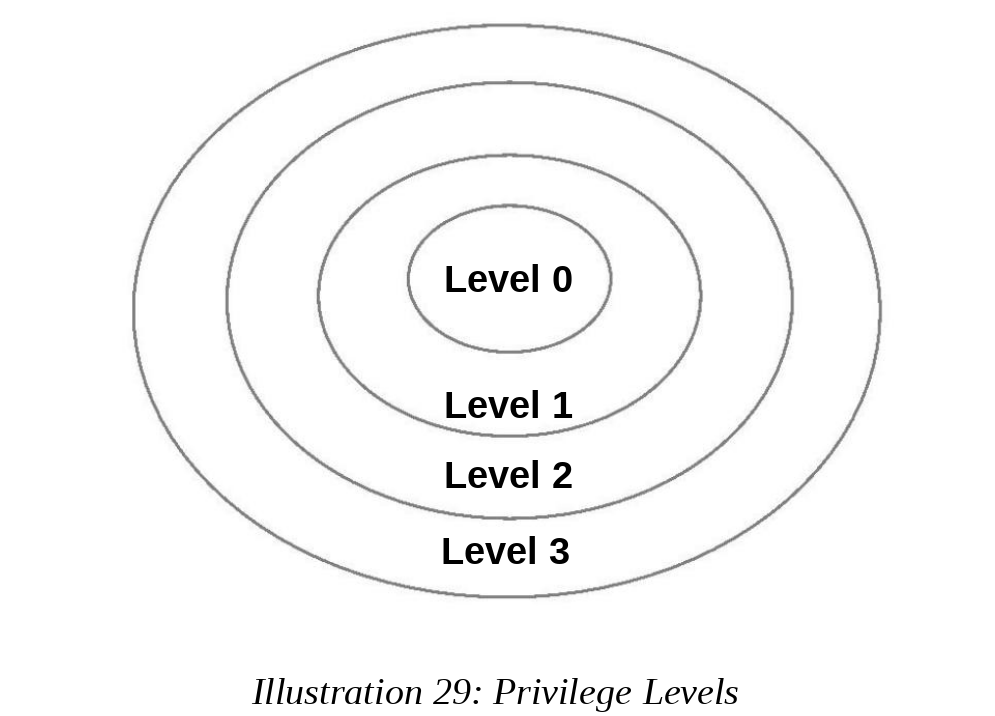

------

⁶⁴ 中断详细介绍：http://en.wikipedia.org/wiki/Interrupt

操作系统的中断处理机制会以安全的方式完成这种特权级提升与恢复操作，这就要求中断处理流程中必须对中断源的合法性以及特权级权限进行校验。

------

### 20.3 中断处理

当中断发生时，系统必须以**安全、快速、正确**的方式对其进行处理。核心逻辑是：挂起当前正在执行的进程，找到并执行与该中断对应的处理代码，处理完成后最终恢复被中断进程的执行。具体需要执行哪些处理逻辑，完全取决于中断的触发原因和用途。

#### 20.3.1 中断服务程序（ISR）

响应中断而执行的代码通常称为**中断服务程序**（Interrupt Service Routine，简称ISR），也叫中断处理器、处理例程或ISR代码。为了保持术语一致，本文档统一使用"ISR"这一称呼。

ISR的开发难度很高，主要源于中断场景下的并发和竞态条件问题，而且ISR的问题定位和调试也非常困难。

#### 20.3.2 处理步骤

中断处理的总体流程分为以下几个步骤：

##### 20.3.2.1 挂起当前进程

当前程序的执行被挂起。至少需要将`rip`（指令指针）和`rFlags`（标志寄存器）保存到系统栈上。根据中断类型的不同，后续还可能需要保存其他通用寄存器。其中`rFlags`必须立即保存，因为中断可能是异步触发的，后续指令的执行会改变该寄存器的值。这种多阶段的保存机制确保了进程上下文可以被完整恢复。

##### 20.3.2.2 获取ISR地址

所有ISR的入口地址都存储在一张称为**中断描述符表**（Interrupt Descriptor Table，IDT）⁶⁵的数据结构中。IDT中的每个条目除了存储对应ISR的地址外，还包含该ISR的任务门信息（优先级和特权级等元数据）。每个IDT条目固定占16字节，表中最多可有256个条目（编号0-255），对应256个可能的中断向量。

要获取某个中断对应的ISR入口地址，只需将中断号乘以16（因为每个条目占16字节），得到的结果作为偏移量从IDT中读取即可。

IDT的起始地址由一个专用的`IDTR`寄存器指向，该寄存器仅操作系统内核可访问，且需要Ring 0特权级才能读写。

ISR的地址与具体的操作系统版本和系统硬件配置强相关。IDT在系统启动时创建，会映射当前系统的硬件配置。这对于操作系统在不同硬件平台上一致、正确地运行至关重要。

##### 20.3.2.3 跳转到ISR

从IDT中获取ISR地址后，系统会先进行合法性校验：包括确认中断源是否合法、是否需要切换特权级、特权级切换是否被允许等。校验通过后，将IDT中存储的ISR地址载入`rip`寄存器，完成跳转到ISR例程的操作。

##### 20.3.2.4 执行ISR

此时根据ISR的具体类型，可能会执行完整的进程上下文切换，即保存被中断进程的所有CPU寄存器状态。

在Linux类操作系统中，ISR通常被拆分为两部分，称为**上半部**（top-half）和**下半部**（bottom-half）。其他操作系统也有类似的划分，称为**一级中断处理程序**（FLIH）和**二级中断处理程序**（SLIH）。

- **上半部/FLIH**：会立即执行，负责处理所有紧急操作。具体操作因中断类型而异，通常包括应答中断、复位硬件（如有必要）、保存中断发生时才有的临时信息等。上半部可能会暂时屏蔽其他部分中断（因此上半部的执行时间必须尽可能短）。
- **下半部/SLIH**：负责执行所有非紧急的后继处理操作。这种设计确保了上半部可以快速完成，非关键逻辑被延迟到更合适的时机执行。如果存在下半部逻辑，上半部会在执行结束时创建并调度下半部的执行。

上半部执行完成后，操作系统调度器会选择一个就绪进程投入运行。

##### 20.3.2.5 恢复被中断进程

当操作系统准备恢复被中断的进程时，会先恢复之前保存的进程上下文，然后执行`iret`（中断返回）指令，该指令会依次弹出之前保存的`rFlags`和`rip`寄存器，完成上下文的恢复，回到被中断的进程继续执行。

------

### 20.4 中断处理流程概览

下图展示了系统中断处理的总体流程（原书插图缺失，此处略）。

------

⁶⁵ 注：原书称Windows中该结构称为中断向量表（IVT），此为过时表述。IVT是16位实模式下的中断表，32/64位保护模式下Windows与Linux一样使用IDT。

------

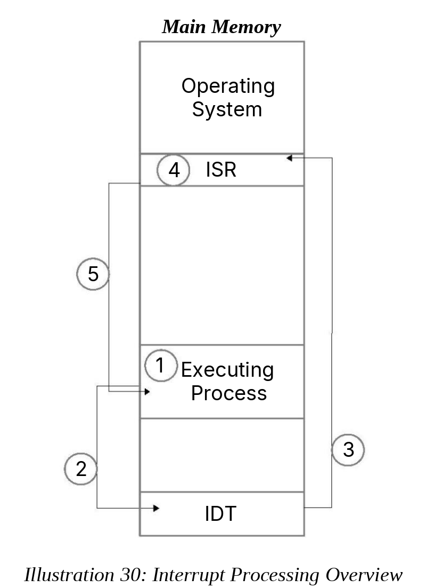

上述步骤的详细说明如下：

1. **挂起当前程序的执行**
   - 将`rip`和`rFlags`寄存器保存到栈上
2. **获取中断服务程序（ISR）的入口地址**
   - 中断号乘以16（因为每个IDT条目占16字节）
   - 以计算结果作为偏移量，索引中断描述符表（IDT）
   - 从IDT中读出对应中断的ISR地址
3. **跳转到中断服务程序**
   - 将IDT中取得的ISR地址载入`rip`寄存器，完成跳转
4. **执行中断服务程序**
   - 保存上下文（即所有可能被修改的附加寄存器）
   - 处理中断（逻辑因中断类型而异）
   - 调度后续的数据处理活动（如下半部）
5. **恢复被中断的进程**
   - 基于操作系统调度器的决策恢复进程调度
   - 恢复之前保存的上下文
   - 执行`iret`指令（弹出`rFlags`和`rip`寄存器，回到被中断的位置）

这种中断处理机制允许系统在**运行时动态查找**ISR地址，使操作系统能够在不同硬件配置上灵活适配。

### 第21章 附录A ASCII字符编码表

ASCII（American Standard Code for Information Interchange，美国信息交换标准代码）是7位编码方案，共定义128个字符（0x00~0x7F），分为**控制字符**（0x00~0x1F + 0x7F）和**可打印字符**（0x20~0x7E）两类。下表为完整映射：

| 十进制 | 十六进制  | 二进制          | 字符/缩写 | 官方名称                  | 说明/常用别名                              |
| ------ | --------- | --------------- | --------- | ------------------------- | ------------------------------------------ |
| 0      | 0x00      | 0000000         | NUL ※     | Null                      | 字符串终止符（第13、15、18章使用）         |
| 1      | 0x01      | 0000001         | SOH       | Start of Heading          | 报文头开始                                 |
| 2      | 0x02      | 0000010         | STX       | Start of Text             | 文本开始                                   |
| 3      | 0x03      | 0000011         | ETX       | End of Text               | 文本结束                                   |
| 4      | 0x04      | 0000100         | EOT       | End of Transmission       | 传输结束                                   |
| 5      | 0x05      | 0000101         | ENQ       | Enquiry                   | 请求应答                                   |
| 6      | 0x06      | 0000110         | ACK       | Acknowledge               | 应答确认                                   |
| 7      | 0x07      | 0000111         | BEL       | Bell                      | 蜂鸣响铃（终端提示音）                     |
| 8      | 0x08      | 0001000         | BS        | Backspace                 | 退格                                       |
| 9      | 0x09      | 0001001         | TAB ※     | Horizontal Tab            | 水平制表符                                 |
| 10     | 0x0A      | 0001010         | LF ※      | Line Feed                 | 换行（第16、17章使用）                     |
| 11     | 0x0B      | 0001011         | VT        | Vertical Tab              | 垂直制表符                                 |
| 12     | 0x0C      | 0001100         | FF        | Form Feed                 | 换页                                       |
| 13     | 0x0D      | 0001101         | CR        | Carriage Return           | 回车                                       |
| 14     | 0x0E      | 0001110         | SO        | Shift Out                 | 切换输出集                                 |
| 15     | 0x0F      | 0001111         | SI        | Shift In                  | 切换输入集                                 |
| 16     | 0x10      | 0010000         | DLE       | Data Link Escape          | 数据链路转义                               |
| 17     | 0x11      | 0010001         | DC1       | Device Control 1          | 设备控制1（XON 流控）                      |
| 18     | 0x12      | 0010010         | DC2       | Device Control 2          | 设备控制2                                  |
| 19     | 0x13      | 0010011         | DC3       | Device Control 3          | 设备控制3（XOFF 流控）                     |
| 20     | 0x14      | 0010100         | DC4       | Device Control 4          | 设备控制4                                  |
| 21     | 0x15      | 0010101         | NAK       | Negative Acknowledge      | 否定应答                                   |
| 22     | 0x16      | 0010110         | SYN       | Synchronous Idle          | 同步空闲                                   |
| 23     | 0x17      | 0010111         | ETB       | End of Transmission Block | 传输块结束                                 |
| 24     | 0x18      | 0011000         | CAN       | Cancel                    | 取消                                       |
| 25     | 0x19      | 0011001         | EM        | End of Medium             | 介质结束                                   |
| 26     | 0x1A      | 0011010         | SUB       | Substitute                | 替换字符                                   |
| 27     | 0x1B      | 0011011         | ESC       | Escape                    | 转义符                                     |
| 28     | 0x1C      | 0011100         | FS        | File Separator            | 文件分隔符                                 |
| 29     | 0x1D      | 0011101         | GS        | Group Separator           | 组分隔符                                   |
| 30     | 0x1E      | 0011110         | RS        | Record Separator          | 记录分隔符                                 |
| 31     | 0x1F      | 0011111         | US        | Unit Separator            | 单元分隔符                                 |
| 32     | 0x20      | 0100000         | ␣ ※       | Space                     | 空格（第16章命令行参数分隔符）             |
| 33     | 0x21      | 0100001         | !         | Exclamation Mark          | 感叹号                                     |
| 34     | 0x22      | 0100010         | "         | Double Quote              | 双引号                                     |
| 35     | 0x23      | 0100011         | #         | Number Sign               | 井号                                       |
| 36     | 0x24      | 0100100         | $         | Dollar Sign               | 美元符                                     |
| 37     | 0x25      | 0100101         | %         | Percent Sign              | 百分号                                     |
| 38     | 0x26      | 0100110         | &         | Ampersand                 | 和号                                       |
| 39     | 0x27      | 0100111         | '         | Single Quote              | 单引号                                     |
| 40     | 0x28      | 0101000         | (         | Left Parenthesis          | 左括号                                     |
| 41     | 0x29      | 0101001         | )         | Right Parenthesis         | 右括号                                     |
| 42     | 0x2A      | 0101010         | *         | Asterisk                  | 星号                                       |
| 43     | 0x2B      | 0101011         | +         | Plus Sign                 | 加号                                       |
| 44     | 0x2C      | 0101100         | ,         | Comma                     | 逗号                                       |
| 45     | 0x2D      | 0101101         | -         | Hyphen/Minus              | 连字符/减号                                |
| 46     | 0x2E      | 0101110         | .         | Period                    | 句号                                       |
| 47     | 0x2F      | 0101111         | /         | Slash                     | 斜杠                                       |
| 48~57  | 0x30~0x39 | 0110000~0111001 | 0~9 ※     | Digit                     | 数字字符，转整数需减0x30（第16章参数转换） |
| 58     | 0x3A      | 0111010         | :         | Colon                     | 冒号                                       |
| 59     | 0x3B      | 0111011         | ;         | Semicolon                 | 分号                                       |
| 60     | 0x3C      | 0111100         | <         | Less Than                 | 小于号                                     |
| 61     | 0x3D      | 0111101         | =         | Equals Sign               | 等号                                       |
| 62     | 0x3E      | 0111110         | >         | Greater Than              | 大于号                                     |
| 63     | 0x3F      | 0111111         | ?         | Question Mark             | 问号                                       |
| 64     | 0x40      | 1000000         | @         | At Sign                   | at符号                                     |
| 65~90  | 0x41~0x5A | 1000001~1011010 | A~Z ※     | Uppercase Letter          | 大写字母，转小写加0x20                     |
| 91     | 0x5B      | 1011011         | [         | Left Bracket              | 左方括号                                   |
| 92     | 0x5C      | 1011100         | \         | Backslash                 | 反斜杠                                     |
| 93     | 0x5D      | 1011101         | ]         | Right Bracket             | 右方括号                                   |
| 94     | 0x5E      | 1011110         | ^         | Caret                     | 脱字符                                     |
| 95     | 0x5F      | 1011111         | _         | Underscore                | 下划线                                     |
| 96     | 0x60      | 1100000         | `         | Grave Accent              | 重音符                                     |
| 97~122 | 0x61~0x7A | 1100001~1111010 | a~z ※     | Lowercase Letter          | 小写字母，转大写减0x20                     |
| 123    | 0x7B      | 1111011         | {         | Left Brace                | 左花括号                                   |
| 124    | 0x7C      | 1111100         | \|        | Vertical Bar              | 竖线                                       |
| 125    | 0x7D      | 1111101         | }         | Right Brace               | 右花括号                                   |
| 126    | 0x7E      | 1111110         | ~         | Tilde                     | 波浪号                                     |
| 127    | 0x7F      | 1111111         | DEL ※     | Delete                    | 删除符（第15章不可注入字符）               |

※ 标注项为本书各章节高频使用的ASCII值。
